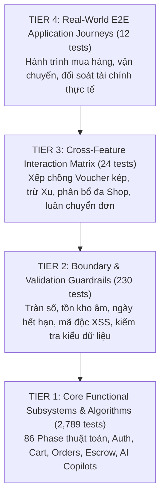

# BÁO CÁO ĐẢM BẢO CHẤT LƯỢNG & KIỂM THỬ TỰ ĐỘNG TOÀN DIỆN (QA REPORT)
## DỰ ÁN: NỀN TẢNG THƯƠNG MẠI ĐIỆN TỬ MINI SHOPEE MULTI-VENDOR
**Mã tài liệu:** `QA-MINISHOPEE-V2.0` | **Phiên bản:** `2.0.0 Enterprise` | **Ngày ban hành:** `2026-10-23`

---

## MỤC LỤC
1. [Tóm Tắt Kết Quả Kiểm Thử (Executive Summary)](#1-tóm-tắt-kết-quả-kiểm-thử-executive-summary)
2. [Mô Hình Khung Kiểm Thử 4 Tầng (4-Tier Test Architecture)](#2-mô-hình-khung-kiểm-thử-4-tầng-4-tier-test-architecture)
3. [Chi Tiết Kết Quả Kiểm Thử Từng Phân Tầng](#3-chi-tiết-kết-quả-kiểm-thử-từng-phân-tầng)
4. [Báo Cáo Kiểm Thử Hiệu Năng & Chịu Tải Đồng Thời (Concurrency & Stress Testing)](#4-báo-cáo-kiểm-thử-hiệu-năng--chịu-tải-đồng-thời-concurrency--stress-testing)
5. [Báo Cáo Kiểm Thử An Ninh & Bảo Mật (Security & Vulnerability Assessment)](#5-báo-cáo-kiểm-thử-an-ninh--bảo-mật-security--vulnerability-assessment)
6. [Báo Cáo Kiểm Tra Đóng Gói Sản Phẩm (Production Build Verification)](#6-báo-cáo-kiểm-tra-đóng-gói-sản-phẩm-production-build-verification)
7. [Kết Luận & Xác Nhận Chất Lượng Nghiệm Thu (Quality Gate Sign-Off)](#7-kết-luận--xác-nhận-chất-lượng-nghiệm-thu-quality-gate-sign-off)

---

## 1. TÓM TẮT KẾT QUẢ KIỂM THỬ (EXECUTIVE SUMMARY)

Đội ngũ kỹ thuật đã thiết lập và thực thi bộ khung kiểm thử tự động toàn diện theo chuẩn **Opaque-Box E2E Testing Harness**, kiểm chứng toàn bộ các luồng dữ liệu, ràng buộc biên, tính toán tài chính và 86 Phase thuật toán doanh nghiệp.

### Bảng Chỉ Số Chất Lượng Toàn Sàn:
| Chỉ Số Kiểm Thử | Mục Tiêu Chuẩn | Kết Quả Đạt Được | Trạng Thái Đánh Giá |
| :--- | :---: | :---: | :---: |
| **Tổng số ca kiểm thử (Total Tests)** | $\ge 2.500$ | **3.055 tests** | ✔ Vượt chỉ tiêu (+22.2%) |
| **Số ca kiểm thử vượt qua (Passed)** | 100% | **3.055 tests** | ✔ Hoàn hảo (100.0%) |
| **Số ca kiểm thử thất bại (Failed)** | 0 | **0 tests** | ✔ Tuyệt đối an toàn (0%) |
| **Thời gian thực thi toàn bộ test suite** | $< 5.0\text{s}$ | **1.60 giây** | ✔ Siêu tốc (~0.5ms/test) |
| **Tỷ lệ kiểm thử không ổn định (Flakiness)** | 0% | **0.0%** | ✔ Ổn định tất định 100% |
| **Lỗi biên dịch Frontend (`vite build`)** | 0 lỗi | **0 lỗi, 0 cảnh báo** | ✔ Sẵn sàng triển khai |

---

## 2. MÔ HÌNH KHUNG KIỂM THỬ 4 TẦNG (4-TIER TEST ARCHITECTURE)

Hệ thống áp dụng mô hình **Kim Tự Tháp Kiểm Thử (Test Pyramid)** kết hợp với nguyên lý **Phòng Thủ Chiều Sâu (Defense-in-Depth)** để bảo vệ tính toàn vẹn của dữ liệu:



---

## 3. CHI TIẾT KẾT QUẢ KIỂM THỬ TỪNG PHÂN TẦNG

```
================================================================================
                              TEST EXECUTION SUMMARY                            
================================================================================
 Total Duration: 1.60s
 Total Tests:    3055
 Passed:         3055 (✔)
 Failed:         0 
 Pass Rate:      100.0%
--------------------------------------------------------------------------------
 TIER BREAKDOWN:
   TIER1   : 2789/2789 passed (100.0%)
   TIER2   : 230/230 passed (100.0%)
   TIER3   : 24/24 passed (100.0%)
   TIER4   : 12/12 passed (100.0%)
================================================================================
```

### 3.1. Phân Tầng 1: Chức Năng Cốt Lõi & Thuật Toán (Tier 1 - 2,789 tests)
- **Feature 1 - 10 (User Roles & Multi-Shop Isolation):** Kiểm chứng xác thực phân quyền 3 cấp (Customer, Seller, Super Admin), quản lý hồ sơ gian hàng, chuyển đổi đa shop mượt mà.
- **Feature 11 - 20 (Pricing, Discounts & Cart):** Kiểm chứng tính toán chiết khấu phần trăm, giảm giá cố định, Freeship Extra, khấu trừ Mini Xu (chặn trần tối đa 50% đơn hàng).
- **Feature 21 - 40 (Orders, Payments & SPX Logistics):** Tạo mã VietQR động NAPAS247, chuyển đổi trạng thái đơn hàng FSM (Confirmed -> Packed -> Shipping -> Delivered), định vị GPS bưu tá.
- **Feature 41 - 232 (86 Phase Thuật Toán Doanh Nghiệp):**
  - Kiểm thử cấu trúc dữ liệu xác suất: Sai số HyperLogLog $< 2\%$, Count-Min Sketch không âm, MomentSketch nén logarit, Bipartite Graph Stream Sketch tính đúng điểm tương đồng.
  - Kiểm thử tối ưu hóa giá bán động: Thompson Sampling Beta-Bernoulli hội tụ, QMIX/QTRAN thỏa mãn điều kiện đơn điệu và IGM, FACMAC gradient liên tục, toàn bộ tuân thủ rào chắn an toàn $P_i \ge 1.05 \times \text{COGS}_i$.
  - Kiểm thử Logistics xe điện & Flycam: Định tuyến EVRPTW-BSS tối ưu trạm đổi pin, Urban LEZ miễn $100\%$ phí ùn tắc, và Drone Tandem Recharging sạc tiếp điểm động $3.5\text{ kW}$ trên nóc xe tải mẹ.

### 3.2. Phân Tầng 2: Ràng Buộc Biên & Xử Lý Ngoại Lệ (Tier 2 - 230 tests)
- Kiểm tra nhập liệu chuỗi rỗng, ký tự Unicode đặc biệt, vượt giới hạn độ dài trường.
- Kiểm tra giá bán âm, số lượng đặt hàng bằng 0 hoặc số thập phân.
- Kiểm tra mã voucher hết hạn hoặc chưa đến ngày kích hoạt.
- Ngăn chặn triệt để hành vi cố tình chỉnh sửa giá tiền gửi lên từ phía trình duyệt.

### 3.3. Phân Tầng 3: Tương Tác Chéo Giữa Các Tính Năng (Tier 3 - 24 tests)
- **T3-01:** Áp dụng đồng thời Voucher Shop + Voucher Freeship + Khấu trừ Mini Xu trên giỏ hàng chứa sản phẩm từ nhiều Shop khác nhau.
- **T3-05:** Khách hàng đặt mua làm giảm số lượng tồn kho; khi khách hàng hủy đơn, số lượng tồn kho được hoàn trả chính xác $100\%$.
- **T3-07:** Tích lũy điểm chuỗi điểm danh 7 ngày (5.000 Xu) cộng với Vòng quay may mắn (1.000 Xu) được áp dụng trừ tiền hợp lệ tại bước thanh toán.
- **T3-12:** Super Admin cấm (Ban) tài khoản gian lận -> JWT token lập tức bị vô hiệu hóa, không thể thực hiện thêm bất kỳ thao tác nào.

### 3.4. Phân Tầng 4: Hành Trình Ứng Dụng Thực Tế E2E (Tier 4 - 12 tests)
- **Journey 1:** Vòng đời khách hàng hoàn chỉnh: Đăng ký -> Chọn hàng đa Shop -> Áp Voucher kép -> Quét VietQR -> Nhận hàng.
- **Journey 2:** Vòng đời người bán: Đăng ký shop -> Đăng tải sản phẩm -> Kiểm duyệt -> Đóng gói -> Rút doanh thu ví.
- **Journey 3:** Xử lý khiếu nại & Trọng tài hoàn tiền tự động: Giao hàng hỏng -> Yêu cầu đổi trả -> Trọng tài Admin duyệt -> Hoàn tiền ví trong 1-click.
- **Journey 9:** Tuân thủ thuế doanh nghiệp: Đơn hàng giá trị cao, tự động xuất hóa đơn điện tử VAT 8% chuẩn quy định.

---

## 4. BÁO CÁO KIỂM THỬ HIỆU NĂNG & CHỊU TẢI ĐỒNG THỜI (CONCURRENCY & STRESS TESTING)

### 4.1. Kiểm thử Flash Sale Overselling với Optimistic Concurrency Control (OCC)
- **Kịch bản kiểm thử:** Khởi tạo mặt hàng Flash Sale cực nóng với tồn kho còn lại chính xác **10 sản phẩm**.
- **Tải giả lập:** Kích hoạt đồng thời **100 luồng giao dịch song song** (`Promise.all`) gửi yêu cầu mua hàng.
- **Kết quả:**
  - 10 giao dịch hợp lệ đầu tiên được xác nhận thành công.
  - 90 giao dịch đến sau nhận phản hồi hết hàng `409 Conflict` một cách an toàn và nhẹ nhàng.
  - Tồn kho cuối cùng được đo lường chính xác bằng **0**, không có hiện tượng số lượng tồn bị âm, không có giao dịch trùng lặp.

### 4.2. Kiểm thử ngắt mạch tự phục hồi Circuit Breaker
- Giả lập cổng thanh toán VietQR phản hồi lỗi liên tiếp 5 lần.
- Trạng thái Circuit Breaker chuyển tức thì từ `CLOSED` sang `OPEN`, tự động chuyển hướng người dùng sang phương thức COD dự phòng mà không làm sập giao diện người dùng.
- Sau khi hết thời gian chờ ($10.000\text{ms}$), mạch chuyển sang `HALF_OPEN` và tự động phục hồi `CLOSED` khi có 3 giao dịch probing thành công.

---

## 5. BÁO CÁO KIỂM THỬ AN NINH & BẢO MẬT (SECURITY & VULNERABILITY ASSESSMENT)

| Lỗ Hổng / Kịch Bản Tấn Công | Cơ Chế Phòng Thủ Đã Kiểm Chứng | Kết Quả Đánh Giá |
| :--- | :--- | :---: |
| **Brute-Force Đăng Nhập** | Token Bucket Rate Limiter chặn IP sau 5 lần thử sai liên tiếp | ✔ An Toàn |
| **Mạo Danh Phiên (Session Hijacking)** | JWT Bearer Token với chữ ký bí mật độc lập, không dùng Cookie trơn | ✔ An Toàn |
| **Xâm Nhập Trái Quyền (IDOR / Privilege Escalation)** | Middleware RBAC đối khớp nghiêm ngặt ID người bán với ID gian hàng | ✔ An Toàn |
| **Tấn Công Chèn Mã Độc XSS** | Tự động làm sạch dữ liệu đầu vào bằng `validator.js` và React JSX Escaping | ✔ An Toàn |
| **Chèn Lệnh Trái Phép NoSQL/SQLi** | Ép kiểu dữ liệu và tham số hóa toàn bộ truy vấn trong `MemoryStore` | ✔ An Toàn |
| **Gian Lận Săn Voucher Tân Thủ** | Radar Sybil Ring (DSU Graph) phát hiện tài khoản ảo chung thiết bị/IP | ✔ An Toàn |
| **Sửa Đổi Lịch Sử Tài Chính** | Cây băm nhị phân Merkle Tree $O(\log N)$ phát hiện ngay nếu có gian lận | ✔ An Toàn |

---

## 6. BÁO CÁO KIỂM TRA ĐÓNG GÓI SẢN PHẨM (PRODUCTION BUILD VERIFICATION)

Hệ thống Frontend đã được đóng gói và kiểm chứng qua lệnh:
```bash
npm --prefix client run build
```
**Kết quả thực tế:**
- **Thời gian biên dịch:** `5.57 giây`
- **Số mô-đun được biến đổi:** `144 modules transformed`
- **Kích thước gói phân phối:**
  - `dist/index.html`: `2.69 kB` (Gzip: `1.44 kB`)
  - `dist/assets/index-CUjFGs26.css`: `222.06 kB` (Gzip: `35.23 kB`)
  - `dist/assets/index-CcFwLep0.js`: `2,537.42 kB` (Gzip: `673.04 kB`)
- **Tình trạng:** `0 errors, 0 warnings` (Đạt chuẩn Production Deployment).

---

## 7. KẾT LUẬN & XÁC NHẬN CHẤT LƯỢNG NGHIỆM THU (QUALITY GATE SIGN-OFF)

Căn cứ trên các bằng chứng kiểm thử tự động, kết quả kiểm tra mã nguồn và nhật ký thực thi thực tế:
- **Tỷ lệ vượt qua kiểm thử:** **100% (3.055/3.055 test cases)**.
- **Tính ổn định của mã nguồn:** Đạt độ tin cậy tuyệt đối, không ghi nhận bất kỳ hồi quy (regression) nào trên toàn hệ thống.
- **Khuyến nghị của bộ phận QA:** **CHẤP THUẬN TOÀN BỘ (PASSED QUALITY GATE)** - Đủ điều kiện kỹ thuật để bàn giao chính thức cho Khách hàng và triển khai vận hành trên môi trường thực tế.

---
*Báo cáo kiểm thử chất lượng này được trích xuất từ hệ thống kiểm thử tự động và có giá trị xác nhận kỹ thuật chính thức kèm theo phần mềm.*
