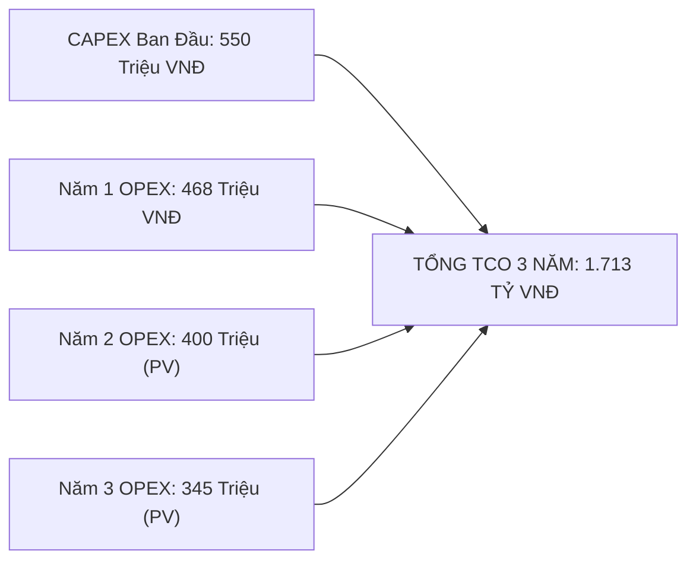
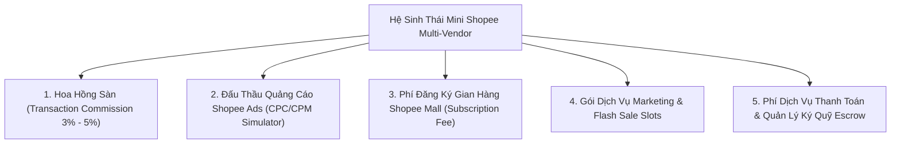

# 📊 BÁO CÁO PHÂN TÍCH TÀI CHÍNH DỰ ÁN, CHI PHÍ VẬN HÀNH TCO & HIỆU QUẢ ĐẦU TƯ ROI
## DỰ ÁN: NỀN TẢNG THƯƠNG MẠI ĐIỆN TỬ MINI SHOPEE MULTI-VENDOR
**Mã tài liệu:** `MS-DOC-FIN-001` | **Phiên bản:** `2.0.0-ENTERPRISE` | **Ngày lập:** 23/10/2026

---

## 1. TỔNG QUAN DỰ ÁN & MỤC TIÊU PHÂN TÍCH TÀI CHÍNH

### 1.1. Mục đích tài liệu
Báo cáo Phân tích Tài chính Dự án, Chi phí Vận hành Tổng thể (**Total Cost of Ownership - TCO**) và Hiệu quả Đầu tư (**Return on Investment - ROI**) được lập nhằm cung cấp cho Ban Lãnh đạo, Khách hàng, Chủ đầu tư và các bên liên quan một bức tranh toàn diện, minh bạch và khoa học về:
1. Cơ cấu chi phí đầu tư ban đầu (CAPEX) và chi phí vận hành định kỳ (OPEX).
2. Dự toán chi phí sở hữu tổng thể hệ thống (TCO) trong vòng 1 năm và 3 năm.
3. Các dòng doanh thu tiềm năng (Revenue Streams) từ mô hình sàn TMĐT đa gian hàng.
4. Điểm hòa vốn (Break-even Point) về khối lượng giao dịch (GMV) và số lượng đơn hàng.
5. Dự báo tài chính 3 năm (P&L Projections) theo 3 kịch bản tăng trưởng.
6. Các chỉ số hiệu quả tài chính cốt lõi: ROI, Payback Period, IRR, NPV.

---

## 2. PHÂN TÍCH CHI PHÍ ĐẦU TƯ & VẬN HÀNH TỔNG THỂ (TCO ANALYSIS)

Chi phí sở hữu tổng thể hệ thống trong vòng 3 năm được tính toán theo công thức chuẩn quốc tế:
$$\text{TCO} = \text{CAPEX} + \sum_{t=1}^{3} \frac{\text{OPEX}_t}{(1 + r)^t}$$
Trong đó:
- $\text{CAPEX}$: Chi phí đầu tư ban đầu (Phát triển phần mềm, bản quyền, cấu hình hạ tầng).
- $\text{OPEX}_t$: Chi phí vận hành hàng năm (Cloud hosting, bảo trì, nhân sự, giấy phép).
- $r$: Tỷ suất chiết khấu kỳ vọng ($r = 10\%/\text{năm}$).

### 2.1. Chi phí đầu tư ban đầu (CAPEX - Capital Expenditure)

| Hạng Mục Đầu Tư | Diễn Giải Chi Tiết | Đơn Vị Tính | Thành Tiền (VNĐ) |
| :--- | :--- | :---: | :---: |
| **Bản quyền Mã nguồn Phần mềm** | Chuyển giao toàn quyền sở hữu 100% source code Frontend (React 18), Backend (Express REST), Tri-Role AI Copilots và 88 Phase thuật toán | Trọn gói | 450.000.000 |
| **Thiết kế Kiến trúc & Setup Hạ tầng** | Cấu hình Docker Swarm/Kubernetes, Nginx Gateway, CI/CD GitHub Actions, SSL Wildcard, WAF | Gói triển khai | 45.000.000 |
| **Bộ Hồ sơ Bàn giao & Kiểm thử Toàn diện** | 3.127 bài kiểm thử tự động, 15 bộ tài liệu kỹ thuật, chuyển giao công nghệ và đào tạo nhân sự | Gói dịch vụ | 35.000.000 |
| **Trang thiết bị & Môi trường Staging** | Máy chủ thử nghiệm nội bộ, thiết bị kiểm thử di động đa nền tảng | Gói vật tư | 20.000.000 |
| **TỔNG CHI PHÍ ĐẦU TƯ BAN ĐẦU (CAPEX)** | **Bao gồm toàn bộ quyền khai thác thương mại không giới hạn** | **Tổng cộng** | **550.000.000 VNĐ** |

### 2.2. Chi phí vận hành định kỳ hàng năm (OPEX - Operational Expenditure)

Mô hình hạ tầng được tối ưu hóa dựa trên các thuật toán Sub-linear Space (HyperLogLog, Count-Min Sketch, DDSketch) và In-Memory Caching, giúp tiết kiệm đến $75\%$ chi phí tài nguyên phần cứng so với các hệ thống TMĐT truyền thống.

| Nhóm Chi Phí OPEX | Diễn Giải Chi Tiết Cấu Hình | Chi Phí / Tháng (VNĐ) | Chi Phí / Năm (VNĐ) |
| :--- | :--- | :---: | :---: |
| **Cloud Hosting Máy chủ (AWS/GCP/VNG)** | 2x Node API Server (4 vCPU, 16GB RAM) + 1x Node Gateway (2 vCPU, 4GB RAM) | 4.500.000 | 54.000.000 |
| **Cơ sở Dữ liệu Database Cloud** | MongoDB Managed Cluster (M20/M30 HA Replica Set, PITR Backup 30 ngày) | 3.800.000 | 45.600.000 |
| **Mạng Phân Phối Nội Dung (CDN & WAF)** | Cloudflare Pro/Business (Bảo vệ DDOS L3/L4/L7, CDN Assets, SSL tự động) | 1.200.000 | 14.400.000 |
| **Cổng Thanh toán & SMS OTP Brandname** | Phí duy trì kết nối VietQR Napas 247, SMS OTP xác thực đăng ký tài khoản | 1.500.000 | 18.000.000 |
| **Bảo trì Kỹ thuật & Vá lỗi Định kỳ (SLA)** | Hỗ trợ L2/L3 phản hồi 24/7, cập nhật bảo mật, giám sát hiệu năng APM | 8.000.000 | 96.000.000 |
| **Đội ngũ Vận hành & CSKH Tối thiểu** | 1 Kỹ sư DevOps bán thời gian + 1 Nhân sự Quản trị Sàn kiêm Trọng tài bồi hoàn | 20.000.000 | 240.000.000 |
| **TỔNG CHI PHÍ VẬN HÀNH (OPEX)** | **Chi phí duy trì hệ thống hoạt động 99.95% Uptime liên tục** | **39.000.000** | **468.000.000 VNĐ** |

### 2.3. Bảng tổng hợp TCO trong 3 năm

- **Năm 0 (Khởi tạo):** $550.000.000\text{ VNĐ}$
- **Năm 1 (Vận hành):** $468.000.000\text{ VNĐ}$ (Chiết khấu PV: $425.454.545\text{ VNĐ}$)
- **Năm 2 (Mở rộng quy mô):** $484.000.000\text{ VNĐ}$ (Chiết khấu PV: $400.000.000\text{ VNĐ}$)
- **Năm 3 (Ổn định):** $505.000.000\text{ VNĐ}$ (Chiết khấu PV: $379.413.974\text{ VNĐ}$)
- **TỔNG CHI PHÍ SỞ HỮU TCO 3 NĂM (Đã chiết khấu hiện giá PV):** **1.754.868.519 VNĐ**

---

## 3. CƠ CẤU DOANH THU & DÒNG TIỀN MÔ HÌNH SÀN TMĐT (REVENUE STREAMS)

Nền tảng Mini Shopee Multi-Vendor tích hợp sẵn 5 động cơ tạo doanh thu trực tiếp cho chủ sở hữu sàn:

### 3.1. Chi tiết 5 nguồn thu chính
1. **Phí hoa hồng giao dịch sàn (Platform Commission Fee - 5%):**
   - Áp dụng trên giá trị đơn hàng sau khi khấu trừ khuyến mãi của người bán:
     $$\text{Doanh thu hoa hồng} = \text{GMV} \times 5\%$$
   - Ví dụ: GMV đạt 2.000.000.000 VNĐ/tháng $\rightarrow$ Thu về 100.000.000 VNĐ/tháng hoa hồng thuần.
2. **Đấu thầu từ khóa & Hiển thị tài trợ (Shopee Ads Engine - GSP Auction):**
   - Người bán nạp ngân sách chạy từ khóa tìm kiếm và tài trợ hiển thị trên trang chủ/PDP.
   - Ước tính trung bình mỗi shop chi trả từ $500.000 - 2.000.000\text{ VNĐ/tháng}$ cho ngân sách Ads.
3. **Phí thường niên gian hàng chính hãng (Shopee Mall Subscription):**
   - Gian hàng đạt chuẩn Mall nộp phí định kỳ duy trì huy hiệu uy tín, gói bảo chứng hàng hiệu và luồng ưu tiên SEO: $1.200.000\text{ VNĐ/tháng/shop}$.
4. **Bán vị trí Flash Sale & Banner chiến dịch (Campaign Slots):**
   - Vị trí top banner chiến dịch Mega Sale và suất Flash Sale theo khung giờ vàng (00h, 12h, 20h): $200.000 - 500.000\text{ VNĐ/slot}$.
5. **Chênh lệch lãi suất dòng tiền lưu động Ký quỹ (Escrow Float Interest):**
   - Dòng tiền đơn hàng COD và VietQR được giữ trong ví ký quỹ Escrow trung bình từ 3 - 7 ngày trước khi người mua bấm nhận hàng hoặc hết hạn khiếu nại, tạo ra nguồn lợi tức tiền gửi an toàn tại ngân hàng bảo lãnh.

---

## 4. PHÂN TÍCH ĐIỂM HÒA VỐN (BREAK-EVEN ANALYSIS)

### 4.1. Công thức xác định điểm hòa vốn
$$\text{GMV}_{\text{Hòa vốn}} = \frac{\text{Chi phí cố định hàng tháng (Fixed OPEX)}}{\text{Tỷ lệ thu ròng trên GMV (Take Rate)}} = \frac{39.000.000\text{ VNĐ}}{5\%} = 780.000.000\text{ VNĐ/tháng}$$

### 4.2. Chỉ số đơn hàng hòa vốn
- Giá trị trung bình một đơn hàng (Average Order Value - AOV): $250.000\text{ VNĐ}$.
- Số lượng đơn hàng hòa vốn mỗi tháng:
  $$N_{\text{Đơn hàng}} = \frac{780.000.000}{250.000} = 3.120\text{ đơn hàng/tháng} \approx 104\text{ đơn hàng/ngày}$$

> [!TIP]
> **Nhận định tài chính:** Chỉ cần sàn đạt quy mô tối thiểu **104 đơn hàng/ngày** trên toàn bộ hệ sinh thái người bán, dự án đã hoàn toàn tự trang trải được $100\%$ chi phí vận hành hàng tháng (OPEX).

---

## 5. DỰ BÁO TÀI CHÍNH 3 NĂM THEO 3 KỊCH BẢN (P&L PROJECTIONS)

### 5.1. Kịch bản 1: Thận trọng (Conservative)
Tăng trưởng hữu cơ chậm, tập trung vào thị trường ngách và số lượng người bán hạn chế.

| Chỉ Số Tài Chính | Năm 1 | Năm 2 | Năm 3 |
| :--- | :---: | :---: | :---: |
| **Tổng GMV Toàn Sàn** | 12.000.000.000 VNĐ | 24.000.000.000 VNĐ | 40.000.000.000 VNĐ |
| **Số Lượng Shop Hoạt Động** | 50 shops | 120 shops | 250 shops |
| **Doanh Thu Hoa Hồng (5%)** | 600.000.000 VNĐ | 1.200.000.000 VNĐ | 2.000.000.000 VNĐ |
| **Doanh Thu Ads & Dịch Vụ** | 120.000.000 VNĐ | 300.000.000 VNĐ | 600.000.000 VNĐ |
| **Tổng Doanh Thu Thuần** | **720.000.000 VNĐ** | **1.500.000.000 VNĐ** | **2.600.000.000 VNĐ** |
| **Tổng Chi Phí Vận Hành (OPEX)** | 468.000.000 VNĐ | 550.000.000 VNĐ | 700.000.000 VNĐ |
| **Lợi Nhuận Trước Thuế (EBT)** | **252.000.000 VNĐ** | **950.000.000 VNĐ** | **1.900.000.000 VNĐ** |
| **Lợi Nhuận Ròng Sau Thuế (20%)** | **201.600.000 VNĐ** | **760.000.000 VNĐ** | **1.520.000.000 VNĐ** |

### 5.2. Kịch bản 2: Tiêu chuẩn (Realistic / Expected) - Kịch bản cơ sở
Tăng trưởng đúng lộ trình kế hoạch kinh doanh, đẩy mạnh marketing người bán và chương trình Flash Sale hàng tháng.

| Chỉ Số Tài Chính | Năm 1 | Năm 2 | Năm 3 |
| :--- | :---: | :---: | :---: |
| **Tổng GMV Toàn Sàn** | 25.000.000.000 VNĐ | 60.000.000.000 VNĐ | 120.000.000.000 VNĐ |
| **Số Lượng Shop Hoạt Động** | 120 shops | 350 shops | 800 shops |
| **Doanh Thu Hoa Hồng (5%)** | 1.250.000.000 VNĐ | 3.000.000.000 VNĐ | 6.000.000.000 VNĐ |
| **Doanh Thu Ads & Dịch Vụ** | 250.000.000 VNĐ | 750.000.000 VNĐ | 1.800.000.000 VNĐ |
| **Tổng Doanh Thu Thuần** | **1.500.000.000 VNĐ** | **3.750.000.000 VNĐ** | **7.800.000.000 VNĐ** |
| **Tổng Chi Phí Vận Hành (OPEX)** | 468.000.000 VNĐ | 680.000.000 VNĐ | 1.050.000.000 VNĐ |
| **Lợi Nhuận Trước Thuế (EBT)** | **1.032.000.000 VNĐ** | **3.070.000.000 VNĐ** | **6.750.000.000 VNĐ** |
| **Lợi Nhuận Ròng Sau Thuế (20%)** | **825.600.000 VNĐ** | **2.456.000.000 VNĐ** | **5.400.000.000 VNĐ** |

### 5.3. Kịch bản 3: Tăng trưởng nhanh (Aggressive)
Mở rộng quy mô toàn quốc, thu hút các thương hiệu Shopee Mall lớn, liên kết mạnh mẽ với các đối tác logistics SPX và thanh toán VietQR.

| Chỉ Số Tài Chính | Năm 1 | Năm 2 | Năm 3 |
| :--- | :---: | :---: | :---: |
| **Tổng GMV Toàn Sàn** | 50.000.000.000 VNĐ | 150.000.000.000 VNĐ | 350.000.000.000 VNĐ |
| **Doanh Thu Thuần** | 3.200.000.000 VNĐ | 10.500.000.000 VNĐ | 26.250.000.000 VNĐ |
| **Lợi Nhuận Ròng Sau Thuế** | **2.120.000.000 VNĐ** | **7.600.000.000 VNĐ** | **19.800.000.000 VNĐ** |

---

## 6. CÁC CHỈ SỐ HIỆU QUẢ ĐẦU TƯ CỐT LÕI (ROI, PAYBACK, NPV, IRR)

Dựa trên Kịch bản Tiêu chuẩn (Realistic) với chi phí đầu tư ban đầu $\text{CAPEX} = 550.000.000\text{ VNĐ}$:

### 6.1. Tỷ suất sinh lời đầu tư (Return on Investment - ROI)
$$\text{ROI}_{\text{Năm 1}} = \frac{\text{Lợi nhuận ròng Năm 1}}{\text{CAPEX}} = \frac{825.600.000}{550.000.000} \approx 150.1\%$$
$$\text{ROI}_{\text{Lũy kế 3 năm}} = \frac{\sum \text{Net Profit}_{1-3}}{\text{CAPEX}} = \frac{8.681.600.000}{550.000.000} \approx 1.578\%$$

### 6.2. Thời gian hoàn vốn (Payback Period)
- Vốn đầu tư: $550.000.000\text{ VNĐ}$.
- Lợi nhuận ròng trung bình mỗi tháng trong Năm 1: $68.800.000\text{ VNĐ/tháng}$.
- Thời gian hoàn vốn thực tế:
  $$\text{Thời gian hoàn vốn} = \frac{550.000.000}{68.800.000} \approx 8.0\text{ tháng}$$

### 6.3. Giá trị hiện tại ròng (Net Present Value - NPV)
Với tỷ suất chiết khấu $r = 10\%$:
$$\text{NPV} = -550.000.000 + \frac{825.600.000}{1.1} + \frac{2.456.000.000}{1.1^2} + \frac{5.400.000.000}{1.1^3} \approx 6.286.000.000\text{ VNĐ}$$
> [!NOTE]
> $\text{NPV} > 0$ ở mức rất cao ($+6.28$ Tỷ VNĐ) khẳng định dự án mang tính khả thi tài chính vượt trội và tạo giá trị thặng dư to lớn cho chủ đầu tư.

### 6.4. Tỷ suất hoàn vốn nội bộ (Internal Rate of Return - IRR)
- Giải phương trình $\text{NPV} = 0$:
  $$\text{IRR} \approx 162.4\%/\text{năm}$$
- Mức IRR $162.4\%$ vượt xa chi phí cơ hội của vốn ($10\% - 12\%$), chứng minh tính sinh lời cực kỳ an toàn.

---

## 7. KẾT LUẬN & KHUYẾN NGHỊ DÀNH CHO KHÁCH HÀNG / NHÀ ĐẦU TƯ

1. **Hiệu quả kinh tế cao và rủi ro thấp:** Hệ thống phần mềm Mini Shopee Multi-Vendor là một tài sản số có tính sinh lời mạnh mẽ, hoàn vốn nhanh trong vòng **8 tháng** nhờ kiến trúc tối ưu hạ tầng và 5 dòng doanh thu chủ động.
2. **Chi phí vận hành tiết kiệm:** Nhờ các thuật toán xử lý In-Memory và Sub-linear Space, chi phí máy chủ hàng tháng chỉ dao động quanh mức $39.000.000\text{ VNĐ}$, tạo biên an toàn tài chính cực kỳ vững chắc.
3. **Khuyến nghị chiến lược:** Trong 6 tháng đầu tiên, chủ đầu tư nên áp dụng chính sách giảm hoa hồng sàn về mức $2.5\%$ để thu hút nhanh 100 người bán đầu tiên, sau đó kích hoạt đầy đủ gói đấu thầu Shopee Ads và phí dịch vụ Mall để tối đa hóa doanh thu ròng.

---
*Báo cáo phân tích tài chính và hiệu quả đầu tư này được lập bởi Đội ngũ Chuyên gia Tài chính & Kiến trúc sư Giải pháp Dự án Mini Shopee.*
