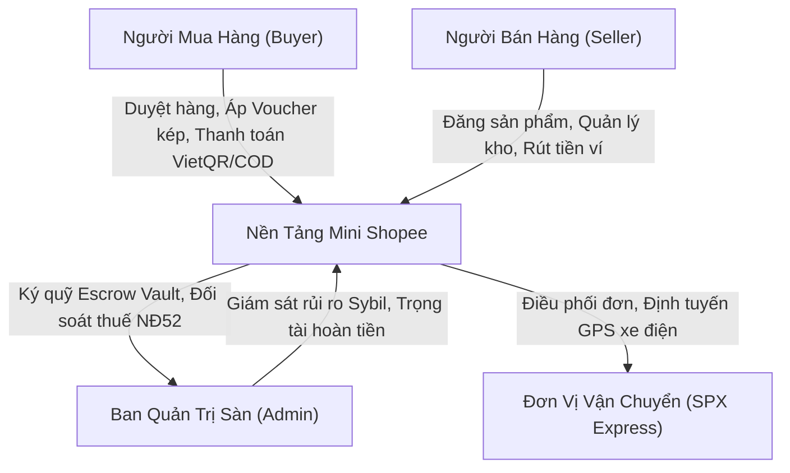
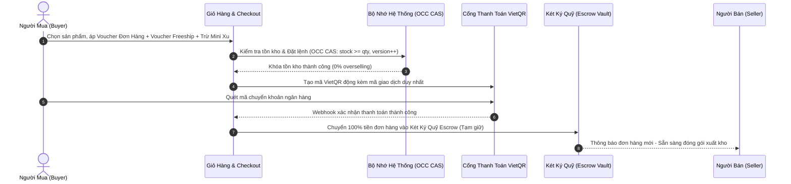

# BÁO CÁO PHÂN TÍCH YÊU CẦU & ĐẶC TẢ NGHIỆP VỤ HỆ THỐNG (SRS/BRD)
## DỰ ÁN: NỀN TẢNG THƯƠNG MẠI ĐIỆN TỬ MINI SHOPEE MULTI-VENDOR
**Mã tài liệu:** `SRS-MINISHOPEE-V2.0` | **Phiên bản:** `2.0.0 Enterprise` | **Ngày ban hành:** `2026-10-23`

---

## MỤC LỤC
1. [Giới Thiệu & Bối Cảnh Dự Án](#1-giới-thiệu--bối-cảnh-dự-án)
2. [Mô Hình Kinh Doanh & Các Bên Tham Gia (Stakeholder Matrix)](#2-mô-hình-kinh-doanh--các-bên-tham-gia-stakeholder-matrix)
3. [Phân Tích Quy Trình Nghiệp Vụ Cốt Lõi (Core Business Flows)](#3-phân-tích-quy-trình-nghiệp-vụ-cốt-lõi-core-business-flows)
4. [Đặc Tả Yêu Cầu Chức Năng (Functional Requirements - FR)](#4-đặc-tả-yêu-cầu-chức-năng-functional-requirements---fr)
5. [Đặc Tả Yêu Cầu Phi Chức Năng (Non-Functional Requirements - NFR)](#5-đặc-tả-yêu-cầu-phi-chức-năng-non-functional-requirements---nfr)
6. [Quy Trình Pháp Lý, Kế Toán & Thuế TMĐT (Legal & Tax Compliance)](#6-quy-trình-pháp-lý-kế-toán--thuế-tmđt-legal--tax-compliance)
7. [Ma Trận Phân Quyền Truy Cập (RBAC Matrix)](#7-ma-trận-phân-quyền-truy-cập-rbac-matrix)

---

## 1. GIỚI THIỆU & BỐI CẢNH DỰ ÁN

### 1.1. Bối cảnh thị trường
Thương mại điện tử đa người bán (Multi-Vendor Marketplace) tại Việt Nam đang phát triển với tốc độ vượt bậc. Tuy nhiên, các giải pháp phần mềm hiện hành thường gặp phải các hạn chế nghiêm trọng:
- Khó khăn trong việc kiểm soát dòng tiền ký quỹ (Escrow Vault) dẫn đến rủi ro chiếm dụng vốn hoặc chậm trễ giải ngân cho đối tác bán hàng.
- Thiếu hụt cơ chế đối soát thuế tự động theo quy định pháp luật Việt Nam (Nghị định 52/2018/NĐ-CP và Thông tư 40/2021/TT-BTC về khấu trừ thuế TNCN/GTGT trên sàn TMĐT).
- Tình trạng nghẽn đơn, bán vượt tồn kho (Overselling) trong các chiến dịch Flash Sale triệu traffic khi nhiều người mua cùng thanh toán một lượng hàng tồn giới hạn.
- Thiếu vắng các công cụ phân tích và hỗ trợ ra quyết định thông minh (AI Copilot) cho người bán và nhà quản trị.

### 1.2. Mục tiêu hệ thống
**Mini Shopee Multi-Vendor** được nghiên cứu, kiến trúc và phát triển nhằm mang đến giải pháp sàn giao dịch trực tuyến hoàn chỉnh, bảo mật cao, đạt tiêu chuẩn doanh nghiệp với các mục tiêu trọng tâm:
1. **Kiến trúc đa người bán độc lập (Multi-Tenant Isolation):** Mỗi gian hàng hoạt động như một thực thể kinh doanh riêng biệt, tự quản lý danh mục, biến thể SKU, chính sách vận chuyển và ví doanh thu.
2. **Ký quỹ Escrow & Đối soát dòng tiền chuẩn mực:** Toàn bộ tiền thanh toán đơn hàng được lưu giữ an toàn tại ví ký quỹ trung gian, tự động khấu trừ thuế nhà thầu, phí hoa hồng sàn và chỉ giải ngân cho người bán khi đơn hàng hoàn tất không có tranh chấp.
3. **Cơ chế chống bán vượt kho Flash Sale (Optimistic Concurrency Control):** Ngăn chặn 100% tình trạng tồn kho âm hoặc hủy đơn hàng loạt do tranh chấp tài nguyên.
4. **Bộ 3 Trợ lý AI Copilot phân vai chuyên sâu (Tri-Role AI Engine):** Tích hợp Admin Sentinel Copilot, Seller ShopSmart Copilot và Buyer Assistant với năng lực suy luận biên (Edge NLP Inference) tức thì dưới 1ms.

---

## 2. MÔ HÌNH KINH DOANH & CÁC BÊN THAM GIA (STAKEHOLDER MATRIX)

| Nhóm Đối Tượng | Vai Trò Chính | Mục Tiêu & Trách Nhiệm | Quyền Hạn Trong Hệ Thống |
| :--- | :--- | :--- | :--- |
| **Người Mua (Buyer)** | Khách hàng cuối tham gia mua sắm | Tìm kiếm sản phẩm, so sánh giá, áp mã giảm giá kép, tích lũy Mini Xu, thanh toán an toàn, nhận hàng và đánh giá | Truy cập Storefront, Cart, Checkout, Order History, Review, Chat Assistant |
| **Người Bán (Seller)** | Đối tác kinh doanh / Chủ gian hàng | Thiết lập shop, đăng bán sản phẩm, theo dõi tồn kho (Safety Stock), chạy Flash Sale, đấu thầu Shopee Ads, rút doanh thu | Quản lý Seller Center, POS hàng loạt, Xem P&L, Tạo chiến dịch, Trợ lý ShopSmart |
| **Quản Trị Viên (Super Admin)** | Ban điều hành & Kiểm soát sàn | Duyệt gian hàng, giám sát GMV toàn sàn, đối soát tài chính Escrow, xuất nghĩa vụ thuế, xử lý tranh chấp hoàn tiền, khóa tài khoản vi phạm | Toàn quyền kiểm soát Admin Portal, Quản lý tài chính, Giám sát Sentinel Copilot |
| **Bưu Tá / Logistics (SPX Courier)** | Đơn vị vận chuyển giao nhận | Nhận bàn giao kiện hàng, luân chuyển qua các Hub SPX, tối ưu hành trình xe điện và flycam, cập nhật trạng thái đơn | Truy cập SPX Tracking API, Live GPS Dispatch Map |

---

## 3. PHÂN TÍCH QUY TRÌNH NGHIỆP VỤ CỐT LÕI (CORE BUSINESS FLOWS)

### 3.1. Quy trình mua hàng & thanh toán ký quỹ (Order-to-Escrow Flow)

### 3.2. Quy trình giao nhận & Giải ngân đối soát (Fulfillment-to-Settlement Flow)
1. **Đóng gói & Bàn giao:** Người bán in phiếu giao hàng và bàn giao cho bưu tá SPX Express.
2. **Luân chuyển & Định vị GPS:** Bưu tá kích hoạt định tuyến thông minh (EVRPTW), hệ thống cập nhật tiến trình 5 chặng (Đã tiếp nhận -> Đang luân chuyển -> Đến bưu cục phát -> Đang giao hàng -> Đã giao thành công).
3. **Nghiệm thu đơn hàng:** Người mua nhận hàng, xác nhận thành công hoặc hệ thống tự động hoàn tất sau thời gian chờ khiếu nại (7 ngày).
4. **Giải ngân tự động từ Escrow:**
   - Trích trừ **5.0% Phí hoa hồng sàn**.
   - Trích trừ **2.5% Thuế TMĐT** (1.0% GTGT + 1.5% TNCN theo Nghị định 52/2018/NĐ-CP) đưa vào quỹ dự phòng ngân sách.
   - Chuyển số tiền thực nhận còn lại vào **Ví Doanh Thu Khả Dụng** của Người Bán.
   - Người Bán có thể tạo lệnh rút tiền về tài khoản ngân hàng liên kết bất kỳ lúc nào.

---

## 4. ĐẶC TẢ YÊU CẦU CHỨC NĂNG (FUNCTIONAL REQUIREMENTS - FR)

### 4.1. Phân hệ Khách hàng & Cửa hàng (Buyer & Storefront Suite)
- **FR-01: Tìm kiếm thông minh đa tiền tố (Trie Fuzzy Search):** Hỗ trợ gợi ý tự động (Autocomplete) dưới 1ms, tìm kiếm chịu lỗi chính tả tiếng Việt không dấu (Levenshtein distance = 1).
- **FR-02: Bộ lọc đa chiều & Danh mục trực quan:** Lọc sản phẩm theo khoảng giá Skiplist ($O(\log N)$), địa điểm gian hàng, đánh giá sao, nhãn Shopee Mall và phương thức vận chuyển hỏa tốc.
- **FR-03: Chi tiết sản phẩm & Biến thể SKU đa cấp:** Lựa chọn linh hoạt màu sắc, kích thước; hiển thị tồn kho và đơn giá tức thì; khu vực Hỏi & Đáp cộng đồng (Q&A) và đánh giá có hình ảnh kèm hoàn xu.
- **FR-04: Xếp chồng ưu đãi đa tầng (Triple Stacking Engine):** Cho phép áp dụng đồng thời trong một đơn hàng: (1) Voucher giảm giá của Shop + (2) Voucher Freeship Extra toàn sàn + (3) Khấu trừ điểm thưởng Mini Xu (tối đa 50% giá trị đơn hàng).
- **FR-05: Thanh toán VietQR & COD:** Sinh mã QR thanh toán động NAPAS247 chuẩn EMVCo chứa nội dung đơn hàng; kiểm tra trạng thái thanh toán thời gian thực; hỗ trợ phương thức trả tiền mặt khi nhận hàng (COD).
- **FR-06: Bản đồ theo dõi vận chuyển SPX Live GPS:** Mô phỏng định vị bưu tá di chuyển thời gian thực; hiển thị thông tin trạm sạc xe điện, số điện thoại bưu tá và thời gian giao dự kiến.

### 4.2. Phân hệ Kênh Người Bán (Seller Center Suite)
- **FR-07: Đăng ký & Xác thực Gian hàng:** Quy trình onboarding trực quan; liên kết tài khoản ngân hàng thụ hưởng; thiết lập chính sách vận chuyển và đổi trả.
- **FR-08: Ma trận quản lý kho & Tồn kho an toàn (Safety Stock):** Tính toán tốc độ bán hàng ngày (Daily Run Rate), dự báo số ngày còn hàng (Days of Inventory Remaining - DIR); cảnh báo hết hàng và nhập hàng theo lô.
- **FR-09: Khởi tạo chiến dịch Flash Sale Shop:** Tự động đề xuất khung giờ vàng (00h-02h, 12h-14h, 20h-22h); kiểm tra ngưỡng giá sàn an toàn $P \ge 1.05 \times \text{COGS}$ ngăn ngừa bán phá giá dưới giá vốn.
- **FR-10: Đấu thầu từ khóa Shopee Ads Simulator:** Mô phỏng đấu thầu vị trí tài trợ Generalized Second Price (GSP) & VCG; theo dõi các chỉ số chuyển đổi thực tế: CTR, CPC, ROAS và Doanh thu quy đổi.
- **FR-11: Quản trị Ví Doanh Thu & Rút tiền (Wallet Withdrawal):** Cho phép người bán theo dõi số dư tạm giữ Escrow, số dư khả dụng và gửi yêu cầu rút tiền về tài khoản ngân hàng đã đăng ký.

### 4.3. Phân hệ Quản trị Sàn (Admin Portal Suite)
- **FR-12: Giám sát Doanh thu & Két Ký Quỹ Escrow Vault:** Hiển thị tổng GMV toàn sàn, tổng hoa hồng thu được, số dư ký quỹ đang bảo chứng và rủi ro tồn nợ COD bưu tá.
- **FR-13: Trích xuất đối soát thuế TMĐT Nghị định 52/2018:** Báo cáo thuế tự động theo từng gian hàng, trích xuất danh sách nộp thuế GTGT/TNCN định kỳ hàng tháng phục vụ cơ quan thuế.
- **FR-14: Radar phát hiện gian lận Sybil Ring (DSU Graph):** Gom cụm các tài khoản ảo chia sẻ chung địa chỉ IP, thiết bị phần cứng, số điện thoại nhận hàng để trục lợi voucher tân thủ; tự động phong tỏa đồng loạt.
- **FR-15: Trọng tài giải quyết khiếu nại & Hoàn tiền tự động:** Thuật toán đánh giá hồ sơ uy tín người mua (Trust Score), phân tích bằng chứng ảnh/video và tự động hoàn tiền tức thì cho các đơn hàng đủ điều kiện.
- **FR-16: Phê duyệt rút tiền ví & Kiểm toán dòng tiền:** Super Admin kiểm tra bảng kê bút toán kép (Double-Entry Ledger) có bảo chứng Merkle Tree trước khi nhấn phê duyệt giải ngân cho người bán.

---

## 5. ĐẶC TẢ YEU CẦU PHI CHỨC NĂNG (NON-FUNCTIONAL REQUIREMENTS - NFR)

### 5.1. Hiệu năng & Khả năng đáp ứng (Performance & Scalability)
- **NFR-01 (Thời gian phản hồi):** 99% các truy vấn API đọc dữ liệu (Storefront, PDP, Cart) phản hồi dưới $50\text{ms}$. Các thao tác thanh toán và ghi nhận đơn hàng phản hồi dưới $150\text{ms}$.
- **NFR-02 (Tốc độ suy luận AI):** Bộ 3 Trợ lý AI Copilot suy luận nội vi (In-Memory Engine) đạt thời gian phản hồi dưới $5\text{ms}$, không tạo tải lên dịch vụ đám mây bên ngoài.
- **NFR-03 (Khả năng chịu tải đồng thời):** Hỗ trợ tối thiểu 1.000 giao dịch song song mua 10 món hàng cuối cùng trong Flash Sale thông qua cơ chế Optimistic Concurrency Control (OCC) với tỷ lệ bán vượt kho bằng 0 tuyệt đối.

### 5.2. Tính khả dụng & Khả năng phục hồi (Availability & Resilience)
- **NFR-04 (Thời gian hoạt động):** Cam kết độ sẵn sàng hệ thống đạt $\ge 99.9\%$ (SLA).
- **NFR-05 (Cắt mạch tự phục hồi Circuit Breaker):** Tự động ngắt kết nối tạm thời tới các dịch vụ bên thứ ba (Cổng VietQR, Webhook SPX, Gemini AI Gateway) khi tỷ lệ lỗi vượt ngưỡng 50% trong cửa sổ trượt, kích hoạt thuật toán Exponential Backoff with Full Jitter để tự phục hồi.

### 5.3. Bảo mật & Toàn vẹn dữ liệu (Security & Data Integrity)
- **NFR-06 (Xác thực & Mã hóa):** 100% phiên làm việc bảo vệ bằng JWT Token mã hóa an toàn; mật khẩu người dùng băm một chiều với Salt.
- **NFR-07 (Chống tấn công từ chối dịch vụ):** Áp dụng Token Bucket Rate Limiting chặn đứng hành vi brute-force đăng nhập và spam giật deal Flash Sale với mã lỗi RFC HTTP 429.
- **NFR-08 (Bảo chứng bất biến tài chính):** Toàn bộ giao dịch giải ngân và thu chi sàn được lưu giữ trong Sổ cái Kế toán kép (Double-Entry Ledger) được băm nhị phân kiểm toán Merkle Tree $O(\log N)$, phát hiện giả mạo tức thì.

---

## 6. QUY TRÌNH PHÁP LÝ, KẾ TOÁN & THUẾ TMĐT (LEGAL & TAX COMPLIANCE)

Hệ thống tuân thủ nghiêm ngặt khung pháp lý thương mại điện tử tại Việt Nam:
1. **Nghị định 52/2018/NĐ-CP & Nghị định 85/2021/NĐ-CP:** Quy định về trách nhiệm của sàn TMĐT trong việc lưu trữ hồ sơ giao dịch, công khai thông tin người bán và cung cấp dữ liệu định kỳ cho cơ quan chức năng.
2. **Thông tư 40/2021/TT-BTC:** Quy định về thuế giá trị gia tăng (GTGT) và thuế thu nhập cá nhân (TNCN) đối với hộ kinh doanh, cá nhân kinh doanh trên sàn TMĐT.
   - **Tỷ lệ trích nộp:** $1.0\%$ thuế GTGT và $1.5\%$ thuế TNCN trên tổng doanh số bán hàng (tổng $2.5\%$).
   - Cơ chế tự động khấu trừ tại nguồn khi tiền từ Escrow Vault giải ngân vào ví người bán, đảm bảo minh bạch và giải phóng áp lực quyết toán cho tiểu thương.
3. **Quy định hóa đơn điện tử (Nghị định 123/2020/NĐ-CP):** Hỗ trợ xuất hóa đơn điện tử giá trị gia tăng (VAT 8% - 10%) cho từng đơn hàng với mã số thuế doanh nghiệp chuẩn mực.

---

## 7. MA TRẬN PHÂN QUYỀN TRUY CẬP (RBAC MATRIX)

| Phân Hệ / Chức Năng | Khách Vãng Lai | Người Mua (Buyer) | Người Bán (Seller) | Quản Trị Viên (Admin) |
| :--- | :---: | :---: | :---: | :---: |
| Xem Catalog, Tìm kiếm, Xem PDP | ✔ | ✔ | ✔ | ✔ |
| Thêm giỏ hàng, Chat Buyer AI | ✔ | ✔ | ✔ | ✔ |
| Đặt hàng, Áp Voucher kép, Trừ Xu | ✘ | ✔ | ✔ | ✔ |
| Theo dõi đơn hàng & Khiếu nại | ✘ | ✔ | ✔ | ✔ |
| Đăng ký gian hàng mới | ✘ | ✔ | ✔ | ✔ |
| Quản lý sản phẩm, Kho hàng Shop | ✘ | ✘ | ✔ | ✔ |
| Cài đặt Flash Sale, Đấu thầu Ads | ✘ | ✘ | ✔ | ✔ |
| Rút tiền Ví Doanh Thu Shop | ✘ | ✘ | ✔ | ✔ |
| Khóa / Mở khóa Shop, Ban User | ✘ | ✘ | ✘ | ✔ |
| Đối soát thuế NĐ52 & Ký quỹ Escrow | ✘ | ✘ | ✘ | ✔ |
| Phê duyệt lệnh rút tiền toàn sàn | ✘ | ✘ | ✘ | ✔ |
| Quét Radar Sybil & Trọng tài hoàn tiền | ✘ | ✘ | ✘ | ✔ |

---
*Tài liệu này là căn cứ pháp lý và kỹ thuật chính thức dùng cho công tác nghiệm thu, triển khai và bàn giao phần mềm giữa Nhà phát triển và Khách hàng.*
