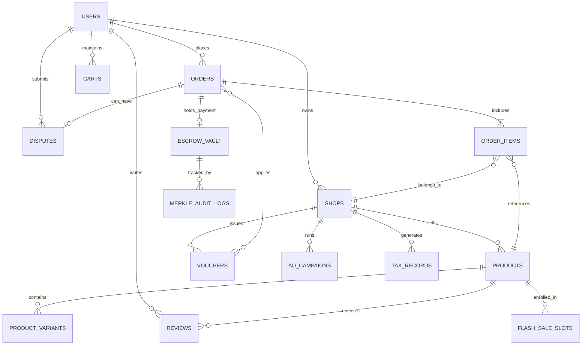
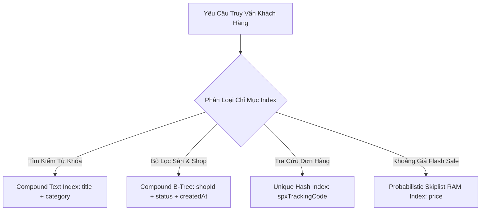

# 🗄️ BÁO CÁO THIẾT KẾ CƠ SỞ DỮ LIỆU & TỪ ĐIỂN DỮ LIỆU TOÀN DIỆN (DDD)
## DỰ ÁN: NỀN TẢNG THƯƠNG MẠI ĐIỆN TỬ MINI SHOPEE MULTI-VENDOR
**Mã tài liệu:** `MS-DOC-DB-001` | **Phiên bản:** `2.0.0-ENTERPRISE` | **Ngày lập:** 23/10/2026

---

## 1. TỔNG QUAN KIẾN TRÚC DỮ LIỆU & NGUYÊN TẮC THIẾT KẾ

### 1.1. Kiến trúc lưu trữ lai (Hybrid High-Performance Data Architecture)
Nền tảng Mini Shopee Multi-Vendor được thiết kế dựa trên mô hình **Kiến trúc Dữ liệu Lai (Hybrid Storage Tier)**, kết hợp giữa tốc độ siêu cao của bộ nhớ trong RAM và tính bền vững bất biến của hệ quản trị cơ sở dữ liệu phân tán:
1. **Lớp Xử lý Nóng (In-Memory Hot Layer):** Toàn bộ dữ liệu phiên hoạt động, giỏ hàng, bảng giá Flash Sale và các bộ cấu trúc xác suất (HyperLogLog, Count-Min Sketch, Skiplist) được duy trì trên RAM để đạt độ trễ truy vấn $< 1\text{ms}$.
2. **Lớp Lưu trữ Bền Vững (Persistent Storage Layer):** Sử dụng hệ quản trị cơ sở dữ liệu Document Store chuẩn hóa (**MongoDB / Mongoose**) kết hợp cơ chế tự động đồng bộ đĩa (**Periodic Disk Persistence Engine**).
3. **Lớp Sổ Cái Kiểm Toán Bất Biến (Cryptographic Audit Ledger):** Dòng tiền ký quỹ Escrow và các bút toán thuế TMĐT được băm chuỗi Merkle Tree để chống chỉnh sửa số liệu.

### 1.2. Chuẩn hóa dữ liệu (Normalization Standards)
- Các thực thể cốt lõi tuân thủ nghiêm ngặt **Dạng chuẩn 3NF (Third Normal Form)** để loại trừ hiện tượng dư thừa dữ liệu (Data Redundancy) và cập nhật dị thường (Update Anomalies).
- Thực hiện phi chuẩn hóa có kiểm soát (**Controlled Denormalization**) đối với các trường thông tin đơn hàng lịch sử (Snapshot giá, snapshot tên sản phẩm tại thời điểm mua hàng) để bảo toàn giá trị pháp lý kế toán và hóa đơn điện tử VAT.

---

## 2. SƠ ĐỒ QUAN HỆ THỰC THỂ TOÀN DIỆN (ENTITY RELATIONSHIP DIAGRAM - ERD)



---

## 3. TỪ ĐIỂN DỮ LIỆU CHI TIẾT (COMPREHENSIVE DATA DICTIONARY)

### 3.1. Bảng thực thể `Users` (Người dùng & Tài khoản)
Lưu trữ thông tin xác thực, phân quyền và hồ sơ cá nhân của người mua, người bán và quản trị viên.

| Tên Trường (Field) | Kiểu Dữ Liệu | Nullable | Mặc Định | Ràng Buộc / Khóa | Ý Nghĩa Nghiệp Vụ |
| :--- | :---: | :---: | :---: | :---: | :--- |
| `_id` | `ObjectId / String` | Không | Tự sinh | **PK** | Mã định danh duy nhất của người dùng |
| `email` | `String (Lowercase)` | Không | Không | **Unique, Index** | Địa chỉ email đăng nhập chuẩn hóa |
| `password` | `String (Hash)` | Không | Không | Bcrypt 12 salt | Chuỗi mật khẩu đã băm một chiều an toàn |
| `name` | `String` | Không | `""` | None | Họ và tên hiển thị của người dùng |
| `phone` | `String` | Có | `null` | Index | Số điện thoại liên hệ nhận hàng |
| `role` | `String` | Không | `'customer'` | Enum | Vai trò: `'customer'`, `'seller'`, `'admin'` |
| `avatar` | `String` | Có | Default URL | URL | Đường dẫn ảnh đại diện |
| `coins` | `Number` | Không | `0` | $\ge 0$ | Số dư Mini Xu tích lũy (dùng để giảm giá) |
| `trustScore` | `Number` | Không | `100` | $[0, 100]$ | Điểm tín nhiệm radar chống bùng hàng COD |
| `isBanned` | `Boolean` | Không | `false` | Index | Cờ đánh dấu tài khoản bị khóa vi phạm |
| `createdAt` | `Date` | Không | `Date.now` | None | Thời điểm đăng ký tài khoản |

---

### 3.2. Bảng thực thể `Shops` (Gian hàng Đa người bán)
Quản lý thông tin pháp nhân kinh doanh, thông tin thanh toán thụ hưởng và chính sách của từng gian hàng.

| Tên Trường (Field) | Kiểu Dữ Liệu | Nullable | Mặc Định | Ràng Buộc / Khóa | Ý Nghĩa Nghiệp Vụ |
| :--- | :---: | :---: | :---: | :---: | :--- |
| `_id` | `ObjectId / String` | Không | Tự sinh | **PK** | Mã định danh duy nhất của gian hàng |
| `ownerId` | `ObjectId / String` | Không | Không | **FK** $\rightarrow$ `Users` | Mã chủ sở hữu gian hàng |
| `name` | `String` | Không | Không | Index | Tên thương hiệu chính thức của Shop |
| `slug` | `String` | Không | Tự sinh | **Unique, Index** | Đường dẫn tĩnh thân thiện SEO (`/shop/:slug`) |
| `description` | `String` | Có | `""` | Text Index | Mô tả giới thiệu tiểu sử gian hàng |
| `isMall` | `Boolean` | Không | `false` | Index | Huy hiệu chứng nhận gian hàng Shopee Mall |
| `rating` | `Number` | Không | `5.0` | $[1.0, 5.0]$ | Điểm đánh giá trung bình từ khách hàng |
| `bankAccount` | `Object` | Không | `{}` | JSON Object | Thông tin tài khoản thụ hưởng rút tiền: `bankName`, `accountNumber`, `accountHolder` |
| `shippingPolicy`| `String` | Có | `""` | None | Chính sách giao vận riêng của gian hàng |
| `returnPolicy` | `String` | Có | `""` | None | Chính sách đổi trả và bảo hành sản phẩm |
| `status` | `String` | Không | `'active'` | Enum | Trạng thái: `'active'`, `'locked'`, `'review'` |
| `penaltyPoints` | `Number` | Không | `0` | $\ge 0$ | Điểm phạt sao quả tạ tích lũy do vi phạm SLA |

---

### 3.3. Bảng thực thể `Products` (Sản phẩm & Tồn kho)
Lưu trữ danh mục hàng hóa, bảng giá, điểm chất lượng và mức tồn kho an toàn.

| Tên Trường (Field) | Kiểu Dữ Liệu | Nullable | Mặc Định | Ràng Buộc / Khóa | Ý Nghĩa Nghiệp Vụ |
| :--- | :---: | :---: | :---: | :---: | :--- |
| `_id` | `ObjectId / String` | Không | Tự sinh | **PK** | Mã định danh duy nhất của sản phẩm |
| `shopId` | `ObjectId / String` | Không | Không | **FK, Index** $\rightarrow$ `Shops` | Mã gian hàng đăng bán sản phẩm |
| `title` | `String` | Không | Không | Text Index | Tiêu đề sản phẩm phục vụ tìm kiếm Full-Text |
| `category` | `String` | Không | Không | Index | Ngành hàng (Thời trang, Công nghệ, Mỹ phẩm...) |
| `price` | `Number` | Không | Không | $\ge 1.000$ VNĐ | Giá niêm yết bán lẻ hiện tại |
| `originalPrice` | `Number` | Không | `= price` | $\ge \text{price}$ | Giá niêm yết gốc trước khi giảm giá |
| `cogs` | `Number` | Không | `0` | $\ge 0$ | Giá vốn hàng bán (Dùng cho khóa sàn $1.05 \times \text{COGS}$) |
| `stock` | `Number` | Không | `0` | $\ge 0$, CAS | Số lượng tồn kho khả dụng (Chống bán âm kho) |
| `version` | `Number` | Không | `1` | Increment | Số phiên bản Optimistic Concurrency Control (OCC) |
| `salesCount` | `Number` | Không | `0` | Index | Tổng số lượt sản phẩm đã bán thành công |
| `safetyStock` | `Number` | Không | `10` | $\ge 0$ | Ngưỡng tồn kho an toàn cảnh báo nhập hàng |
| `qualityScore` | `Number` | Không | `8.0` | $[0.0, 10.0]$ | Điểm chất lượng phục vụ đấu thầu Ad Rank |

---

### 3.4. Bảng thực thể `Orders` & `OrderItems` (Đơn hàng Đa gian hàng)
Quản lý chu trình đơn hàng, phân bổ dòng tiền đa shop, mã vận đơn SPX và hóa đơn điện tử VAT 8%.

| Tên Trường (Field) | Kiểu Dữ Liệu | Nullable | Mặc Định | Ràng Buộc / Khóa | Ý Nghĩa Nghiệp Vụ |
| :--- | :---: | :---: | :---: | :---: | :--- |
| `_id` | `ObjectId / String` | Không | Tự sinh | **PK** | Mã định danh đơn hàng (VD: `ORD-984712`) |
| `customerId` | `ObjectId / String` | Không | Không | **FK, Index** $\rightarrow$ `Users` | Mã khách hàng thực hiện giao dịch |
| `items` | `Array<OrderItem>` | Không | `[]` | Nested Array | Danh sách các mặt hàng: `productId`, `shopId`, `qty`, `price`, `variant` |
| `totalAmount` | `Number` | Không | Không | $\ge 0$ | Tổng giá trị đơn hàng sau khi giảm trừ |
| `shippingFee` | `Number` | Không | `30000` | $\ge 0$ | Phí vận chuyển toàn sàn tính cho đơn hàng |
| `discountAmount`| `Number` | Không | `0` | $\ge 0$ | Tổng tiền được miễn giảm từ Voucher kép |
| `coinsUsed` | `Number` | Không | `0` | $\le \text{coins}$ | Số lượng Mini Xu khấu trừ (Tối đa 50% đơn) |
| `paymentMethod` | `String` | Không | `'cod'` | Enum | Phương thức: `'cod'`, `'vietqr'`, `'wallet'` |
| `paymentStatus` | `String` | Không | `'pending'` | Enum | `'pending'`, `'paid'`, `'refunded'` |
| `shippingStatus`| `String` | Không | `'preparing'` | Enum | Trạng thái SPX: `'preparing'`, `'delivering'`, `'completed'`, `'returned'` |
| `spxTrackingCode`| `String` | Không | Tự sinh | **Unique, Index** | Mã vận đơn SPX Express theo dõi định vị GPS |
| `vatInvoice` | `Object` | Có | `null` | JSON Object | Hóa đơn điện tử VAT 8%: `taxId`, `companyName`, `subtotal`, `vatAmount` |

---

### 3.5. Bảng thực thể `EscrowVault` & `MerkleAuditLogs` (Ví Ký Quỹ & Sổ Cái)
Bảo đảm tính toàn vẹn và bất biến của dòng tiền tài chính theo tiêu chuẩn kế toán kép.

| Tên Trường (Field) | Kiểu Dữ Liệu | Nullable | Ràng Buộc / Khóa | Ý Nghĩa Nghiệp Vụ |
| :--- | :---: | :---: | :---: | :--- |
| `orderId` | `String` | Không | **PK, FK** $\rightarrow$ `Orders` | Đơn hàng gắn liền với khoản tiền ký quỹ |
| `heldAmount` | `Number` | Không | $> 0$ | Số tiền đang tạm giữ bảo vệ quyền lợi người mua |
| `platformFee` | `Number` | Không | $= 5\%$ Subtotal | Doanh thu phí hoa hồng sàn dự kiến trích xuất |
| `withholdingTax` | `Number` | Không | $= 1.5\%$ Subtotal | Thuế nhà thầu TMĐT giữ lại nộp ngân sách |
| `sellerPayable` | `Number` | Không | $= \text{Held} - \text{Fee} - \text{Tax}$ | Số tiền thực nhận sẽ giải ngân cho người bán |
| `escrowStatus` | `String` | Không | Enum | `'holding'`, `'disbursed'`, `'refunded_buyer'` |
| `merkleRootHash`| `String (Hex)` | Không | SHA-256 Hash | Băm gốc cây Merkle bảo chứng chống sửa đổi |

---

## 4. CHIẾN LƯỢC ĐÁNH CHỈ MỤC & TỐI ƯU HÓA TRUY VẤN (INDEX OPTIMIZATION)

Hệ thống thiết lập các chỉ mục trọng yếu để đảm bảo thời gian phản hồi API luôn đạt mức $< 50\text{ms}$ ngay cả khi cơ sở dữ liệu đạt quy mô hàng triệu bản ghi:



1. **Compound Index cho Danh mục sản phẩm:**
   ```javascript
   db.products.createIndex({ category: 1, price: 1, salesCount: -1 });
   ```
   *Mục đích:* Tối ưu hóa bộ lọc ngành hàng kết hợp sắp xếp theo giá và độ bán chạy mà không cần sắp xếp bộ nhớ ngoài (In-Memory Sort).
2. **Text Search Index chịu lỗi tiếng Việt:**
   ```javascript
   db.products.createIndex({ title: "text", description: "text" }, { default_language: "none" });
   ```
   *Mục đích:* Hỗ trợ tìm kiếm từ khóa không dấu và có dấu với độ tương đồng cao.
3. **Chỉ mục đơn lẻ tốc độ cao cho Mã vận đơn:**
   ```javascript
   db.orders.createIndex({ spxTrackingCode: 1 }, { unique: true });
   ```
   *Mục đích:* Truy cứu hành trình bưu tá SPX Live GPS tức thì trong $O(1)$.

---

## 5. QUY TRÌNH SAO LƯU & PHỤC HỒI THỜI ĐIỂM (BACKUP & DISASTER RECOVERY)

1. **Sao lưu ảnh chụp đầy đủ (Full Snapshot Backup):** Thực hiện tự động mỗi 24 giờ vào lúc 02:00 AM (giờ ít traffic nhất), lưu trữ tại kho lưu trữ đám mây biệt lập (AWS S3 Glacier / Cloud Storage Vault).
2. **Sao lưu nhật ký liên tục (Point-in-Time Recovery - PITR):** Ghi nhận Oplog liên tục mỗi 5 phút, cho phép khôi phục cơ sở dữ liệu về chính xác từng giây trước thời điểm xảy ra sự cố.
3. **Mục tiêu phục hồi cam kết:**
   - **RPO (Recovery Point Objective):** $\le 5$ phút (Không bao giờ mất quá 5 phút dữ liệu giao dịch).
   - **RTO (Recovery Time Objective):** $\le 15$ phút (Hệ thống phục hồi hoạt động hoàn toàn trong vòng 15 phút).

---
*Báo cáo thiết kế cơ sở dữ liệu và từ điển dữ liệu này là tài liệu chuẩn mực bàn giao chính thức cho khách hàng tiếp nhận dự án Mini Shopee.*
