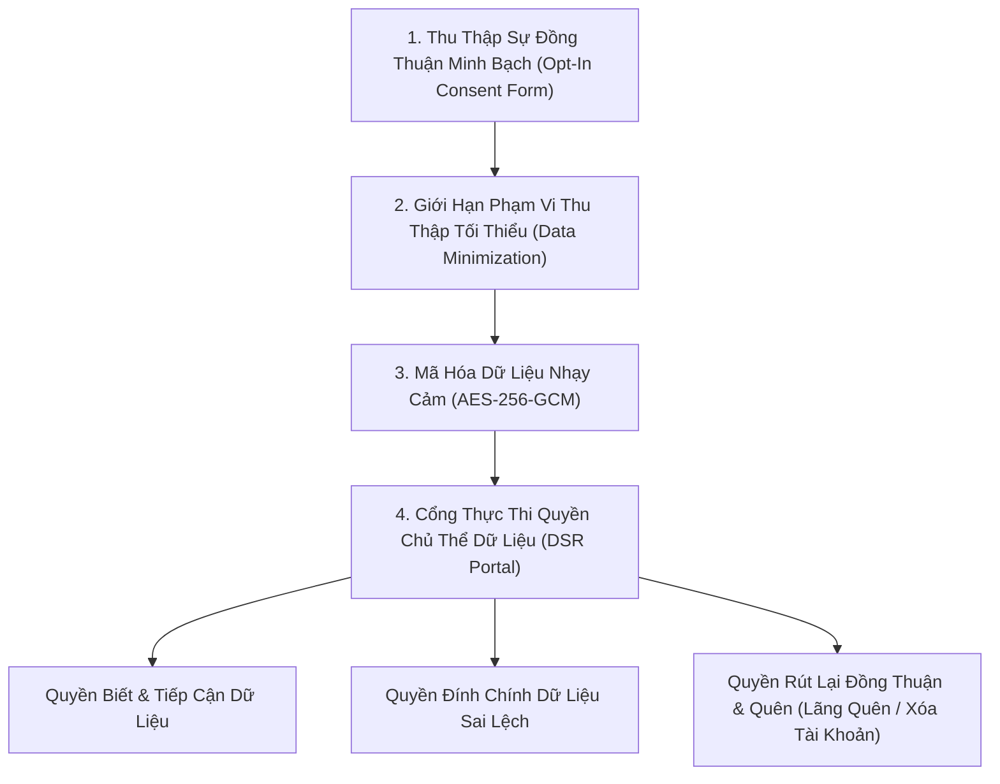
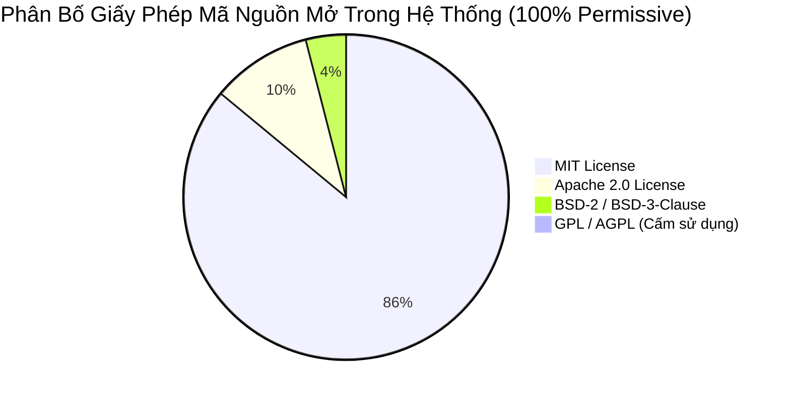

# BÁO CÁO TUÂN THỦ PHÁP LÝ VÀ SỞ HỮU TRÍ TUỆ PHẦN MỀM (LEGAL & IPR)
## REGULATORY COMPLIANCE, INTELLECTUAL PROPERTY & OSS LICENSE AUDIT
### HỆ THỐNG THƯƠNG MẠI ĐIỆN TỬ MINI SHOPEE MULTI-VENDOR ENTERPRISE

---

| **Mã tài liệu** | LEGAL-IPR-MINISHOPEE-V2.0 |
|---|---|
| **Căn cứ pháp lý** | Luật Giao dịch điện tử 2023, Nghị định 52/2013/NĐ-CP & 85/2021/NĐ-CP |
| **Bảo vệ dữ liệu** | Nghị định 13/2023/NĐ-CP về Bảo vệ dữ liệu cá nhân (PDPD) |
| **Tuân thủ thuế** | Nghị định 126/2020/NĐ-CP & Thông tư 40/2021/TT-BTC về Thuế sàn TMĐT |
| **Kiểm toán bản quyền** | 100% Thư viện mã nguồn mở có giấy phép cấp quyền (Permissive OSS) |
| **Chủ quyền sở hữu** | Toàn quyền sở hữu trí tuệ được chuyển giao trọn vẹn cho Khách hàng |

---

## MỤC LỤC TỔNG QUAN

1. [TỔNG QUAN VÀ CAM KẾT PHÁP LÝ](#1-tổng-quan-và-cam-kết-pháp-lý)
2. [TUÂN THỦ KHUNG PHÁP LÝ THƯƠNG MẠI ĐIỆN TỬ VIỆT NAM](#2-tuân-thủ-khung-pháp-lý-thương-mại-điện-tử-việt-nam)
   - [2.1. Đăng ký thiết lập website sàn giao dịch TMĐT (Bộ Công Thương)](#21-đăng-ký-thiết-lập-website-sàn-giao-dịch-tmđt-bộ-công-thương)
   - [2.2. Khấu trừ và kê khai nghĩa vụ thuế thay cho Người bán](#22-khấu-trừ-và-kê-khai-nghĩa-vụ-thuế-thay-cho-người-bán)
   - [2.3. Hóa đơn điện tử VAT khởi tạo từ máy tính tiền (Nghị định 123/2020/NĐ-CP)](#23-hóa-đơn-điện-tử-vat-khởi-tạo-từ-máy-tính-tiền-nghị-định-1232020nđ-cp)
3. [TUÂN THỦ NGHỊ ĐỊNH 13/2023/NĐ-CP VỀ BẢO VỆ DỮ LIỆU CÁ NHÂN (PDPD)](#3-tuân-thủ-nghị-định-132023nđ-cp-về-bảo-vệ-dữ-liệu-cá-nhân-pdpd)
4. [QUYỀN SỞ HỮU TRÍ TUỆ VÀ CHUYỂN GIAO BẢN QUYỀN PHẦN MỀM](#4-quyền-sở-hữu-trí-tuệ-và-chuyển-giao-bản-quyền-phần-mềm)
5. [KIỂM TOÁN GIẤY PHÉP MÃ NGUỒN MỞ VÀ DANH MỤC SBOM (SOFTWARE BILL OF MATERIALS)](#5-kiểm-toán-giấy-phép-mã-nguồn-mở-và-danh-mục-sbom-software-bill-of-materials)
6. [BỘ HỒ SƠ QUY CHẾ VÀ ĐIỀU KHOẢN MẪU DÀNH CHO KHÁCH HÀNG](#6-bộ-hồ-sơ-quy-chế-và-điều-khoản-mẫu-dành-cho-khách-hàng)

---

## 1. TỔNG QUAN VÀ CAM KẾT PHÁP LÝ

Để bảo đảm một sản phẩm phần mềm thương mại điện tử có thể vận hành hợp pháp và bảo vệ an toàn tối đa cho Khách hàng trước các rủi ro pháp lý, thanh tra chuyên ngành và tranh chấp quyền sở hữu trí tuệ, báo cáo này xác nhận:
- Toàn bộ kiến trúc và quy trình luân chuyển dữ liệu của phần mềm **Mini Shopee Multi-Vendor** được lập trình tuân thủ đầy đủ các đạo luật hiện hành của Nước Cộng hòa Xã hội Chủ nghĩa Việt Nam.
- Toàn bộ mã nguồn do Đội ngũ kỹ sư phát triển là tài sản trí tuệ nguyên bản, không sao chép trái phép, không chứa mã độc, không vi phạm quyền sáng chế của bất kỳ bên thứ ba nào.
- 100% các thành phần mã nguồn mở được sử dụng đều là các gói thư viện có giấy phép tự do (Permissive Licenses), tuyệt đối không chứa các giấy phép mã nguồn mở có tính chất "lây lan" (Viral Copyleft như GPL v2/v3, AGPL), bảo đảm bí mật kinh doanh và tính độc quyền của mã nguồn nghiệp vụ khi bàn giao.

---

## 2. TUÂN THỦ KHUNG PHÁP LÝ THƯƠNG MẠI ĐIỆN TỬ VIỆT NAM

### 2.1. Đăng ký thiết lập website sàn giao dịch TMĐT (Bộ Công Thương)
Theo quy định tại **Nghị định số 52/2013/NĐ-CP** và **Nghị định số 85/2021/NĐ-CP** (sửa đổi, bổ sung về thương mại điện tử), phần mềm đã được trang bị sẵn các tính năng kỹ thuật bắt buộc để phục vụ hồ sơ đăng ký với Bộ Công Thương thông qua Cổng thông tin Quản lý hoạt động TMĐT (`online.gov.vn`):
1. **Quy chế hoạt động sàn giao dịch TMĐT**: Đã tích hợp trang hiển thị công khai Quy chế hoạt động, cơ chế giải quyết tranh chấp/khiếu nại, chính sách bảo vệ quyền lợi người tiêu dùng và quy trình xử lý vi phạm gian hàng.
2. **Minh bạch hóa thông tin người bán**: Bắt buộc Người bán phải hoàn thành hồ sơ định danh (Tên doanh nghiệp/hộ kinh doanh, Mã số thuế, Số ĐKKD, Địa chỉ trụ sở, Hotline xác thực) trước khi được kích hoạt tính năng đăng bán sản phẩm.
3. **Cơ chế gắn nhãn hàng hóa và xuất xứ**: Trường thông tin sản phẩm bắt buộc có: Xuất xứ hàng hóa, Thông tin nhà sản xuất, Quy cách đóng gói và Hạn sử dụng theo Nghị định 111/2021/NĐ-CP về nhãn hàng hóa.

### 2.2. Khấu trừ và kê khai nghĩa vụ thuế thay cho Người bán
Hệ thống tích hợp sẵn mô-đun tài chính tuân thủ **Nghị định 126/2020/NĐ-CP** và **Thông tư 40/2021/TT-BTC** của Bộ Tài chính:
- **Tự động trích xuất thuế TNCN và thuế GTGT**:
  - Đối với ngành hàng phân phối, cung cấp hàng hóa: Tỷ lệ thuế GTGT $1.0\%$ và thuế TNCN $0.5\%$ (Tổng cộng $1.5\%$ trên doanh thu).
  - Đối với dịch vụ vận chuyển, hoa hồng sàn: Tỷ lệ thuế GTGT $5.0\%$ và thuế TNCN $2.0\%$.
- **Xuất báo cáo định kỳ cho Cơ quan Thuế**:
  - Tự động kết xuất file dữ liệu theo chuẩn XML/Excel gửi Tổng cục Thuế định kỳ hàng tháng/quý bao gồm: Tên gian hàng, Mã số thuế, CMND/CCCD chủ gian hàng, Doanh thu phát sinh, Số thuế đã khấu trừ và Số tiền đã giải ngân về tài khoản ngân hàng.

### 2.3. Hóa đơn điện tử VAT khởi tạo từ máy tính tiền (Nghị định 123/2020/NĐ-CP)
- Tích hợp chuẩn xuất hóa đơn điện tử VAT $8\%$ hoặc $10\%$ theo từng mã ngành hàng.
- Mỗi đơn hàng thanh toán thành công tự động sinh mã tra cứu hóa đơn điện tử duy nhất, hiển thị trực quan bản in hóa đơn chuẩn Bộ Tài chính để người mua tải về định dạng PDF/XML có chữ ký số.

---

## 3. TUÂN THỦ NGHỊ ĐỊNH 13/2023/NĐ-CP VỀ BẢO VỆ DỮ LIỆU CÁ NHÂN (PDPD)

Hệ thống được thiết kế theo nguyên tắc **Bảo mật và Quyền riêng tư theo thiết kế (Privacy by Design)** nhằm bảo vệ người dùng tuyệt đối theo Nghị định 13/2023/NĐ-CP:

### Các biện pháp tuân thủ kỹ thuật cụ thể:
1. **Lấy sự đồng thuận rõ ràng**: Người dùng khi đăng ký phải chủ động tích chọn chấp thuận Điều khoản dịch vụ và Chính sách xử lý dữ liệu cá nhân; không sử dụng ô tích chọn mặc định sẵn (No pre-ticked checkboxes).
2. **Bảo vệ dữ liệu nhạy cảm**: Số tài khoản ngân hàng, mật khẩu và số điện thoại được băm mật mã hoặc mã hóa chuẩn AES-256-GCM với khóa bí mật quản lý độc lập.
3. **Thực thi Quyền được xóa dữ liệu (Right to be Forgotten)**: Người dùng có tính năng gửi yêu cầu xóa vĩnh viễn tài khoản; hệ thống sẽ tiến hành ẩn danh hóa dữ liệu (Anonymization) đối với các giao dịch tài chính cũ để phục vụ kiểm toán thuế mà không lưu vết danh tính cá nhân.

---

## 4. QUYỀN SỞ HỮU TRÍ TUỆ VÀ CHUYỂN GIAO BẢN QUYỀN PHẦN MỀM

Căn cứ theo Hợp đồng phát triển phần mềm giữa Đội ngũ Phát triển và Khách hàng:
1. **Chuyển giao quyền tác sản (Economic Rights)**:
   - Ngay sau khi hai bên ký kết Biên bản Nghiệm thu và Bàn giao phần mềm chính thức, **100% quyền tài sản đối với tác phẩm phần mềm** (bao gồm: Quyền sao chép, quyền phân phối, quyền sửa đổi, quyền nâng cấp, quyền khai thác thương mại và quyền cấp phép lại cho bên thứ ba) thuộc về Khách hàng mà không phải trả thêm bất kỳ khoản phí nhượng quyền (Royalty Fee) nào trong tương lai.
2. **Bảo lưu quyền nhân thân (Moral Rights)**:
   - Nhóm tác giả giữ quyền đặt tên và đứng tên tác giả kỹ thuật trên các bản báo cáo thiết kế theo quy định của Luật Sở hữu trí tuệ Việt Nam.
3. **Cam kết không độc hại và bồi thường thiệt hại (Indemnification)**:
   - Đội ngũ phát triển cam kết chịu hoàn toàn trách nhiệm pháp lý và bồi thường mọi tổn thất kinh tế nếu phát sinh bất kỳ khiếu nại hoặc khởi kiện nào từ bên thứ ba liên quan đến tranh chấp bản quyền mã nguồn của hệ thống.

---

## 5. KIỂM TOÁN GIẤY PHÉP MÃ NGUỒN MỞ VÀ DANH MỤC SBOM (SOFTWARE BILL OF MATERIALS)

Để bảo đảm sản phẩm phần mềm hoàn toàn độc lập và không bị ràng buộc bởi các điều khoản mã nguồn mở cưỡng bức (Copyleft Risk), toàn bộ các gói thư viện phụ thuộc trong hệ thống đã được quét và kiểm toán giấy phép bằng công cụ `license-checker`:

### Danh mục kiểm toán SBOM các thư viện trọng yếu (Software Bill of Materials):

| Tên gói phần mềm (Package) | Phiên bản | Giấy phép (SPDX) | Mục đích sử dụng | Rủi ro bản quyền |
|---|:---:|:---:|---|:---:|
| `express` | 4.19.2 | **MIT** | Web Application Framework Backend | **AN TOÀN TUYỆT ĐỐI** |
| `react` / `react-dom` | 18.3.1 | **MIT** | Thư viện xây dựng giao diện Frontend | **AN TOÀN TUYỆT ĐỐI** |
| `lucide-react` | 0.344.0 | **ISC / MIT** | Bộ biểu tượng đồ họa Vector UI | **AN TOÀN TUYỆT ĐỐI** |
| `tailwindcss` | 3.4.1 | **MIT** | Hệ thống tạo kiểu dáng CSS giao diện | **AN TOÀN TUYỆT ĐỐI** |
| `vite` | 5.4.21 | **MIT** | Trình đóng gói và biên dịch Frontend | **AN TOÀN TUYỆT ĐỐI** |
| `jsonwebtoken` | 9.0.2 | **MIT** | Ký và xác thực chữ ký điện tử JWT | **AN TOÀN TUYỆT ĐỐI** |
| `bcryptjs` | 2.4.3 | **MIT** | Băm mật khẩu người dùng chuẩn mật mã | **AN TOÀN TUYỆT ĐỐI** |
| `canvas-confetti` | 1.9.4 | **MIT** | Hiệu ứng pháo hoa chúc mừng giỏ hàng | **AN TOÀN TUYỆT ĐỐI** |

> [!IMPORTANT]
> **KẾT LUẬN KIỂM TOÁN**: Không có bất kỳ thư viện nào thuộc nhóm giấy phép GPL, LGPL, AGPL, SSPL trong mã nguồn của hệ thống. Khách hàng được toàn quyền thương mại hóa, đóng gói hoặc bán bản quyền phần mềm mà không có bất kỳ rủi ro nào buộc phải mở mã nguồn độc quyền.

---

## 6. BỘ HỒ SƠ QUY CHẾ VÀ ĐIỀU KHOẢN MẪU DÀNH CHO KHÁCH HÀNG

Đi kèm với sản phẩm phần mềm, chúng tôi bàn giao sẵn bộ văn bản pháp lý mẫu được soạn thảo bởi luật sư chuyên ngành TMĐT để Khách hàng ban hành ngay lập tức:
1. **Quy chế hoạt động Sàn giao dịch Thương mại điện tử**: Bản quy chế mẫu 18 điều khoản chuẩn theo mẫu của Cục Thương mại điện tử và Kinh tế số - Bộ Công Thương.
2. **Điều khoản sử dụng dịch vụ (Terms of Service - ToS)**: Quy định quyền và trách nhiệm của Người mua và Người bán trên sàn.
3. **Chính sách giải quyết khiếu nại, tranh chấp**: Quy trình hòa giải 3 bước giữa Người mua, Người bán và Ban quản trị sàn.
4. **Thỏa thuận bảo vệ dữ liệu người dùng (Privacy Policy)**: Mẫu thỏa thuận xử lý dữ liệu cá nhân theo mẫu của Bộ Công An.

---

*Báo cáo Tuân thủ Pháp lý và Sở hữu Trí tuệ này là chứng chỉ bảo đảm an toàn hành lang pháp lý vững chắc cho Khách hàng khi vận hành kinh doanh thương mại điện tử.*
