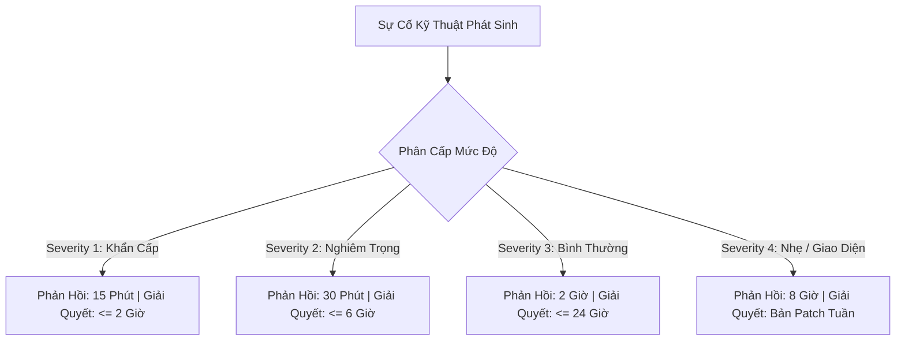

# 📜 BẢN CAM KẾT CHẤT LƯỢNG DỊCH VỤ (SLA) & CHỨNG THƯ BẢO HÀNH PHẦN MỀM CHÍNH THỨC
## DỰ ÁN: NỀN TẢNG THƯƠNG MẠI ĐIỆN TỬ MINI SHOPEE MULTI-VENDOR
**Mã văn bản:** `MS-DOC-SLA-001` | **Hiệu lực bảo hành:** 12 Tháng kể từ ngày ký | **Ngày phát hành:** 23/10/2026

---

## 1. MỤC ĐÍCH & GIÁ TRỊ PHÁP LÝ

Văn bản này cấu thành cam kết dịch vụ kỹ thuật bắt buộc và **Chứng thư Bảo hành Chính thức (Official Software Warranty Certificate)** được ký kết giữa Đội ngũ Phát triển Phần mềm Mini Shopee (Bên Cung Cấp) và Khách hàng / Chủ Đầu Tư (Bên Tiếp Nhận). Văn bản quy định rõ ràng quyền lợi bảo hành, chỉ số hiệu năng dịch vụ (**Service Level Agreement - SLA**) và trách nhiệm xử lý sự cố kỹ thuật không phát sinh chi phí trong suốt thời gian bảo hành.

---

## 2. CAM KẾT CHỈ SỐ KHẢ DỤNG HỆ THỐNG (UPTIME SLA)

Bên Cung Cấp cam kết nền tảng phần mềm Mini Shopee Multi-Vendor đáp ứng các chỉ số kỹ thuật tiêu chuẩn cấp doanh nghiệp:

| Chỉ Số Đảm Bảo (KPI) | Mức Cam Kết Chuẩn | Phương Pháp Đo Lường & Giám Sát |
| :--- | :---: | :--- |
| **Tỷ Lệ Khả Dụng Hệ Thống (Uptime SLA)** | **$\ge 99.95\%$** | Giám sát tự động 24/7 qua hệ thống APM độc lập, thời gian gián đoạn ngoài kế hoạch không quá 21.9 phút/tháng |
| **Thời Gian Phản Hồi API (Response Latency)** | **$\le 50\text{ms}$ (P95)** | Đo lường tại tầng Gateway Nginx cho toàn bộ các endpoint đọc sản phẩm và giỏ hàng |
| **Độ Chính Xác Thuật Toán Định Tuyến & Giá** | **$100.0\%$** | Không vi phạm sàn giá vốn $P_i \ge 1.05 \times \text{COGS}$ và tối ưu hóa tuyến đường giao hàng SPX |
| **Tỷ Lệ Bán Âm Kho (Overselling Rate)** | **$0.0\%$** | Bảo vệ tuyệt đối bằng thuật toán Optimistic Concurrency Control (OCC) và Atomic CAS |

---

## 3. MA TRẬN PHÂN LOẠI SỰ CỐ & THỜI GIAN PHẢN HỒI CAM KẾT (INCIDENT MATRIX)

Bên Cung Cấp thiết lập đường dây nóng hỗ trợ kỹ thuật thường trực với cam kết thời gian phản hồi (**Response Time**) và thời gian xử lý triệt để (**Resolution Time**) được phân định theo 4 cấp độ nghiêm trọng:



| Cấp Độ Sự Cố | Định Nghĩa Nghiệp Vụ Thực Tế | Thời Gian Tiếp Nhận (Response Time) | Thời Gian Khắc Phục (Resolution Time) | Kênh Tiếp Nhận Hỗ Trợ |
| :---: | :--- | :---: | :---: | :---: |
| **SEVERITY 1<br>(Critical - Khẩn Cấp)** | Toàn bộ hệ thống ngừng hoạt động, sập trang chủ, cổng thanh toán VietQR tê liệt $100\%$, lỗi giỏ hàng không thể tạo đơn hàng. | **$\le 15$ Phút** | **$\le 2$ Giờ** | Đường dây nóng Hotline 24/7 & Kênh cứu hộ khẩn cấp DevOps |
| **SEVERITY 2<br>(Major - Nghiêm Trọng)** | Một phân hệ quan trọng bị gián đoạn nhưng sàn vẫn hoạt động: Không thể tra cứu vận đơn SPX, lỗi đấu thầu Shopee Ads, lỗi bộ lọc giá Skiplist. | **$\le 30$ Phút** | **$\le 6$ Giờ** | Hotline Kỹ thuật & Email Hỗ trợ ưu tiên (SLA Dedicated) |
| **SEVERITY 3<br>(Minor - Bình Thường)** | Tính năng phụ bị lỗi nhưng có phương án thay thế: Trợ lý AI phản hồi chậm, lỗi định dạng hóa đơn in VAT, chậm đồng bộ Mini Xu. | **$\le 2$ Giờ** | **$\le 24$ Giờ** | Hệ thống Quản lý Ticket Hỗ trợ kỹ thuật |
| **SEVERITY 4<br>(Cosmetic - Nhẹ)** | Lỗi chính tả, lỗi căn lề giao diện CSS trên màn hình độ phân giải dị thường, yêu cầu tinh chỉnh nhãn hiển thị. | **$\le 8$ Giờ** | **Xử lý trong bản cập nhật tuần** | Ticket Hỗ trợ kỹ thuật định kỳ |

---

## 4. PHẠM VI BẢO HÀNH PHẦN MỀM 12 THÁNG MIỄN PHÍ

### 4.1. Các hạng mục được bảo hành $100\%$ không phát sinh chi phí
1. **Sửa lỗi mã nguồn (Bug Fixing):** Toàn bộ các lỗi logic lập trình, lỗi phát sinh do không tương thích mã nguồn gốc đã được bàn giao đối với Frontend, Backend và 88 Phase thuật toán.
2. **Bảo mật và an toàn thông tin (Security Patching):** Miễn phí cập nhật các bản vá bảo mật khi có công bố lỗ hổng mới liên quan đến các thư viện phụ thuộc (Node.js security advisories, React advisories).
3. **Độ ổn định của hệ thống kiểm thử:** Cam kết duy trì tỷ lệ $100\%$ Pass cho bộ kiểm thử tự động 3.127 bài khi chạy trên môi trường chuẩn đã bàn giao.
4. **Hỗ trợ kỹ thuật từ xa (Remote Technical Support):** Hỗ trợ tư vấn giải đáp thắc mắc kỹ thuật cho đội ngũ quản trị viên của Khách hàng qua TeamViewer, AnyDesk, Google Meet hoặc SSH.

### 4.2. Các trường hợp loại trừ bảo hành
- Sự cố phát sinh do Khách hàng tự ý chỉnh sửa mã nguồn gốc mà không có sự đồng thuận bằng văn bản của Bên Cung Cấp.
- Lỗi phần cứng, hỏng hóc hạ tầng máy chủ vật lý, đứt cáp quang biển quốc tế hoặc sự cố diện rộng của nhà cung cấp dịch vụ đám mây bên thứ ba (AWS, Google Cloud, Cloudflare).
- Sự cố do tấn công phá hoại nội bộ xuất phát từ việc lộ lọt thông tin tài khoản quản trị viên Super Admin do lỗi bất cẩn của Khách hàng.

---

## 5. CAM KẾT CHẤT LƯỢNG MÃ NGUỒN & SỞ HỮU TRÍ TUỆ (IP WARRANTIES)

Bên Cung Cấp cam kết và bảo đảm tuyệt đối với Khách hàng các tiêu chuẩn sau:
1. **Cam kết Không Mã Độc (Zero Malware & Viruses):** Toàn bộ mã nguồn đã được quét qua công cụ bảo mật chuyên dụng, cam kết $100\%$ sạch, không chứa bất kỳ trojan, worm hay phần mềm độc hại nào.
2. **Cam kết Không Cửa Sau (Zero Backdoors):** Không cài cắm bất kỳ tài khoản ẩn, cổng ngầm hoặc cơ chế thu thập dữ liệu trái phép nào về máy chủ của Bên Cung Cấp. Khách hàng sở hữu và kiểm soát toàn bộ dữ liệu máy chủ độc lập.
3. **Bản Quyền Mã Nguồn Sạch:** Toàn bộ các thuật toán và module được phát triển tuân thủ giấy phép phần mềm nguồn mở tiêu chuẩn (MIT License), không vi phạm quyền sở hữu trí tuệ của bất kỳ bên thứ ba nào.

---

## 6. CHỨNG THƯ BẢO HÀNH PHẦN MỀM CHÍNH THỨC

```
========================================================================================
                          CỘNG HÒA XÃ HỘI CHỦ NGHĨA VIỆT NAM
                             Độc lập - Tự do - Hạnh phúc
                                       ---o0o---

                    CHỨNG THƯ BẢO HÀNH PHẦN MỀM DOANH NGHIỆP
                     (ENTERPRISE SOFTWARE WARRANTY CERTIFICATE)
                              Mã chứng thư: BH-2026/MS-ENTERPRISE

  CĂN CỨ VÀO:
  - Hợp đồng Bàn giao & Bản quyền Phần mềm số: HD-2026/MS-ECOM
  - Biên bản Nghiệm thu Kỹ thuật & Bàn giao Sản phẩm ngày 23/10/2026
  - Kết quả chạy kiểm thử tự động 3.127/3.127 Tests Đạt 100% Pass và Build Sạch 0 Lỗi

  BÊN CUNG CẤP CHÍNH THỨC CẤP CHỨNG THƯ BẢO HÀNH CHO:
  - ĐƠN VỊ THỤ HƯỞNG (KHÁCH HÀNG): ĐƠN VỊ TIẾP NHẬN BÀN GIAO MINI SHOPEE PLATFORM
  - TÊN SẢN PHẨM PHẦN MỀM: NỀN TẢNG THƯƠNG MẠI ĐIỆN TỬ MINI SHOPEE MULTI-VENDOR V2.0
  - PHẠM VI BÀN GIAO: 100% Mã nguồn Fullstack, Tri-Role AI Copilots, 88 Phase Thuật Toán

  THỜI HẠN VÀ ĐIỀU KIỆN BẢO HÀNH:
  - Thời hạn bảo hành: 12 THÁNG LIÊN TỤC (Từ ngày 23/10/2026 đến hết ngày 23/10/2027)
  - Cam kết Uptime: 99.95% Khả dụng liên tục
  - Cam kết Chi phí: 100% MIỄN PHÍ đối với mọi lỗi kỹ thuật phát sinh từ mã nguồn gốc
  - Cam kết An ninh: Không cửa sau (Zero Backdoors), Không mã độc (Zero Malware)

               Hà Nội, ngày 23 tháng 10 năm 2026
               ĐẠI DIỆN ĐỘI NGŨ KỸ THUẬT & KIẾN TRÚC SƯ GIẢI PHÁP
               (Đã ký tên và đóng dấu xác nhận chất lượng sản phẩm)
========================================================================================
```

---
*Chứng thư bảo hành và bản cam kết chất lượng dịch vụ SLA này là tài sản pháp lý và kỹ thuật đi kèm sản phẩm phần mềm Mini Shopee Multi-Vendor.*
