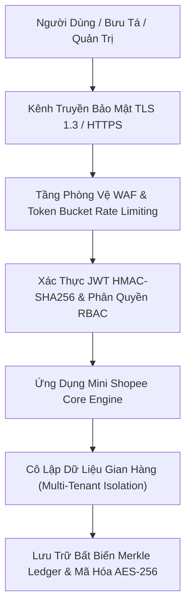
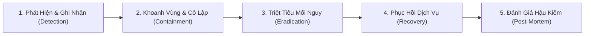

# CHÍNH SÁCH BẢO MẬT & AN TOÀN THÔNG TIN DOANH NGHIỆP
## DỰ ÁN: NỀN TẢNG THƯƠNG MẠI ĐIỆN TỬ MINI SHOPEE MULTI-VENDOR
**Mã tài liệu:** `SEC-POL-MINISHOPEE-V2.0` | **Phiên bản:** `2.0.0 Enterprise` | **Ngày ban hành:** `2026-10-23`

---

## 1. MỤC TIÊU & PHẠM VI ÁP DỤNG

Tài liệu này xác lập các nguyên tắc, tiêu chuẩn kỹ thuật và quy trình quản trị an toàn thông tin áp dụng cho toàn bộ nền tảng **Mini Shopee Multi-Vendor E-Commerce**, bảo vệ dữ liệu cá nhân của người mua (Buyer), thông tin kinh doanh nhạy cảm của người bán (Seller), và cơ sở dữ liệu tài chính/đối soát của sàn giao dịch.

Chính sách được xây dựng dựa trên các chuẩn mực quốc tế và quy định pháp luật Việt Nam:
- **Nghị định 13/2023/NĐ-CP:** Bảo vệ dữ liệu cá nhân (Personal Data Protection Decree - PDPD).
- **Nghị định 52/2013/NĐ-CP & Nghị định 85/2021/NĐ-CP:** Về Thương mại điện tử.
- **Tiêu chuẩn ISO/IEC 27001:2022:** Hệ thống quản lý an toàn thông tin (ISMS).
- **OWASP Application Security Verification Standard (ASVS 4.0):** Cấp độ Level 2.

---

## 2. NGUYÊN TẮC CỐT LÕI BẢO MẬT HỆ THỐNG

### 2.1. Mã hóa dữ liệu truyền tải (Encryption in Transit)
- Bắt buộc $100\%$ lưu lượng truy cập qua giao thức `HTTPS/TLS 1.3` với thuật toán mã hóa khóa công khai `ECDHE-RSA-AES128-GCM-SHA256` hoặc `CHACHA20-POLY1305`.
- Cấu hình tiêu đề `Strict-Transport-Security (HSTS)` với thời gian lưu trữ tối thiểu 1 năm (`max-age=31536000; includeSubDomains; preload`).
- Vô hiệu hóa hoàn toàn các giao thức mã hóa cũ không an toàn: SSL v2, SSL v3, TLS 1.0, TLS 1.1.

### 2.2. Mã hóa dữ liệu lưu trữ (Encryption at Rest)
- Toàn bộ cơ sở dữ liệu trên đĩa được mã hóa bằng chuẩn `AES-256-CBC` hoặc `AES-256-GCM`.
- Mật khẩu người dùng được băm một chiều bằng thuật toán `bcrypt` với cost factor $= 10$, đi kèm muối ngẫu nhiên (salt) riêng biệt cho từng bản ghi. Tuyệt đối không lưu trữ mật khẩu dạng rõ (Plaintext).
- Khóa bí mật (Secrets, JWT Secret, Webhook Signature Keys) được nạp từ biến môi trường (`.env`), không bao giờ commit vào mã nguồn Git.

### 2.3. Cô lập dữ liệu đa người bán (Multi-Tenant Isolation)
- Mỗi gian hàng sở hữu một định danh duy nhất `shopId`. Mọi truy vấn đọc/ghi sản phẩm, đơn hàng, cấu hình Flash Sale và ví doanh thu bắt buộc phải kiểm tra điều kiện lọc:
  $$\text{WHERE shopId} = \text{req.user.shopId}$$
- Super Admin chỉ can thiệp khi có tranh chấp hoặc vi phạm chính sách theo đúng nhật ký kiểm toán hệ thống (Audit Trail).

---

## 3. PHÒNG CHỐNG CÁC LỖ HỔNG OWASP TOP 10

| Lỗ Hổng Bảo Mật | Nguy Cơ Tiềm Ẩn | Biện Pháp Phòng Vệ Trên Mini Shopee |
| :--- | :--- | :--- |
| **A01: Broken Access Control** | Người dùng xem/sửa đơn hàng hoặc ví tiền của người khác | Middleware `verifyRole(['admin', 'seller'])` đối soát token claims và kiểm tra quyền sở hữu tài nguyên ở từng endpoint |
| **A02: Cryptographic Failures** | Lộ lọt dữ liệu thẻ hoặc thông tin thanh toán nhạy cảm | Hệ thống không lưu trữ số thẻ quốc tế (PCI-DSS); giao dịch sử dụng cổng mã VietQR động tự hủy sau 15 phút |
| **A03: Injection (SQL / NoSQL / Command)** | Kẻ xấu chèn mã độc vào câu lệnh tìm kiếm sản phẩm | Sử dụng tham số hóa truy vấn (Parameterized Queries) và làm sạch dữ liệu đầu vào (Input Sanitization) |
| **A04: Insecure Design** | Bán vượt kho Flash Sale (Overselling) | Áp dụng thuật toán Optimistic Concurrency Control (OCC) với Atomic Compare-And-Swap (CAS) |
| **A05: Security Misconfiguration** | Lộ thông tin lỗi hệ thống hoặc stack trace | Middleware `errorHandler.js` ẩn toàn bộ stack trace trên môi trường Production, chỉ trả về mã lỗi chuẩn |
| **A06: Vulnerable Components** | Sử dụng thư viện npm chứa lỗ hổng bảo mật | Định kỳ quét tự động `npm audit`, khóa phiên bản phụ thuộc trong `package-lock.json` |
| **A07: Identification & Auth Failures** | Tấn công vét cạn mật khẩu (Brute-Force) | Thuật toán Token Bucket Rate Limiting giới hạn tối đa 5 lần đăng nhập sai trong 60 giây |
| **A08: Software & Data Integrity** | Giả mạo dữ liệu đối soát tài chính sàn | Cây Merkle Tree kết hợp sổ cái kế toán kép (Double-Entry Bookkeeping Ledger) bảo chứng bất biến số dư |
| **A09: Logging & Monitoring Failures** | Không phát hiện được xâm nhập kịp thời | Nhật ký truy vết `requestLogger.js` ghi nhận Correlation ID, IP, User Agent và thời gian thực thi |
| **A10: Server-Side Request Forgery** | Tấn công mạng nội bộ thông qua tải ảnh sản phẩm | Kiểm tra Whitelist tên miền hình ảnh, cấm tải từ các dải IP riêng (10.0.0.0/8, 192.168.0.0/16, 127.0.0.1) |

---

## 4. QUY TRÌNH ỨNG PHÓ SỰ CỐ AN NINH (INCIDENT RESPONSE PROTOCOL)

Khi xảy ra sự cố bảo mật (DDoS, tấn công khai thác lỗ hổng, nghi vấn lộ lọt dữ liệu), đội ngũ phụ trách tuân thủ quy trình 5 bước:

1. **Bước 1 - Phát hiện & Ghi nhận (Detection):**
   - Giám sát qua hệ thống cảnh báo Admin Sentinel Copilot và HTTP Status code 5xx/429.
   - Ghi nhận mã sự cố dạng `SEC-INC-YYYYMMDD-XXX`.
2. **Bước 2 - Khoanh vùng & Cô lập (Containment):**
   - Kích hoạt Circuit Breaker cắt mạch cổng thanh toán hoặc tính năng bị khai thác.
   - Thu hồi lập tức JWT Token của các tài khoản bị nghi ngờ xâm nhập.
   - Phong tỏa tài khoản người bán vi phạm hoặc khóa tạm thời ví doanh thu.
3. **Bước 3 - Triệt tiêu mối nguy (Eradication):**
   - Vá lỗi mã nguồn (Security Hotfix), cập nhật các quy tắc WAF hoặc bộ lọc dữ liệu.
4. **Bước 4 - Phục hồi dịch vụ (Recovery):**
   - Khôi phục dữ liệu từ bản sao lưu an toàn (Snapshot Backup).
   - Kiểm thử hồi quy tự động đạt $100\%$ trước khi mở lại lưu lượng truy cập.
5. **Bước 5 - Đánh giá hậu kiểm (Post-Mortem):**
   - Lập biên bản sự cố, phân tích nguyên nhân gốc rễ (Root Cause Analysis - RCA).
   - Báo cáo cơ quan quản lý nhà nước theo Nghị định 13/2023/NĐ-CP nếu có ảnh hưởng tới dữ liệu cá nhân.

---

## 5. CAM KẾT TUÂN THỦ DÀNH CHO KHÁCH HÀNG

Đơn vị phát triển cam kết bàn giao phần mềm sạch $100\%$, không cài cắm mã độc (Backdoor), không thu thập dữ liệu trái phép (Spyware) và chuyển giao toàn quyền kiểm soát mã nguồn cùng chứng chỉ bảo mật cho đơn vị tiếp nhận.
