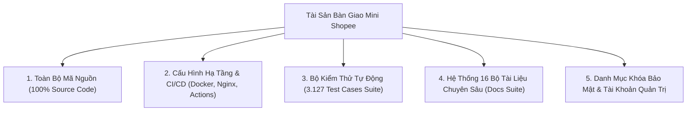

# 🎓 KẾ HOẠCH ĐÀO TẠO NHÂN SỰ & CHUYỂN GIAO CÔNG NGHỆ TOÀN DIỆN (TTTP)
## DỰ ÁN: NỀN TẢNG THƯƠNG MẠI ĐIỆN TỬ MINI SHOPEE MULTI-VENDOR
**Mã tài liệu:** `MS-DOC-TRN-001` | **Phiên bản:** `2.0.0-ENTERPRISE` | **Ngày lập:** 23/10/2026

---

## 1. MỤC TIÊU VÀ NGUYÊN TẮC CHUYỂN GIAO CÔNG NGHỆ

### 1.1. Mục tiêu tổng quát
Kế hoạch Đào tạo Nhân sự & Chuyển giao Công nghệ (**Technology Transfer & Training Plan - TTTP**) được thiết kế nhằm đảm bảo:
1. Đội ngũ nhân sự của Khách hàng làm chủ $100\%$ kiến trúc, mã nguồn, cơ chế vận hành và quy trình bảo trì của hệ thống Mini Shopee Multi-Vendor.
2. Xóa bỏ hoàn toàn sự phụ thuộc vào nhà thầu phát triển sau khi kết thúc giai đoạn bảo hành.
3. Chuyển giao đầy đủ quyền sở hữu trí tuệ, tài nguyên mã nguồn, tài liệu thiết kế và môi trường triển khai.
4. Nâng cao năng lực vận hành thực chiến cho 3 khối nhân sự: **Ban Lãnh đạo (Business), Đội ngũ Kỹ thuật (DevOps/IT), và Đội ngũ Vận hành Sàn (Operations/Support)**.

### 1.2. Nguyên tắc chuyển giao
- **Chuyển giao "Chìa khóa trao tay" (Turnkey Handover):** Bàn giao hệ thống hoàn chỉnh đã được kiểm chứng bằng 3.127 bài kiểm thử tự động (100% Pass) và 0 lỗi build production.
- **Thực hành trên môi trường Staging thực tế (Hands-on Lab):** $70\%$ thời lượng đào tạo là thực hành trực tiếp trên hệ thống demo với các tình huống giả lập thực tế (Flash Sale triệu traffic, bùng đơn COD, sập cổng thanh toán, đối soát thuế).
- **Đánh giá sát hạch độc lập (Independent Examination):** Học viên tham gia được kiểm tra năng lực thực tế trước khi ký kết Biên bản Hoàn thành Chuyển giao.

---

## 2. DANH MỤC TÀI SẢN TRÍ TUỆ & HỒ SƠ BÀN GIAO (ASSET TRANSFER LIST)



### 2.1. Chi tiết các cấu phần bàn giao
1. **Mã nguồn ứng dụng (Application Source Code):**
   - Kho lưu trữ Git repository hoàn chỉnh: Nhánh `main` đồng bộ tại GitHub remote.
   - Frontend Client: Mã nguồn React 18, Vite 5, TailwindCSS, Context API, In-Memory NLP Copilots (`client/src`).
   - Backend Server: Mã nguồn Node.js Express REST API, Mongoose Models, 88 Phase thuật toán doanh nghiệp (`server/src`).
2. **Cấu hình Hạ tầng & Tự động hóa (DevOps Assets):**
   - File cấu hình container: `Dockerfile` (Multi-stage build cho Client và Server), `docker-compose.yml`.
   - File cấu hình máy chủ Gateway: `nginx.conf` (SSL HTTPS, Reverse Proxy, Gzip, WAF Rate-Limiting).
   - Quy trình CI/CD: `.github/workflows/ci.yml` (Tự động build và test khi đẩy code).
3. **Bộ dữ liệu kiểm thử & Dữ liệu mẫu (Test Suite & Seed Data):**
   - Bộ chạy kiểm thử E2E Opaque-Box `tests/run-all.js` chứa 3.127 kịch bản kiểm thử tự động.
   - Dữ liệu mẫu khởi tạo: 180 sản phẩm thuộc 10 ngành hàng, 10 shop chuẩn, danh mục voucher và tài khoản demo.
4. **Hệ thống Tài liệu Kỹ thuật Toàn diện:**
   - Đầy đủ 16 tài liệu chuyên sâu chuẩn quốc tế lưu trữ tại thư mục `/docs`.

---

## 3. KHUNG CHƯƠNG TRÌNH ĐÀO TẠO PHÂN TẦNG (TRAINING SYLLABUS)

Chương trình đào tạo được tổ chức thành 3 Khóa học chuyên biệt với tổng thời lượng 6 ngày:

```mermaid
journey
    title Lộ Trình Đào Tạo Chuyển Giao Công Nghệ Mini Shopee (6 Ngày)
    section Khóa 1: Ban Lãnh Đạo & Kinh Doanh
      Tổng quan kiến trúc & Mô hình dòng tiền: 5: Ban Lãnh Đạo
      Chính sách sàn, Escrow Vault & Thuế TMĐT: 5: Ban Lãnh Đạo
    section Khóa 2: Đội Ngũ Kỹ Thuật & DevOps
      Triển khai Docker & Cấu hình Nginx SSL: 4: Kỹ Sư DevOps
      Bảo trì Database, Backup PITR & Scaling: 5: Kỹ Sư DevOps
      Vận hành 88 Phase thuật toán & CI/CD: 5: Kỹ Sư DevOps
    section Khóa 3: Vận Hành Sàn & CSKH
      Quản trị Gian hàng, Duyệt Mall & Khóa Shop: 5: Nhân Viên Vận Hành
      Trọng tài Tranh chấp, Hoàn tiền & Cứu hộ SPX: 4: Nhân Viên CSKH
```

---

### 3.1. Khóa Học 1: Quản Trị Chiến Lược & Mô Hình Kinh Doanh Sàn TMĐT
- **Đối tượng:** Ban Giám đốc, Giám đốc Điều hành (COO), Giám đốc Tài chính (CFO), Trưởng phòng Kinh doanh.
- **Thời lượng:** 01 Ngày (8 Giờ làm việc).
- **Nội dung chi tiết:**

| Buổi | Chuyên Đề Đào Tạo | Nội Dung & Tình Huống Thực Hành |
| :---: | :--- | :--- |
| **Sáng** | **Tổng quan Hệ Sinh Thái Mini Shopee** | - Cấu trúc phân quyền đa cấp RBAC (Super Admin, Seller, Buyer).<br>- Cơ chế dòng tiền ký quỹ Escrow Vault bảo vệ khách hàng.<br>- 5 nguồn doanh thu cốt lõi: Hoa hồng 5%, Quảng cáo Ads, Gói Mall, Flash Sale slot. |
| **Chiều** | **Tuân Thủ Pháp Lý & Đối Soát Tài Chính** | - Quản trị nghĩa vụ thuế TMĐT theo Nghị định 52/2018 và Thông tư 40/2021.<br>- Sử dụng Sổ cái kép Merkle Tree Ledger để kiểm toán doanh thu chống gian lận.<br>- Phân tích báo cáo P&L tự động do Admin Sentinel AI Copilot trích xuất. |

---

### 3.2. Khóa Học 2: Quản Trị Hệ Thống, DevOps & Bảo Trì Mã Nguồn
- **Đối tượng:** Trưởng phòng CNTT (CTO/IT Lead), Kỹ sư DevOps, Lập trình viên Fullstack, Quản trị viên Cơ sở dữ liệu (DBA).
- **Thời lượng:** 03 Ngày (24 Giờ làm việc).
- **Nội dung chi tiết:**

| Ngày | Chuyên Đề Đào Tạo | Hoạt Động Thực Hành (Hands-on Labs) |
| :---: | :--- | :--- |
| **Ngày 1** | **Kiến Trúc Ứng Dụng & Triển Khai Docker** | - Cấu trúc mã nguồn Clean Architecture của React 18 và Express.js.<br>- Triển khai hệ thống 1-click bằng `docker-compose up -d --build`.<br>- Cấu hình Nginx Reverse Proxy, chứng chỉ SSL Let's Encrypt tự động gia hạn. |
| **Ngày 2** | **Quản Trị Cơ Sở Dữ Liệu & Khôi Phục Thảm Họa** | - Mô hình dữ liệu MongoDB và cơ chế đồng bộ In-Memory Store.<br>- Thiết lập quy trình sao lưu PITR tự động hàng ngày và kịch bản khôi phục khi mất dữ liệu.<br>- Tối ưu hóa truy vấn B-Tree Index và phân tích hiệu năng tải cao. |
| **Ngày 3** | **Vận Hành Thuật Toán, Giám Sát APM & CI/CD** | - Vận hành bộ 88 Phase thuật toán: Token Bucket, Circuit Breaker, DSU Fraud Ring.<br>- Cấu hình CI/CD Pipeline với GitHub Actions, chạy tự động 3.127 bài kiểm thử.<br>- Giám sát Log tập trung (Morgan, APM), xử lý nghẽn CPU và scale cụm máy chủ. |

---

### 3.3. Khóa Học 3: Vận Hành Sàn, CSKH & Trọng Tài Xử Lý Tranh Chấp
- **Đối tượng:** Trưởng phòng Vận hành Sàn, Nhân viên Kiểm duyệt Sản phẩm, Nhân viên CSKH/Khiếu nại, Đội ngũ Trọng tài.
- **Thời lượng:** 02 Ngày (16 Giờ làm việc).
- **Nội dung chi tiết:**

| Ngày | Chuyên Đề Đào Tạo | Kịch Bản Giả Lập Trực Tiếp |
| :---: | :--- | :--- |
| **Ngày 1** | **Quản Lý Gian Hàng & Điều Phối Chiến Dịch** | - Quy trình thẩm định hồ sơ Seller, phê duyệt gian hàng Shopee Mall.<br>- Kỹ thuật khóa shop vi phạm chính sách, đóng băng tài khoản gian lận trong 1-click.<br>- Thiết lập chiến dịch Mega Sale toàn sàn, tạo Slot Flash Sale và Voucher Freeship. |
| **Ngày 2** | **Trọng Tài Tranh Chấp & Điều Phối Đơn Hàng SPX** | - Quy trình xử lý bồi hoàn tiền: Xem xét bằng chứng video, phân giải đúng - sai.<br>- Sử dụng bản đồ vệ tinh SPX Live GPS theo dõi bưu tá và xử lý bưu gửi thất lạc.<br>- Sử dụng trợ lý Admin Sentinel AI Copilot để soạn thảo bản tin phát sóng khẩn cấp. |

---

## 4. TIÊU CHUẨN ĐÁNH GIÁ SÁT HẠCH & CẤP CHỨNG CHỈ (EXAMINATION & SIGN-OFF)

### 4.1. Bài kiểm tra sát hạch thực tế (Practical Assessment)
Để được công nhận hoàn thành chuyển giao công nghệ, đội ngũ Khách hàng phải vượt qua 3 bài thi thực hành độc lập:
1. **Bài thi DevOps (Dành cho Kỹ thuật):** Tự tay triển khai hệ thống từ mã nguồn sạch lên một máy chủ Linux Cloud mới hoàn toàn, cấu hình SSL thành công và chạy bộ test suite đạt $100\%$ Pass trong thời gian $\le 30$ phút.
2. **Bài thi Vận hành (Dành cho Operations):** Thực hiện quy trình xử lý một vụ bùng đơn COD kết hợp gian lận voucher, khóa shop vi phạm và giải ngân bồi hoàn ví Escrow trong $\le 10$ phút.
3. **Bài thi Báo cáo (Dành cho Quản lý):** Trích xuất báo cáo doanh thu đối soát thuế tháng của 5 gian hàng bằng Admin Copilot và giải trình bảng cân đối tài chính.

### 4.2. Điều kiện ký kết bàn giao chính thức
- Tỷ lệ nhân sự tham gia đầy đủ các buổi đào tạo đạt $\ge 90\%$.
- $100\%$ nhân sự tham gia sát hạch đạt điểm số $\ge 80/100$.
- Các bên tiến hành ký Biên bản Xác nhận Hoàn thành Chuyển giao Công nghệ.

---

## 5. MẪU BIÊN BẢN XÁC NHẬN HOÀN THÀNH CHUYỂN GIAO CÔNG NGHỆ

```
CỘNG HÒA XÃ HỘI CHỦ NGHĨA VIỆT NAM
Độc lập - Tự do - Hạnh phúc
---o0o---

BIÊN BẢN XÁC NHẬN HOÀN THÀNH ĐÀO TẠO & CHUYỂN GIAO CÔNG NGHỆ
Mã văn bản: BB-CGCN-2026/MS

Hôm nay, ngày ..... tháng ..... năm 2026, tại Trụ sở Bên Nhận, chúng tôi gồm có:

ĐẠI DIỆN BÊN CHUYỂN GIAO (BÊN PHÁT TRIỂN):
- Đơn vị: Đội ngũ Kỹ sư Giải pháp & Kiến trúc sư Mini Shopee Platform
- Đại diện: ...........................................  Chức vụ: Trưởng dự án Kỹ thuật

ĐẠI DIỆN BÊN TIẾP NHẬN (KHÁCH HÀNG / CHỦ ĐẦU TƯ):
- Đơn vị: .................................................................................
- Đại diện: ...........................................  Chức vụ: .........................

HAI BÊN CÙNG THỐNG NHẤT XÁC NHẬN CÁC NỘI DUNG SAU:
1. Bên Chuyển giao đã hoàn tất toàn bộ 03 khóa đào tạo nhân sự theo đúng Kế hoạch TTTP.
2. Đội ngũ Kỹ thuật và Vận hành của Bên Tiếp nhận đã vượt qua bài sát hạch với kết quả xuất sắc.
3. Toàn bộ mã nguồn, tài liệu hướng dẫn và tài khoản quản trị đã được bàn giao đầy đủ, an toàn.
4. Kể từ ngày ký biên bản này, Bên Tiếp nhận chính thức làm chủ và tự chủ vận hành hệ thống.

       ĐẠI DIỆN BÊN TIẾP NHẬN                        ĐẠI DIỆN BÊN CHUYỂN GIAO
       (Ký tên & Đóng dấu)                           (Ký tên & Ghi rõ họ tên)
```

---
*Kế hoạch đào tạo và chuyển giao công nghệ này là văn bản cam kết dịch vụ chuyên nghiệp bắt buộc đi kèm sản phẩm phần mềm Mini Shopee Multi-Vendor.*
