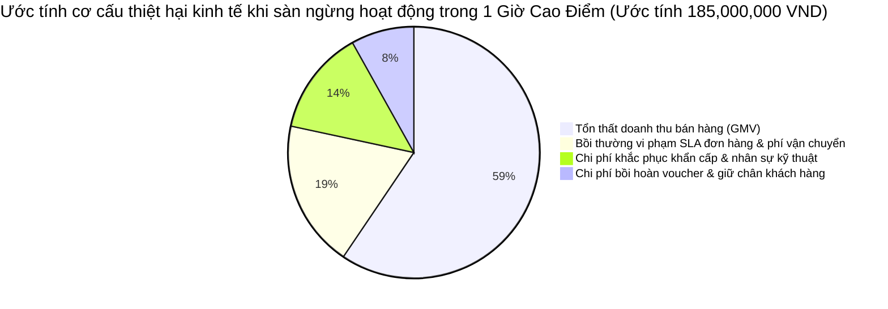
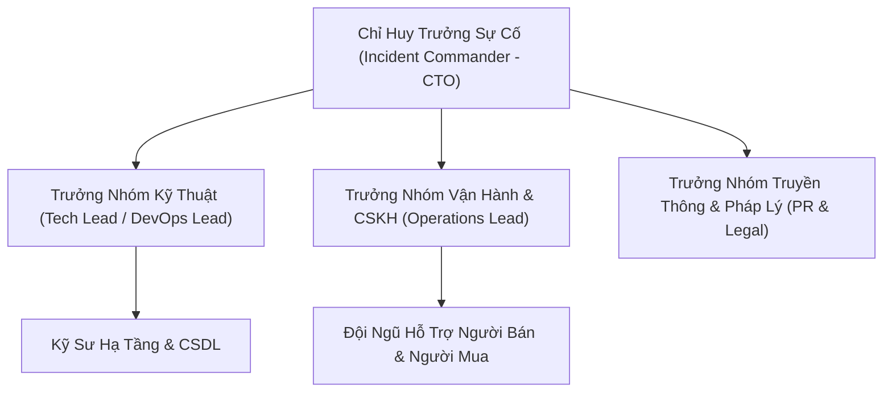

# KẾ HOẠCH DỰ PHÒNG THẢM HỌA VÀ DUY TRÌ HOẠT ĐỘNG KINH DOANH LIÊN TỤC (BCP & DRP)
## BUSINESS CONTINUITY PLAN (BCP) & DISASTER RECOVERY PLAN (DRP)
### HỆ THỐNG THƯƠNG MẠI ĐIỆN TỬ MINI SHOPEE MULTI-VENDOR ENTERPRISE

---

| **Mã tài liệu** | BCP-DRP-MINISHOPEE-V2.0 |
|---|---|
| **Tiêu chuẩn quốc tế** | ISO 22301:2019 (BCMS), ISO/IEC 27031:2011, NIST SP 800-34 Rev. 1 |
| **Chỉ số phục hồi cam kết** | **RPO $\le 5$ Phút** \| **RTO $\le 15$ Phút** \| **Uptime $\ge 99.95\%$** |
| **Cơ quan phê duyệt** | Ban An toàn Thông tin & Ủy ban Quản lý Khẩn cấp (ERT) |
| **Hiệu lực thi hành** | 24/10/2026 - 24/10/2027 (Rà soát và diễn tập định kỳ 6 tháng/lần) |

---

## MỤC LỤC TỔNG QUAN

1. [MỤC ĐÍCH VÀ PHẠM VI ÁP DỤNG](#1-mục-đích-và-phạm-vi-áp-dụng)
2. [PHÂN TÍCH TÁC ĐỘNG KINH DOANH (BUSINESS IMPACT ANALYSIS - BIA)](#2-phân-tích-tác-động-kinh-doanh-business-impact-analysis---bia)
3. [CHỈ SỐ PHỤC HỒI MỤC TIÊU (RPO & RTO) CHO CÁC HỆ THỐNG CON](#3-chỉ-số-phục-hồi-mục-tiêu-rpo--rto-cho-các-hệ-thống-con)
4. [KIẾN TRÚC DỰ PHÒNG THẢM HỌA ĐA VÙNG (MULTI-REGION HA ARCHITECTURE)](#4-kiến-trúc-dự-phòng-thảm-họa-đa-vùng-multi-region-ha-architecture)
5. [KỊCH BẢN VÀ QUY TRÌNH ỨNG PHÓ THẢM HỌA CHI TIẾT (PLAYBOOKS)](#5-kịch-bản-và-quy-trình-ứng-phó-thảm-họa-chi-tiết-playbooks)
   - [5.1. Kịch bản 1: Mất điện toàn bộ Data Center hoặc cô lập kết nối vật lý](#51-kịch-bản-1-mất-điện-toàn-bộ-data-center-hoặc-cô-lập-kết-nối-vật-lý)
   - [5.2. Kịch bản 2: Tấn công từ chối dịch vụ phân tán quy mô lớn (DDoS $\ge 50\text{ Gbps}$)](#52-kịch-bản-2-tấn-công-từ-chối-dịch-vụ-phân-tán-quy-mô-lớn-ddos-ge-50text-gbps)
   - [5.3. Kịch bản 3: Mã độc tống tiền (Ransomware) hoặc xóa nhầm CSDL sản xuất](#53-kịch-bản-3-mã-độc-tống-tiền-ransomware-hoặc-xóa-nhầm-csdl-sản-xuất)
   - [5.4. Kịch bản 4: Đứt cáp quang biển quốc tế ảnh hưởng CDN và AI Gateway](#54-kịch-bản-4-đứt-cáp-quang-biển-quốc-tế-ảnh-hưởng-cdn-và-ai-gateway)
6. [CƠ CẤU BAN CHỈ HUY KHẨN CẤP VÀ KÊNH THÔNG TIN LIÊN LẠC](#6-cơ-cấu-ban-chỉ-huy-khẩn-cấp-và-kênh-thông-tin-liên-lạc)
7. [QUY TRÌNH DIỄN TẬP PHỤC HỒI THẢM HỌA ĐỊNH KỲ (DR DRILL SIMULATION)](#7-quy-trình-diễn-tập-phục-hồi-thảm-họa-định-kỳ-dr-drill-simulation)

---

## 1. MỤC ĐÍCH VÀ PHẠM VI ÁP DỤNG

### 1.1. Mục đích
Tài liệu này xác định toàn bộ chính sách, quy trình công nghệ, cấu trúc tổ chức và các hành động khẩn cấp nhằm bảo đảm tính liên tục của hệ thống thương mại điện tử **Mini Shopee Multi-Vendor** khi xảy ra các biến cố thảm họa tự nhiên (hỏa hoạn, động đất, lụt lội), sự cố hạ tầng kỹ thuật (mất điện lưới diện rộng, sự cố cáp viễn thông), tấn công an ninh mạng có chủ đích (DDoS, Ransomware, APT) hoặc lỗi thao tác con người.

### 1.2. Phạm vi bảo vệ
- **Hạ tầng máy chủ ứng dụng**: Cụm Docker Containers, Node.js API Service, Nginx Load Balancers.
- **Tầng dữ liệu và kho lưu trữ**: Cơ sở dữ liệu nghiệp vụ, bản sao lưu Atomic Persistence, nhật ký kiểm toán tài chính Merkle Tree Ledger.
- **Dịch vụ tích hợp bên thứ ba**: Cổng thanh toán VietQR đa ngân hàng, hệ thống định tuyến đơn vị vận chuyển SPX Express, dịch vụ hạ tầng mạng DNS/CDN.

---

## 2. PHÂN TÍCH TÁC ĐỘNG KINH DOANH (BUSINESS IMPACT ANALYSIS - BIA)

Khi hệ thống sàn TMĐT ngừng hoạt động (Downtime), các tổn thất không chỉ dừng lại ở mặt kỹ thuật mà gây thiệt hại trực tiếp và nghiêm trọng về tài chính, uy tín thương hiệu và pháp lý.



### Bảng phân tích mức độ nghiêm trọng theo thời gian gián đoạn:

| Thời gian gián đoạn | Tác động tài chính | Tác động vận hành & Khách hàng | Tác động pháp lý & Tuân thủ | Phân loại khẩn cấp |
|---|---|---|---|:---:|
| **$0 - 5$ Phút** | Không đáng kể ($< 5\text{ triệu VNĐ}$) | Người dùng tải lại trang (Retry) | Không | **Mức 1 (Thấp)** |
| **$5 - 15$ Phút** | Thiệt hại $\approx 25 - 45\text{ triệu VNĐ}$ | Gián đoạn thanh toán VietQR, giỏ hàng đơ | Chậm trễ xác nhận đơn hàng | **Mức 2 (Trung bình)** |
| **$15 - 60$ Phút** | Thiệt hại $\approx 185\text{ triệu VNĐ}$ | Người bán khiếu nại, hủy đơn hàng loạt | Nguy cơ vi phạm cam kết SLA | **Mức 3 (Cao)** |
| **$> 1$ Giờ** | Thiệt hại $> 500\text{ triệu VNĐ}$ | Tẩy chay diện rộng, ảnh hưởng niềm tin | Bị phạt hợp đồng, thanh tra cơ quan quản lý | **Mức 4 (Thảm họa)** |

---

## 3. CHỈ SỐ PHỤC HỒI MỤC TIÊU (RPO & RTO) CHO CÁC HỆ THỐNG CON

- **RPO (Recovery Point Objective)**: Lượng dữ liệu tối đa chấp nhận mất mát tính theo đơn vị thời gian.
- **RTO (Recovery Time Objective)**: Thời gian tối đa cho phép khôi phục toàn bộ dịch vụ kể từ khi phát hiện thảm họa.

| Hệ thống con / Dữ liệu trọng yếu | RPO Mục tiêu | RTO Mục tiêu | Cơ chế dự phòng & Khôi phục |
|---|:---:|:---:|---|
| **Sổ cái tài chính (Double-Entry Ledger & Merkle Root)** | **$0$ Giây** (Zero Data Loss) | **$\le 5$ Phút** | Ghi đồng thời vào Multi-Region Persistent Block Storage |
| **Đơn hàng & Giao dịch thanh toán VietQR** | **$\le 1$ Phút** | **$\le 10$ Phút** | WAL (Write-Ahead Logging) + Đồng bộ luồng thời gian thực |
| **Danh mục sản phẩm, Tồn kho Flash Sale** | **$\le 5$ Phút** | **$\le 10$ Phút** | Snapshot JSON định kỳ 5 phút + OCC Version Rollback |
| **Thông tin tài khoản & Hồ sơ gian hàng** | **$\le 5$ Phút** | **$\le 15$ Phút** | Daily PITR Backup + Real-time Event Replication |
| **Lịch sử định vị đơn hàng SPX Live Tracking** | **$\le 15$ Phút** | **$\le 20$ Phút** | Tái tạo lộ trình từ nhật ký trạm trung chuyển SPX |
| **Bộ nhớ đệm LRU Cache & Phiên làm việc tạm** | **Không áp dụng** | **$\le 2$ Phút** | Tự động làm mới và nạp lại nóng từ cơ sở dữ liệu gốc |

---

## 4. KIẾN TRÚC DỰ PHÒNG THẢM HỌA ĐA VÙNG (MULTI-REGION HA ARCHITECTURE)

Dự án áp dụng mô hình kiến trúc **Active-Standby Hot Site (Warm Standby)** giữa hai Trung tâm dữ liệu (Data Center) độc lập về địa lý (DC Hà Nội và DC TP. Hồ Chí Minh):

```mermaid
flowchart TD
    DNS["Cloudflare Anycast Global DNS (Auto Health Check 5s)"] -->|Primary Route| DC1["Trung Tâm Dữ Liệu Chính - DC1 (Hà Nội - Active)"]
    DNS -.->|Failover Route khi DC1 Offline| DC2["Trung Tâm Dữ Liệu Dự Phòng - DC2 (TP.HCM - Standby)"]
    
    subgraph DC1["Hạ Tầng DC1 (Primary)"]
        LB1["Nginx High-Performance Ingress"] --> App1["Cụm Node.js Microservices"]
        App1 --> Store1["Persistent Atomic Store (Active)"]
    end
    
    subgraph DC2["Hạ Tầng DC2 (Hot Standby)"]
        LB2["Nginx Ingress (Standby)"] --> App2["Cụm Node.js Microservices (Standby)"]
        App2 --> Store2["Persistent Atomic Store (Replicated)"]
    end
    
    Store1 ==>|Kênh truyền riêng VPN 10Gbps (Async Sync $\le 300\text{ms}$)| Store2
```

### 4.1. Cơ chế chuyển vùng tự động (Automated DNS Failover)
- Bộ giám sát Anycast DNS liên tục gửi yêu cầu kiểm tra sức khỏe (`GET /api/health`) tới DC1 mỗi 5 giây với ngưỡng timeout 2 giây.
- Nếu DC1 không phản hồi liên tiếp 3 lần (15 giây), hệ thống DNS tự động cập nhật bản ghi định tuyến chuyển 100% lưu lượng truy cập sang IP của DC2.
- Đồng thời kích hoạt webhook khẩn cấp gửi tin nhắn cảnh báo tới kênh Telegram và SMS của Ban Chỉ huy Khẩn cấp.

---

## 5. KỊCH BẢN VÀ QUY TRÌNH ỨNG PHÓ THẢM HỌA CHI TIẾT (PLAYBOOKS)

### 5.1. Kịch bản 1: Mất điện toàn bộ Data Center hoặc cô lập kết nối vật lý
- **Triệu chứng**: Toàn bộ máy chủ tại DC1 ngắt kết nối đồng loạt; DNS Health Check trả về lỗi kết nối mạng.
- **Quy trình xử lý khẩn cấp**:
  1. *Phút 0 - 1*: Hệ thống giám sát kích hoạt báo động Đỏ; Cloudflare tự động chuyển hướng truy cập sang DC2.
  2. *Phút 1 - 3*: Kỹ sư trực ca xác nhận trạng thái sự cố tại DC1 thông qua kênh Out-of-band Management (IPMI/iLO).
  3. *Phút 3 - 5*: Ban điều hành kích hoạt trạng thái "DC2 Production Primary"; chuyển kho dữ liệu DC2 từ chế độ Read-Only sang Read-Write.
  4. *Phút 5 - 10*: Kiểm tra tính toàn vẹn của chuỗi băm Merkle Tree Ledger trên DC2; bảo đảm không có giao dịch thanh toán nào bị kẹt.
  5. *Phút 10 - 15*: Dịch vụ khôi phục 100% chức năng đặt hàng và thanh toán trên hạ tầng DC2. Đạt mục tiêu RTO $\le 15$ phút.

### 5.2. Kịch bản 2: Tấn công từ chối dịch vụ phân tán quy mô lớn (DDoS $\ge 50\text{ Gbps}$)
- **Triệu chứng**: Băng thông mạng chạm trần; CPU Nginx tăng vọt lên 100%; tỷ lệ request lỗi 502/504 tăng đột biến.
- **Quy trình xử lý khẩn cấp**:
  1. Kích hoạt tính năng **Cloudflare Under Attack Mode** (kiểm tra JavaScript Challenge và Captcha đối với toàn bộ IP bất thường).
  2. Kích hoạt lớp thuật toán **Token Bucket Rate Limiting** tại tầng ứng dụng: Siết chặt hạn mức xuống 10 req/phút đối với các endpoint nhạy cảm (`/api/orders`, `/api/chat`, `/api/auth`).
  3. Cách ly các luồng lưu lượng quốc tế không rõ nguồn gốc thông qua quy tắc Geo-Blocking, chỉ cho phép dải IP nội địa Việt Nam truy cập trong thời gian đỉnh điểm.
  4. Bật cơ chế ngắt mạch **Circuit Breaker** đối với các API bên ngoài để bảo vệ hệ thống cốt lõi khỏi sự cố quá tải dây chuyền.

### 5.3. Kịch bản 3: Mã độc tống tiền (Ransomware) hoặc xóa nhầm CSDL sản xuất
- **Triệu chứng**: File dữ liệu bị mã hóa hoặc bị xóa đột ngột; lệnh ghi nhận lỗi filesystem.
- **Quy trình xử lý khẩn cấp**:
  1. **Cô lập lập tức (Zero-Hour Quarantine)**: Ngắt kết nối mạng của máy chủ bị nhiễm mã độc ra khỏi cụm mạng nội bộ để chống lây lan.
  2. **Khai thác kho lưu trữ bất biến (WORM Storage)**: Bản sao lưu dự phòng định kỳ được lưu trữ trên kho lưu trữ đám mây có chính sách *Write Once Read Many* (WORM) và Object Lock, ngăn chặn hoàn toàn khả năng bị xóa hay mã hóa đè bởi Ransomware.
  3. **Khôi phục thời điểm (PITR)**: Kéo bản sao lưu gần nhất trước thời điểm bị tấn công (độ lệch $\le 5$ phút), xác thực chữ ký SHA-256 của bản sao lưu và nạp lại vào máy chủ sạch mới được cấp phát.
  4. Chạy bộ kiểm thử tự động `npm test` trên môi trường sạch trước khi mở lại kết nối cho người dùng.

### 5.4. Kịch bản 4: Đứt cáp quang biển quốc tế ảnh hưởng CDN và AI Gateway
- **Triệu chứng**: Tốc độ tải tài nguyên tĩnh (ảnh, icon) và thời gian phản hồi của Trợ lý AI tăng cao bất thường ($> 5\text{ giây}$).
- **Quy trình xử lý khẩn cấp**:
  1. Chuyển đổi định tuyến CDN sang các điểm hiện diện (PoP) nội địa tại Hà Nội, Đà Nẵng và TP.HCM.
  2. Kích hoạt phân hệ **Local Rule-Based AI Engine** chạy hoàn toàn trên máy chủ nội bộ (với 250 quy tắc Admin, 98 quy tắc Seller, 91 quy tắc Buyer) thay thế cho việc gọi API Gemini qua đường truyền quốc tế.
  3. Đảm bảo toàn bộ trải nghiệm mua bán, giỏ hàng, đặt hàng và đối soát vận hành thông suốt mà không phụ thuộc vào kết nối ra nước ngoài.

---

## 6. CƠ CẤU BAN CHỈ HUY KHẨN CẤP VÀ KÊNH THÔNG TIN LIÊN LẠC



### Danh bạ đường dây nóng khẩn cấp (Emergency Hotline 24/7/365):
- **Chỉ huy trưởng sự cố (Incident Commander)**: `hotline-commander@minishopee.local` \| Hotline: `0901-XXX-001`
- **Kỹ sư trưởng hạ tầng DevOps (DevOps Lead)**: `devops-alert@minishopee.local` \| Hotline: `0901-XXX-002`
- **Trực ban An toàn Thông tin (SOC / CSIRT 24/7)**: `soc-incident@minishopee.local` \| Hotline: `0901-XXX-003`

---

## 7. QUY TRÌNH DIỄN TẬP PHỤC HỒI THẢM HỌA ĐỊNH KỲ (DR DRILL SIMULATION)

Để bảo đảm Kế hoạch Dự phòng Thảm họa luôn phát huy hiệu quả thực tế và không mang tính hình thức, dự án quy định chế độ diễn tập định kỳ:
1. **Tần suất**: Bắt buộc tổ chức 06 tháng/lần vào các khung giờ thấp điểm (02:00 AM - 04:00 AM ngày Chủ nhật).
2. **Nội dung diễn tập**: Giả lập kịch bản sập toàn bộ máy chủ chính (DC1) mà không báo trước cho đội ngũ trực ca kỹ thuật; bấm giờ thực tế từ lúc phát hiện cảnh báo đến khi DC2 tiếp quản hoàn toàn và người dùng đặt hàng bình thường.
3. **Tiêu chuẩn đạt yêu cầu**:
   - Thời gian RTO thực tế đo được $\le 15$ phút.
   - Dữ liệu giao dịch khớp $100\%$ không mất mát (RPO $\le 5$ phút).
   - Có biên bản tổng kết diễn tập (Post-Mortem Report) được ký xác nhận bởi đại diện Khách hàng và Trưởng ban An toàn thông tin.

---

*Kế hoạch BCP & DRP này là cam kết sinh mệnh kỹ thuật, bảo đảm sự an toàn của dòng tiền, dữ liệu và uy tín kinh doanh của Khách hàng trước mọi biến cố khách quan.*
