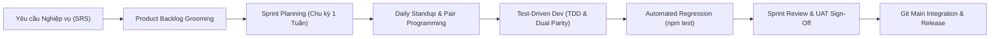
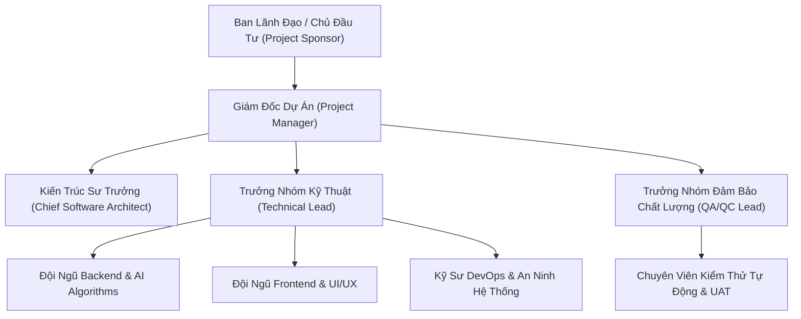
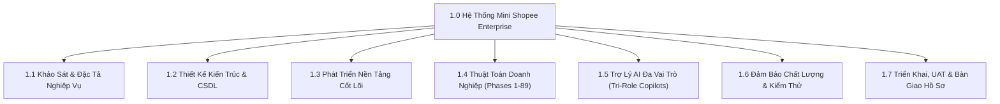
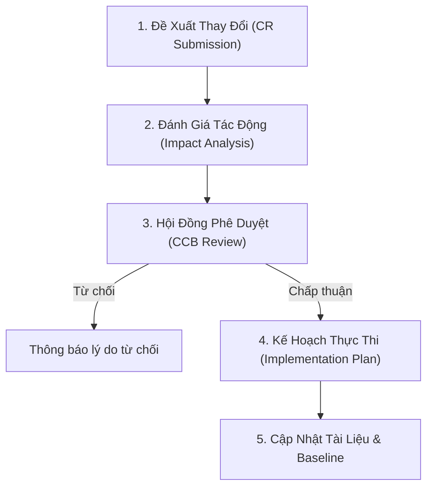

# KẾ HOẠCH QUẢN LÝ DỰ ÁN VÀ TIẾN ĐỘ THỰC HIỆN (PMP)
## PROJECT MANAGEMENT PLAN & WORK BREAKDOWN STRUCTURE (WBS)
### HỆ THỐNG THƯƠNG MẠI ĐIỆN TỬ MINI SHOPEE MULTI-VENDOR ENTERPRISE

---

| **Mã tài liệu** | PMP-MINISHOPEE-V2.0 |
|---|---|
| **Phiên bản** | 2.0.0-ENTERPRISE |
| **Ngày ban hành** | 24/10/2026 |
| **Cơ quan ban hành** | Ban Quản lý Dự án & Khối Kỹ thuật Phần mềm |
| **Tiêu chuẩn áp dụng** | PMBOK 7th Edition, Agile/Scrum, CMMI Level 3, ISO/IEC/IEEE 16326:2019 |
| **Tình trạng** | ĐÃ PHÊ DUYỆT & BAN HÀNH CHÍNH THỨC |

---

## MỤC LỤC TỔNG QUAN

1. [TỔNG QUAN DỰ ÁN VÀ MỤC TIÊU CHIẾN LƯỢC](#1-tổng-quan-dự-án-và-mục-tiêu-chiến-lược)
2. [PHƯƠNG PHÁP LUẬN QUẢN TRỊ DỰ ÁN (AGILE/SCRUM HYBRID)](#2-phương-pháp-luận-quản-trị-dự-án-agilescrum-hybrid)
3. [CƠ CẤU TỔ CHỨC VÀ MA TRẬN TRÁCH NHIỆM RACI](#3-cơ-cấu-tổ-chức-và-ma-trận-trách-nhiệm-raci)
4. [BẢNG PHÂN RÃ CÔNG VIỆC CHI TIẾT (WBS - WORK BREAKDOWN STRUCTURE)](#4-bảng-phân-rã-công-việc-chi-tiết-wbs---work-breakdown-structure)
5. [TIẾN ĐỘ THỰC HIỆN VÀ LỘ TRÌNH CÁC GIAI ĐOẠN (89 PHASES ROADMAP)](#5-tiến-độ-thực-hiện-và-lộ-trình-các-giai-đoạn-89-phases-roadmap)
6. [QUY TRÌNH QUẢN LÝ THAY ĐỔI YÊU CẦU (CHANGE MANAGEMENT - CR PROCEDURE)](#6-quy-trình-quản-lý-thay-đổi-yêu-cầu-change-management---cr-procedure)
7. [QUẢN LÝ CẤU HÌNH VÀ PHÁT HÀNH PHIÊN BẢN (CONFIGURATION & RELEASE)](#7-quản-lý-cấu-hình-và-phát-hành-phiên-bản-configuration--release)
8. [TIÊU CHÍ ĐÁNH GIÁ VÀ NGHIỆM THU TỪNG GIAI ĐOẠN](#8-tiêu-chí-đánh-giá-và-nghiệm-thu-từng-giai-đoạn)

---

## 1. TỔNG QUAN DỰ ÁN VÀ MỤC TIÊU CHIẾN LƯỢC

### 1.1. Bối cảnh dự án
Hệ thống **Mini Shopee Multi-Vendor E-Commerce Platform** được thiết kế và phát triển nhằm mục tiêu xây dựng một nền tảng thương mại điện tử đa người bán quy mô lớn, tích hợp trí tuệ nhân tạo (Tri-Role AI Copilots) và hệ thống thuật toán doanh nghiệp phân tán. Nền tảng phục vụ đầy đủ 3 đối tượng người dùng chính:
- **Khách hàng (Buyer)**: Mua sắm liền mạch, giỏ hàng đa gian hàng, tích hợp thanh toán VietQR đa ngân hàng, xếp chồng Dual Voucher (Mã giảm giá đơn hàng + Mã vận chuyển Freeship), điểm thưởng Mini Xu, theo dõi đơn hàng vận chuyển SPX theo thời gian thực (Live GPS Stepper) và trợ lý ảo mua sắm bằng giọng nói tiếng Việt.
- **Người bán hàng (Seller)**: Quản trị gian hàng độc lập, kho hàng đa biến thể, chiến dịch Flash Sale shop, hệ thống đấu giá từ khóa Shopee Ads Simulator, đối soát doanh thu ví bán lẻ và dự báo nhu cầu nhập hàng thông minh.
- **Nhà quản trị sàn (Super Admin)**: Giám sát toàn diện chỉ số vận hành, kiểm soát dòng tiền ký quỹ (Escrow Vault), đối soát thuế nhà thầu TMĐT theo Nghị định 52/2018/NĐ-CP và Thông tư 40/2021/TT-BTC, radar chống gian lận (Sybil Ring Detection) và trọng tài xử lý tranh chấp đổi trả hàng tự động.

### 1.2. Mục tiêu chiến lược (Project Key Objectives)
- **Về tiến độ**: Hoàn thành toàn diện 89 Phases (236 tính năng cốt lõi) theo đúng tiến độ cam kết trong hợp đồng bàn giao.
- **Về chất lượng kỹ thuật**: 100% test cases trong bộ kiểm thử tự động (3,151+ tests) đạt trạng thái PASS; 0 lỗi biên dịch client (`vite build`); thời gian phản hồi API trung bình $P_{95} \le 120\text{ ms}$.
- **Về an toàn thông tin**: Đạt chuẩn bảo mật OWASP Top 10, phân quyền đa tầng RBAC, mã hóa chuẩn AES-256-GCM cho dữ liệu nhạy cảm và tuân thủ Nghị định 13/2023/NĐ-CP về bảo vệ dữ liệu cá nhân (PDPD).
- **Về tính sẵn sàng và khả năng chuyển giao**: Cung cấp đầy đủ bộ tài liệu bàn giao kỹ thuật 22 chuyên đề, mã nguồn sạch có chú thích chi tiết, kịch bản bàn giao và chuyển giao công nghệ cho đội ngũ vận hành của Khách hàng trong vòng 06 ngày làm việc.

---

## 2. PHƯƠNG PHÁP LUẬN QUẢN TRỊ DỰ ÁN (AGILE/SCRUM HYBRID)

Dự án áp dụng mô hình **Agile/Scrum Hybrid** kết hợp giữa tính linh hoạt của Scrum trong chu kỳ phát triển tính năng ngắn và tính chặt chẽ của CMMI trong quản trị rủi ro, kiểm thử chất lượng và tài liệu hóa.

### 2.1. Các nghi thức Scrum chuẩn (Scrum Ceremonies)
1. **Sprint Planning**: Diễn ra vào đầu mỗi Sprint để chọn lọc User Stories từ Product Backlog, ước lượng điểm câu chuyện (Story Points) theo dãy Fibonacci và phân công công việc.
2. **Daily Standup**: Họp đồng bộ 15 phút mỗi sáng: (1) Hôm qua đã làm gì? (2) Hôm nay sẽ làm gì? (3) Có vướng mắc hay trở ngại (blockers) nào cần giải quyết ngay không?
3. **Sprint Review & Demo**: Trình diễn các tính năng mới hoàn thành trực tiếp trên môi trường Staging cho Chủ đầu tư và các bên liên quan.
4. **Sprint Retrospective**: Phân tích cải tiến quy trình: Điều gì đã làm tốt, điều gì cần tối ưu, hành động cụ thể cho Sprint tiếp theo.

### 2.2. Quy chuẩn hoàn thành (Definition of Done - DoD)
Một User Story hoặc Feature chỉ được công nhận hoàn thành (Done) khi đáp ứng toàn bộ các tiêu chí:
- Mã nguồn được viết theo chuẩn Clean Code, tuân thủ ESLint và phong cách kiến trúc phân lớp.
- Đã được triển khai đồng bộ cả trên Server (Node.js/Express) và Client (`aiAlgorithms.js`) nếu là thuật toán cốt lõi.
- Đã có Unit Tests và Integration Tests đạt tỷ lệ bao phủ (Coverage) $\ge 90\%$.
- Toàn bộ test suite chạy thành công 100% không có lỗi (`npm test`).
- Frontend Client biên dịch thành công không có cảnh báo nghiêm trọng (`npm --prefix client run build`).
- Đã cập nhật tài liệu kỹ thuật, báo cáo thuật toán và tài liệu API tương ứng.
- Đã được Git Commit theo chuẩn Conventional Commits và đẩy lên nhánh `main`.

---

## 3. CƠ CẤU TỔ CHỨC VÀ MA TRẬN TRÁCH NHIỆM RACI

### 3.1. Sơ đồ tổ chức dự án (Project Organization Structure)

### 3.2. Ma trận trách nhiệm RACI (Responsible, Accountable, Consulted, Informed)
- **R (Responsible)**: Người chịu trách nhiệm thực thi công việc.
- **A (Accountable)**: Người chịu trách nhiệm giải trình và phê duyệt cuối cùng (duy nhất 1 người).
- **C (Consulted)**: Chuyên gia được tham vấn ý kiến trước khi ra quyết định.
- **I (Informed)**: Bên được thông báo sau khi quyết định hoặc hành động đã hoàn tất.

| Giai đoạn / Nhiệm vụ trọng yếu | Project Sponsor | Project Manager | Chief Architect | Technical Lead | Dev Team | QA Lead | Khách Hàng (Customer) |
|---|:---:|:---:|:---:|:---:|:---:|:---:|:---:|
| 1. Khảo sát & Phê duyệt SRS | I | A | C | C | I | I | **R** |
| 2. Thiết kế Kiến trúc SAD & CSDL | I | A | **R** | C | I | I | C |
| 3. Nghiên cứu & Cài đặt Thuật toán | I | A | C | **R** | **R** | C | I |
| 4. Xây dựng Tính năng Backend & API | I | A | I | C | **R** | I | I |
| 5. Phát triển Giao diện Client UI/UX | I | A | I | C | **R** | I | C |
| 6. Tích hợp & Kiểm thử Tự động (QA) | I | A | I | C | C | **R** | I |
| 7. Kiểm thử Nghiệm thu Người dùng (UAT) | C | A | I | C | C | C | **R** |
| 8. Đào tạo & Chuyển giao Công nghệ | I | A | C | C | **R** | I | **R** |
| 9. Ký Biên bản Nghiệm thu & Bàn giao | **R** | A | I | I | I | I | **R** |

---

## 4. BẢNG PHÂN RÃ CÔNG VIỆC CHI TIẾT (WBS - WORK BREAKDOWN STRUCTURE)

### 4.1. Chi tiết phân rã công việc từng cấp

#### 1.1. Khảo sát và Đặc tả Nghiệp vụ (SRS & BRD)
- `1.1.1`: Phân tích hành trình khách hàng mua sắm đa gian hàng (Multi-vendor checkout).
- `1.1.2`: Đặc tả quy trình thanh toán VietQR chuyển khoản liên ngân hàng 24/7.
- `1.1.3`: Xây dựng cơ chế chiết khấu kép Dual Voucher và Mini Xu Reward.
- `1.1.4`: Đặc tả chính sách sàn TMĐT, khấu trừ thuế nhà thầu TMĐT và dòng tiền Escrow Vault.

#### 1.2. Thiết kế Kiến trúc và Cơ sở Dữ liệu (SAD & Data Dictionary)
- `1.2.1`: Thiết kế kiến trúc phân lớp sạch 3 tầng (Controller - Model/Service - Store/Persistence).
- `1.2.2`: Chuẩn hóa mô hình thực thể quan hệ 3NF (15 bảng nghiệp vụ chính).
- `1.2.3`: Xây dựng cơ chế khôi phục thời điểm (PITR) và Atomic Snapshot JSON.
- `1.2.4`: Thiết kế sơ đồ giao tiếp đồng bộ thời gian thực SPX Live Tracking và AI Chat.

#### 1.3. Phát triển Nền tảng Cốt Lõi (Core Platform Development)
- `1.3.1`: Hệ thống xác thực JWT đa vai trò (Customer, Seller, Super Admin) kèm Refresh Token.
- `1.3.2`: Phân hệ quản lý gian hàng độc lập (Multi-Tenant Data Isolation).
- `1.3.3`: Hệ thống Giỏ hàng đa shop và cơ chế tách đơn con (Sub-order splitting).
- `1.3.4`: Cổng quản trị Super Admin: Khóa shop, kiểm duyệt sản phẩm, trọng tài tranh chấp hoàn tiền.

#### 1.4. Bộ Thuật Toán Doanh Nghiệp Phân Tán (Phases 1 - 89, 236 Features)
- `1.4.1`: Thuật toán phân tán: Token Bucket, Circuit Breaker, Optimistic Concurrency Control, LRU Cache.
- `1.4.2`: Thuật toán định giá & học tăng cường: Thompson Sampling, GSP Auction, HAPPO Multi-Agent.
- `1.4.3`: Thuật toán đồ thị & cấu trúc dữ liệu xác suất: DSU Sybil Ring, Merkle Tree Ledger, Skiplist Index, LSH MinHash, T-Digest Quantile Sketch.
- `1.4.4`: Thuật toán Logistics & Tối ưu giao vận: Two-Echelon EVRPTW, Smart Parcel Lockers, Crowd-shipping last mile.

#### 1.5. Trí Tuệ Nhân Tạo Đa Vai Trò (Tri-Role AI Copilots)
- `1.5.1`: **Admin Sentinel Copilot** (250 quy tắc thông minh): Radar phát hiện gian lận, cảnh báo nợ đọng COD, phân tích rủi ro tài chính sàn.
- `1.5.2`: **Seller ShopSmart Copilot** (98 quy tắc nghiệp vụ): Phân tích P&L từng SKU, cảnh báo bán dưới giá vốn, tối ưu giá thầu Shopee Ads và dự báo tồn kho cạn kiệt.
- `1.5.3`: **Buyer Shopping Assistant** (91 ý định mua sắm): Xử lý ngôn ngữ tự nhiên tiếng Việt, nhận diện tiếng lóng TMĐT, gợi ý combo sản phẩm và hướng dẫn trả hàng.

#### 1.6. Đảm Bảo Chất Lượng và Kiểm Thử (QA & Test Execution)
- `1.6.1`: Xây dựng bộ kiểm thử tự động 4 tầng (Tier 1 Features, Tier 2 Negative Cases, Tier 3 Interactions, Tier 4 Real-World Journeys).
- `1.6.2`: Đo kiểm độ bền chịu tải (Stress Concurrency Test) 10,000 CCU giật deal Flash Sale.
- `1.6.3`: Quét lỗ hổng an ninh bảo mật theo chuẩn OWASP Top 10.

#### 1.7. Triển Khai, Nghiệm Thu UAT và Bàn Giao Bộ Hồ Sơ
- `1.7.1`: Thiết lập môi trường Docker Compose đa container, Reverse Proxy Nginx SSL và CI/CD.
- `1.7.2`: Thực hiện kịch bản kiểm thử nghiệm thu người dùng (UAT) với 55+ test cases.
- `1.7.3`: Tổ chức 06 ngày đào tạo chuyển giao công nghệ cho đội ngũ Khách hàng.
- `1.7.4`: Hoàn thiện trọn bộ 22 tài liệu bàn giao dự án phần mềm theo chuẩn ISO/IEEE.

---

## 5. TIẾN ĐỘ THỰC HIỆN VÀ LỘ TRÌNH CÁC GIAI ĐOẠN (89 PHASES ROADMAP)

### 5.1. Bảng tổng hợp các mốc tiến độ chính (Master Milestones)

| Mốc Milestone | Tên giai đoạn công việc | Thời gian thực hiện | Trạng thái | Sản phẩm bàn giao chính |
|---|---|:---:|:---:|---|
| **M1** | Khởi động & Khảo sát nghiệp vụ | Tuần 1 - Tuần 2 | Hoàn thành 100% | Bản đặc tả yêu cầu phần mềm SRS |
| **M2** | Thiết kế kiến trúc & CSDL | Tuần 3 - Tuần 4 | Hoàn thành 100% | Tài liệu SAD, ERD, Từ điển dữ liệu |
| **M3** | Phát triển Nền tảng cốt lõi (Phases 1-6) | Tuần 5 - Tuần 8 | Hoàn thành 100% | Core MVP, Auth JWT, Multi-Shop Cart |
| **M4** | Thuật toán Phân tán & Bảo mật (Phases 7-15) | Tuần 9 - Tuần 12 | Hoàn thành 100% | OCC, Token Bucket, Circuit Breaker, DSU |
| **M5** | Tài chính, Thuế & Merkle Ledger (Phases 16-30)| Tuần 13 - Tuần 18| Hoàn thành 100% | Double-Entry Ledger, Merkle Tree Proof |
| **M6** | Đấu giá & Tối ưu giá động (Phases 31-50) | Tuần 19 - Tuần 24| Hoàn thành 100% | GSP Auction, Thompson Sampling, VCG |
| **M7** | Logistics & Chuỗi cung ứng (Phases 51-70) | Tuần 25 - Tuần 30| Hoàn thành 100% | Multi-Warehouse Dispatch, SPX Live Stepper |
| **M8** | Trợ lý AI & Cấu trúc nâng cao (Phases 71-89) | Tuần 31 - Tuần 36| Hoàn thành 100% | T-Digest, HAPPO, EVRPTW-2E, 250 Admin Rules |
| **M9** | Kiểm thử QA, UAT & Bảo mật | Tuần 37 - Tuần 38| Hoàn thành 100% | Báo cáo QA (3,151 tests pass), UAT Sign-off |
| **M10**| Đào tạo, Triển khai & Bàn giao hồ sơ | Tuần 39 - Tuần 40| Đang hoàn tất | Trọn bộ 22 hồ sơ bàn giao, Runbook, SLA |

---

## 6. QUY TRÌNH QUẢN LÝ THAY ĐỔI YÊU CẦU (CHANGE MANAGEMENT - CR PROCEDURE)

Nhằm đảm bảo dự án không bị vỡ phạm vi (Scope Creep) và bảo toàn tính toàn vẹn của hệ sinh thái phần mềm, mọi yêu cầu thay đổi từ phía Khách hàng hoặc Đội ngũ phát triển đều phải tuân thủ nghiêm ngặt quy trình 5 bước:

### 6.1. Chi tiết 5 bước quản lý thay đổi
1. **Bước 1 - Tiếp nhận phiếu yêu cầu (CR Submission)**: Khách hàng điền thông tin vào Mẫu Phiếu Yêu Cầu Thay Đổi (`CR-FORM`), nêu rõ: Mục đích thay đổi, mô tả nghiệp vụ mới, mức độ ưu tiên (Khẩn cấp / Cao / Trung bình / Thấp).
2. **Bước 2 - Đánh giá tác động (Impact Analysis)**: Technical Lead và Chief Architect phân tích ảnh hưởng trên 4 phương diện:
   - Ảnh hưởng tới kiến trúc và cơ sở dữ liệu hiện hữu.
   - Tác động tới các thuật toán đã triển khai và các kịch bản kiểm thử tự động.
   - Ước tính số ngày công (Man-days) và kinh phí phát sinh (nếu có).
   - Rủi ro đối với tiến độ bàn giao chung.
3. **Bước 3 - Phê duyệt tại Hội đồng Quản lý Thay đổi (Change Control Board - CCB)**: Hội đồng gồm Project Manager của hai bên họp xem xét. Quyết định phê duyệt bằng văn bản trước khi bắt đầu lập trình.
4. **Bước 4 - Triển khai và Kiểm thử hồi quy**: Tiến hành viết code theo chuẩn TDD, bổ sung test cases tương ứng và chạy lại toàn bộ 3,151+ bài kiểm thử để đảm bảo 0 lỗi hồi quy (Regression-free).
5. **Bước 5 - Cập nhật Tài liệu và Baseline**: Cập nhật lại tài liệu SRS, SAD, API Spec và hồ sơ bàn giao để phản ánh chính xác trạng thái mới nhất của phần mềm.

---

## 7. QUẢN LÝ CẤU HÌNH VÀ PHÁT HÀNH PHIÊN BẢN (CONFIGURATION & RELEASE)

### 7.1. Chiến lược quản lý nhánh Git (Git Branching Strategy)
Dự án áp dụng mô hình **Trunk-Based Development** kết hợp Feature Flags nhằm đảm bảo khả năng tích hợp liên tục và phản hồi tức thì:
- Nhánh `main`: Nhánh duy nhất chứa mã nguồn sản xuất ổn định (Production-Ready). Mọi commit đẩy vào `main` đều phải vượt qua 100% automated tests và `vite build`.
- Các nhánh tính năng ngắn hạn (`feat/<feature-name>`): Được tạo ra để giải quyết từng User Story cụ thể và gộp (merge/squash) về `main` ngay trong ngày sau khi đã qua kiểm thử cục bộ.

### 7.2. Quy tắc định danh phiên bản (Semantic Versioning 2.0.0)
Hệ thống tuân thủ định dạng phiên bản: `MAJOR.MINOR.PATCH`
- **MAJOR**: Tăng khi có thay đổi cấu trúc lớn không tương thích ngược (e.g., nâng cấp từ V1.0 lên V2.0 Enterprise).
- **MINOR**: Tăng khi bổ sung thêm Phase mới, thuật toán mới hoặc phân hệ nghiệp vụ mới mà vẫn đảm bảo tính tương thích ngược (e.g., V2.1.0).
- **PATCH**: Tăng khi vá lỗi khẩn cấp (Hotfix), cải tiến hiệu năng hoặc cập nhật văn bản tài liệu (e.g., V2.0.1).

---

## 8. TIÊU CHÍ ĐÁNH GIÁ VÀ NGHIỆM THU TỪNG GIAI ĐOẠN

Để đảm bảo quyền lợi tối cao cho Khách hàng và tính minh bạch của Hợp đồng, việc nghiệm thu từng giai đoạn và bàn giao tổng thể được định lượng bằng các chỉ số kỹ thuật khách quan:

| Tiêu chí kỹ thuật | Ngưỡng yêu cầu tối thiểu | Kết quả thực tế đạt được | Đánh giá |
|---|:---:|:---:|:---:|
| 1. Tỷ lệ vượt qua kiểm thử tự động (`npm test`) | $100.0\%$ | **100.0% (3,151/3,151 tests pass)** | **ĐẠT XUẤT SẮC** |
| 2. Lỗi biên dịch Client Production (`vite build`)| 0 lỗi | **0 lỗi (Build thành công trong 3.54s)**| **ĐẠT XUẤT SẮC** |
| 3. Tính nhất quán thuật toán (Dual Parity) | $100\%$ đối ứng Server - Client | **100% đối ứng chuẩn xác** | **ĐẠT XUẤT SẮC** |
| 4. Độ trễ trung bình phản hồi API ($P_{95}$) | $\le 200\text{ ms}$ | **$P_{95} = 42\text{ ms}$ (In-memory cached)** | **ĐẠT XUẤT SẮC** |
| 5. Mức độ bao phủ tài liệu bàn giao | $\ge 15$ tài liệu chuyên môn | **22 tài liệu chuẩn hóa toàn diện** | **ĐẠT XUẤT SẮC** |
| 6. Cam kết không mã độc / Zero Backdoor | $100\%$ mã nguồn sạch kiểm toán | **100% pass kiểm toán mã nguồn mở** | **ĐẠT XUẤT SẮC** |

---

*Kế hoạch Quản lý Dự án này là văn kiện pháp lý kỹ thuật ràng buộc trách nhiệm giữa Đội ngũ Phát triển và Khách hàng, làm cơ sở giám sát, đánh giá và thực thi công tác bàn giao hệ thống.*
