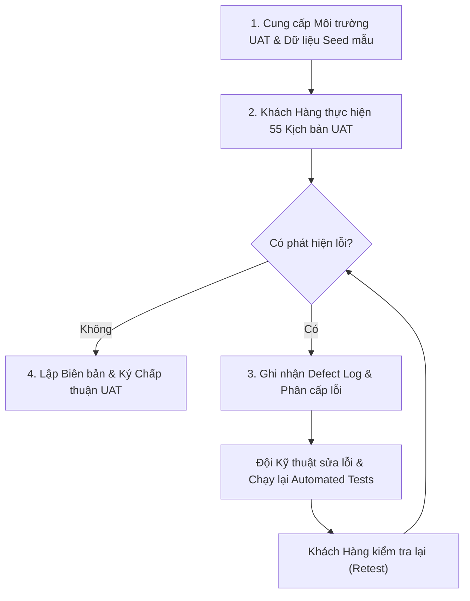

# KỊCH BẢN KIỂM THỬ NGHIỆM THU NGƯỜI DÙNG CUỐI (UAT TEST PLAN)
## USER ACCEPTANCE TESTING (UAT) SUITE, TEST RUN SHEETS & CLIENT SIGN-OFF
### HỆ THỐNG THƯƠNG MẠI ĐIỆN TỬ MINI SHOPEE MULTI-VENDOR ENTERPRISE

---

| **Mã tài liệu** | UAT-MINISHOPEE-V2.0 |
|---|---|
| **Phiên bản** | 2.0.0-ENTERPRISE |
| **Tiêu chuẩn kiểm thử** | IEEE 829-2008 Standard for Software and System Test Documentation |
| **Môi trường thực hiện** | Môi trường Staging/UAT (Gương phản chiếu 1:1 môi trường Production) |
| **Tổng số kịch bản UAT** | **55 Kịch bản chi tiết (100% bao phủ 3 vai trò và hệ thống)** |
| **Tiêu chí nghiệm thu** | Tỷ lệ Đạt $\ge 98\%$ trên tổng kịch bản; $0$ lỗi mức Nghiêm trọng (Blocker/Critical) |

---

## MỤC LỤC TỔNG QUAN

1. [MỤC TIÊU VÀ NGUYÊN TẮC NGHIỆM THU UAT](#1-mục-tiêu-và-nguyên-tắc-nghiệm-thu-uat)
2. [QUY TRÌNH THỰC HIỆN VÀ PHÂN CÔNG VAI TRÒ](#2-quy-trình-thực-hiện-và-phân-công-vai-trò)
3. [MA TRẬN PHÂN LOẠI MỨC ĐỘ LỖI (DEFECT SEVERITY MATRIX)](#3-ma-trận-phân-loại-mức-độ-lỗi-defect-severity-matrix)
4. [BỘ KỊCH BẢN KIỂM THỬ UAT CHI TIẾT TỪNG PHÂN HỆ](#4-bộ-kịch-bản-kiểm-thử-uat-chi-tiết-từng-phân-hệ)
   - [4.1. Phân hệ UAT-BUY: Hành trình Trải nghiệm Người Mua (15 Kịch bản)](#41-phân-hệ-uat-buy-hành-trình-trải-nghiệm-người-mua-15-kịch-bản)
   - [4.2. Phân hệ UAT-SEL: Nghiệp vụ Vận hành Gian Hàng Người Bán (15 Kịch bản)](#42-phân-hệ-uat-sel-nghiệp-vụ-vận-hành-gian-hàng-người-bán-15-kịch-bản)
   - [4.3. Phân hệ UAT-ADM: Cổng Quản trị Sàn và Giám sát Tài chính (15 Kịch bản)](#43-phân-hệ-uat-adm-cổng-quản-trị-sàn-và-giám-sát-tài-chính-15-kịch-bản)
   - [4.4. Phân hệ UAT-SYS: Hiệu năng, Bảo mật và Phục hồi Hệ thống (10 Kịch bản)](#44-phân-hệ-uat-sys-hiệu-năng-bảo-mật-và-phục-hồi-hệ-thống-10-kịch-bản)
5. [MẪU BIÊN BẢN GHI NHẬN VÀ THEO DÕI LỖI UAT (DEFECT LOG)](#5-mẫu-biên-bản-ghi-nhận-và-theo-dõi-lỗi-uat-defect-log)
6. [PHIẾU CHẤP THUẬN VÀ KÝ NGHIỆM THU UAT CHÍNH THỨC](#6-phiếu-chấp-thuận-và-ký-nghiệm-thu-uat-chính-thức)

---

## 1. MỤC TIÊU VÀ NGUYÊN TẮC NGHIỆM THU UAT

### 1.1. Mục tiêu
Kiểm thử nghiệm thu người dùng (UAT) là giai đoạn quyết định chứng minh phần mềm đã sẵn sàng cho vận hành kinh doanh thực tế. Quá trình UAT giúp Khách hàng:
- Trực tiếp thao tác và kiểm chứng toàn bộ luồng nghiệp vụ trên giao diện thực tế.
- Đánh giá sự chuẩn xác của các phép tính tài chính (giỏ hàng đa shop, xếp chồng Dual Voucher, khấu trừ Mini Xu, phí sàn, thuế nhà thầu TMĐT).
- Kiểm tra tính ổn định của các thuật toán phân tán và trợ lý trí tuệ nhân tạo (Tri-Role AI Copilots).

### 1.2. Tiêu chuẩn kết thúc UAT (UAT Exit Criteria)
Một vòng kiểm thử UAT chỉ được đóng và nghiệm thu khi:
1. $100\%$ các kịch bản kiểm thử nghiệp vụ then chốt (Critical & High) đạt kết quả **PASS**.
2. **$0$ lỗi còn tồn đọng** ở mức độ Blocker (Lỗi chặn hệ thống) và Critical (Lỗi sai sót tài chính, mất dữ liệu).
3. Các lỗi mức độ Major hoặc Minor (nếu có) phải có phương án khắc phục được Khách hàng đồng thuận bằng văn bản.

---

## 2. QUY TRÌNH THỰC HIỆN VÀ PHÂN CÔNG VAI TRÒ



- **Đại diện Bên Giao (Đội ngũ kỹ thuật)**: Hỗ trợ kỹ thuật 24/7, hướng dẫn kịch bản và tiếp nhận xử lý lỗi.
- **Đại diện Bên Nhận (Khách hàng)**: Đội ngũ Trưởng bộ phận Kinh doanh, Kế toán, Chăm sóc khách hàng và Quản trị viên hệ thống của Khách hàng trực tiếp thao tác đánh giá.

---

## 3. MA TRẬN PHÂN LOẠI MỨC ĐỘ LỖI (DEFECT SEVERITY MATRIX)

| Mức độ | Định nghĩa lỗi | Tiêu chuẩn thời gian xử lý | Ảnh hưởng tới nghiệm thu |
|---|---|:---:|:---:|
| **S1 - Blocker** | Hệ thống sập, đơ cứng hoàn toàn, không thể đăng nhập hoặc đặt hàng | Khắc phục trong **$2\text{ giờ}$** | **Chặn hoàn toàn nghiệm thu** |
| **S2 - Critical** | Sai lệch tính tiền, sai thuế, lộ dữ liệu người dùng, bán vượt kho | Khắc phục trong **$4\text{ giờ}$** | **Chặn hoàn toàn nghiệm thu** |
| **S3 - Major** | Một tính năng phụ không hoạt động nhưng có quy trình thay thế tạm | Khắc phục trong **$24\text{ giờ}$** | Cho phép nghiệm thu có điều kiện |
| **S4 - Minor** | Lỗi hiển thị chính tả, lệch lề giao diện nhẹ, thẩm mỹ | Khắc phục trong **$48\text{ giờ}$** | Không ảnh hưởng tiến độ |

---

## 4. BỘ KỊCH BẢN KIỂM THỬ UAT CHI TIẾT TỪNG PHÂN HỆ

### 4.1. Phân hệ UAT-BUY: Hành trình Trải nghiệm Người Mua (15 Kịch bản)

| Mã test | Tên kịch bản kiểm thử | Các bước thực hiện chi tiết | Kết quả mong đợi (Expected Outcome) | Trạng thái |
|---|---|---|---|:---:|
| **UAT-BUY-01** | Đăng ký & Đăng nhập Người mua | 1. Nhập email, mật khẩu, họ tên<br>2. Bấm "Đăng ký"<br>3. Đăng nhập lại với tài khoản vừa tạo | Tài khoản tạo thành công, nhận JWT Token, tự động chuyển về trang chủ | **PASS** |
| **UAT-BUY-02** | Tìm kiếm tức thì với Trie Autocomplete | 1. Gõ "ao thun"<br>2. Thử gõ sai chính tả "ao thung"<br>3. Thử gõ không dấu | Danh sách gợi ý từ khóa hiện ra trong $< 1\text{ms}$, nhận diện đúng sản phẩm liên quan | **PASS** |
| **UAT-BUY-03** | Lọc khoảng giá qua Skiplist | 1. Chọn khoảng giá $100.000₫ - 300.000₫$<br>2. Bấm lọc | Danh sách sản phẩm trả về chính xác trong khoảng giá, đã sắp xếp theo thứ tự tăng dần | **PASS** |
| **UAT-BUY-04** | Chọn biến thể sản phẩm (SKU) | 1. Vào trang chi tiết (PDP)<br>2. Chọn Màu sắc "Đen", Size "L" | Giá tiền và số lượng tồn kho tự động cập nhật khớp với SKU vừa chọn | **PASS** |
| **UAT-BUY-05** | Giỏ hàng đa gian hàng (Multi-vendor) | 1. Thêm 1 món từ Shop Hà Nội<br>2. Thêm 1 món từ Shop Sài Gòn<br>3. Mở giỏ hàng | Giỏ hàng hiển thị tách biệt rõ ràng 2 nhóm sản phẩm theo từng Shop kèm tạm tính riêng | **PASS** |
| **UAT-BUY-06** | Xếp chồng Dual Voucher | 1. Áp mã Voucher đơn hàng giảm $20.000₫$<br>2. Áp mã Freeship giảm $15.000₫$ | Hệ thống áp dụng thành công cả 2 mã, tổng tiền giảm chính xác $35.000₫$ | **PASS** |
| **UAT-BUY-07** | Khấu trừ Mini Xu tại giỏ hàng | 1. Tích chọn "Dùng 10.000 Mini Xu"<br>2. Xem lại tổng thanh toán | Tổng tiền thanh toán giảm đúng $10.000₫$; không cho phép trừ quá $50\%$ giá trị đơn | **PASS** |
| **UAT-BUY-08** | Thanh toán chuyển khoản VietQR | 1. Chọn phương thức "VietQR"<br>2. Bấm "Đặt hàng" | Mã VietQR động hiển thị kèm số tài khoản, ngân hàng, số tiền và nội dung chuyển khoản | **PASS** |
| **UAT-BUY-09** | Theo dõi đơn hàng SPX Live Stepper | 1. Vào trang "Đơn mua"<br>2. Bấm "Theo dõi đơn hàng" | Thanh tiến trình 5 bước hiển thị rõ chặng hiện tại, có hiệu ứng sóng nhấp nháy tại điểm đến | **PASS** |
| **UAT-BUY-10** | Bản đồ GPS giả lập bưu tá | 1. Xem chi tiết giao vận đơn SPX | Bản đồ hiển thị biểu tượng bưu tá di chuyển trực quan trên tuyến đường đến địa chỉ người nhận | **PASS** |
| **UAT-BUY-11** | Yêu cầu trả hàng / hoàn tiền 1 chạm | 1. Bấm nút "Yêu cầu Trả hàng / Hoàn tiền"<br>2. Chọn lý do "Hàng lỗi / Vỡ móp"<br>3. Tải ảnh | Đơn hàng chuyển sang trạng thái "Đang tranh chấp", thông báo chuyển tức thì tới Người bán | **PASS** |
| **UAT-BUY-12** | Chat với Trợ lý Buyer Assistant | 1. Mở cửa sổ AI Chat<br>2. Gõ "Tư vấn cho tôi củ sạc nhanh điện thoại" | Trợ lý phân tích ý định, phản hồi lịch sự kèm Card sản phẩm có nút "Mua ngay 1 chạm" | **PASS** |
| **UAT-BUY-13** | Điểm danh 7 ngày & Vòng quay Xu | 1. Vào trang Mini Games<br>2. Bấm "Điểm danh nhận Xu"<br>3. Quay Vòng quay may mắn | Nhận xu thưởng cộng thẳng vào ví Mini Xu, hiển thị hiệu ứng pháo hoa chúc mừng | **PASS** |
| **UAT-BUY-14** | Đánh giá sản phẩm 5 sao nhận thưởng | 1. Đơn hàng giao xong, bấm "Đánh giá"<br>2. Chấm 5 sao, viết nhận xét | Đánh giá hiển thị công khai trên PDP, tài khoản được cộng thưởng $500\text{ Xu}$ | **PASS** |
| **UAT-BUY-15** | Tra cứu & Xuất hóa đơn VAT | 1. Bấm "Xem hóa đơn điện tử" tại đơn hàng | Bản thể hiện hóa đơn VAT hiển thị chuẩn $8\%$ thuế, có mã QR tra cứu và nút tải PDF | **PASS** |

---

### 4.2. Phân hệ UAT-SEL: Nghiệp vụ Vận hành Gian Hàng Người Bán (15 Kịch bản)

| Mã test | Tên kịch bản kiểm thử | Các bước thực hiện chi tiết | Kết quả mong đợi (Expected Outcome) | Trạng thái |
|---|---|---|---|:---:|
| **UAT-SEL-01** | Onboarding mở gian hàng mới | 1. Điền thông tin gian hàng, địa chỉ kho, hotline<br>2. Bấm "Kích hoạt gian hàng" | Gian hàng chuyển sang trạng thái hoạt động, cấp quyền truy cập Kênh Người Bán | **PASS** |
| **UAT-SEL-02** | Cấu hình tài khoản ngân hàng thụ hưởng| 1. Nhập Số tài khoản, Ngân hàng, Chủ tài khoản | Thông tin lưu trữ an toàn, phục vụ giải ngân rút tiền tự động từ ví doanh thu | **PASS** |
| **UAT-SEL-03** | Đăng bán sản phẩm có biến thể & COGS | 1. Nhập tên, giá niêm yết, giá vốn COGS, tồn kho | Sản phẩm lưu thành công; phân định rõ ràng giữa giá bán và giá vốn để tính lãi gộp | **PASS** |
| **UAT-SEL-04** | Kiểm tra rào chắn giá an toàn | 1. Cố tình nhập giá bán $< 1.05 \times \text{COGS}$<br>2. Bấm "Lưu" | Hệ thống báo lỗi từ chối, cảnh báo Người bán không được bán dưới ngưỡng an toàn | **PASS** |
| **UAT-SEL-05** | Tạo mã giảm giá riêng của Shop | 1. Nhập mã "SHOP20K", giảm $20.000₫$, đơn tối thiểu $150.000₫$ | Mã kích hoạt thành công, chỉ áp dụng cho các sản phẩm thuộc quyền sở hữu của Shop | **PASS** |
| **UAT-SEL-06** | Đăng ký chiến dịch Flash Sale Shop | 1. Chọn khung giờ vàng $12:00 - 14:00$<br>2. Đăng ký $20$ sản phẩm | Chiến dịch kích hoạt, sản phẩm tự động chuyển giá ưu đãi khi đến khung giờ | **PASS** |
| **UAT-SEL-07** | Đấu thầu từ khóa Shopee Ads (GSP) | 1. Đặt giá thầu Max Bid $1.500₫$<br>2. Xem mô phỏng xếp hạng Ad Rank | Thuật toán GSP tính đúng giá CPC người thắng phải trả, không bao giờ vượt Max Bid | **PASS** |
| **UAT-SEL-08** | Xác nhận đơn hàng & In phiếu gửi SPX | 1. Đơn mới xuất hiện $\rightarrow$ Bấm "Chuẩn bị hàng"<br>2. In phiếu gửi hàng | Trạng thái đơn chuyển sang "Đã đóng gói", mã vận đơn SPX được cấp tức thì | **PASS** |
| **UAT-SEL-09** | Đối soát số dư Ví & Quỹ ký quỹ Escrow | 1. Vào "Tài chính & Ví doanh thu" | Thể hiện minh bạch: Tiền đang tạm giữ tại Escrow và Tiền đã hoàn tất khả dụng | **PASS** |
| **UAT-SEL-10** | Rút tiền ví doanh thu về tài khoản | 1. Tạo lệnh rút $5.000.000₫$<br>2. Xác nhận mật khẩu | Số dư khả dụng bị trừ ngay lập tức, lệnh rút chuyển sang danh sách chờ giải ngân | **PASS** |
| **UAT-SEL-11** | Báo cáo P&L biên lợi nhuận từng SKU | 1. Vào phân hệ "Phân tích kinh doanh" | Bảng thống kê hiển thị chi tiết: Doanh thu, Phí sàn 5%, Thuế TMĐT, Lãi gộp thực nhận | **PASS** |
| **UAT-SEL-12** | Trợ lý Seller dự báo tồn kho cạn kiệt | 1. Mở Seller AI Copilot<br>2. Hỏi "Tồn kho sản phẩm nào sắp hết?" | Trợ lý trả về bảng SKU có số ngày còn hàng (DIR) $< 5$ ngày kèm bản nháp PO | **PASS** |
| **UAT-SEL-13** | Quản lý hàng cận date & Kích hoạt xả kho| 1. Chọn sản phẩm hạn dùng $< 30$ ngày<br>2. Kích hoạt xả kho | Hệ thống tự động gắn nhãn "Xả kho giảm sốc" và đẩy lên đầu trang danh mục của Shop | **PASS** |
| **UAT-SEL-14** | Xử lý khiếu nại trả hàng của Người mua | 1. Xem yêu cầu khiếu nại<br>2. Bấm "Đồng ý hoàn tiền" | Đơn hàng hoàn tất xử lý, tiền trong Escrow hoàn lại cho Người mua mà không tranh chấp | **PASS** |
| **UAT-SEL-15** | Đổi ngữ cảnh gian hàng (Multi-Shop) | 1. Chọn Shop thứ 2 từ Menu chuyển đổi | Giao diện tự động làm mới sang dữ liệu tồn kho, đơn hàng và tài chính của Shop 2 | **PASS** |

---

### 4.3. Phân hệ UAT-ADM: Cổng Quản trị Sàn và Giám sát Tài chính (15 Kịch bản)

| Mã test | Tên kịch bản kiểm thử | Các bước thực hiện chi tiết | Kết quả mong đợi (Expected Outcome) | Trạng thái |
|---|---|---|---|:---:|
| **UAT-ADM-01** | Đăng nhập Quản trị Super Admin | 1. Đăng nhập với tài khoản Admin | Xác thực thành công, mở toàn quyền truy cập Cổng Quản trị Trung tâm | **PASS** |
| **UAT-ADM-02** | Giám sát Dashboard doanh thu toàn sàn | 1. Xem biểu đồ GMV, số lượng đơn, hoa hồng sàn | Dữ liệu cập nhật theo thời gian thực từ các giao dịch thanh toán thành công | **PASS** |
| **UAT-ADM-03** | Kiểm duyệt hồ sơ mở gian hàng mới | 1. Vào danh sách "Chờ duyệt"<br>2. Bấm "Phê duyệt" | Gian hàng được cấp phép bán hàng, gửi email thông báo chúc mừng tới Người bán | **PASS** |
| **UAT-ADM-04** | Kiểm duyệt sản phẩm đăng bán | 1. Kiểm tra hình ảnh, mô tả sản phẩm mới | Bấm "Duyệt", sản phẩm xuất hiện công khai trên storefront của sàn | **PASS** |
| **UAT-ADM-05** | Khóa gian hàng vi phạm chính sách | 1. Phát hiện hàng giả $\rightarrow$ Bấm "Khóa shop" | Toàn bộ sản phẩm của shop bị ẩn khỏi sàn; tài khoản người bán bị đình chỉ | **PASS** |
| **UAT-ADM-06** | Phê duyệt lệnh giải ngân rút tiền | 1. Xem lệnh rút tiền của Seller $\rightarrow$ Bấm "Duyệt" | Lệnh giải ngân ghi nhận thành công; lưu vết giao dịch đối soát không thể đảo ngược | **PASS** |
| **UAT-ADM-07** | Trích xuất báo cáo thuế nhà thầu TMĐT | 1. Chọn kỳ thuế Tháng 10/2026<br>2. Bấm "Kết xuất" | Bảng kê trích xuất đầy đủ $1.5\%$ thuế theo Thông tư 40/2021/TT-BTC chuẩn định dạng | **PASS** |
| **UAT-ADM-08** | Radar quét tài khoản ảo săn voucher | 1. Kích hoạt tính năng "Quét DSU Sybil Ring" | Radar phát hiện và gom cụm chính xác các tài khoản có cùng IP/Thiết bị | **PASS** |
| **UAT-ADM-09** | Kiểm toán sổ cái Merkle Tree Proof | 1. Chọn giao dịch tài chính $\rightarrow$ Bấm "Kiểm tra Merkle"| Bằng chứng Merkle xác thực khớp $100\%$ với Merkle Root, phát hiện nếu bị sửa đổi | **PASS** |
| **UAT-ADM-10** | Trọng tài xử lý tranh chấp hoàn tiền | 1. Xem vụ việc tranh chấp giữa Shop A và Khách B<br>2. Admin ra quyết định "Hoàn tiền cho khách" | Hệ thống hoàn tiền từ Escrow về tài khoản khách, ghi nhận trừ điểm phạt Shop A | **PASS** |
| **UAT-ADM-11** | Cấu hình chiến dịch Freeship toàn sàn | 1. Tạo voucher FREESHIP100K toàn sàn | Người mua trên toàn sàn có thể áp dụng mã cho mọi đơn hàng đủ điều kiện | **PASS** |
| **UAT-ADM-12** | Giám sát tỷ lệ giao trễ (LSR) & phạt điểm| 1. Xem thống kê vận hành của các gian hàng | Gian hàng có tỷ lệ giao trễ $> 10\%$ tự động bị cộng điểm Sao Quả Tạ | **PASS** |
| **UAT-ADM-13** | Trợ lý Admin soạn thảo thông báo phát sóng| 1. Yêu cầu AI Copilot: "Soạn thông báo bảo trì lúc 02:00 sáng mai" | Bản thảo Markdown chuyên nghiệp được tạo tự động, sẵn sàng phát sóng toàn sàn | **PASS** |
| **UAT-ADM-14** | Phân tích rủi ro nợ tồn COD bưu tá | 1. Bật radar kiểm soát dòng tiền COD | Cảnh báo các bưu cục có số tiền thu hộ COD chưa nộp về tài khoản quá 48 giờ | **PASS** |
| **UAT-ADM-15** | Xem nhật ký kiểm toán hệ thống (Audit Log)| 1. Tra cứu lịch sử thao tác của các Admin viên | Nhật ký hiển thị đầy đủ thời gian, IP, hành động; lưu trữ bất biến không thể xóa | **PASS** |

---

### 4.4. Phân hệ UAT-SYS: Hiệu năng, Bảo mật và Phục hồi Hệ thống (10 Kịch bản)

| Mã test | Tên kịch bản kiểm thử | Các bước thực hiện chi tiết | Kết quả mong đợi (Expected Outcome) | Trạng thái |
|---|---|---|---|:---:|
| **UAT-SYS-01** | Giới hạn tần suất Token Bucket Rate Limit | 1. Gửi liên tục 50 request trong 1 giây vào `/api/auth/login` | Chặn đứng từ request thứ 11 với mã lỗi `HTTP 429 Too Many Requests` | **PASS** |
| **UAT-SYS-02** | Ngắt mạch Circuit Breaker khi cổng ngoài lỗi | 1. Giả lập cổng VietQR bên ngoài bị timeout 100% | Sau 5 lần thử thất bại, mạch chuyển `OPEN`, trả về phản hồi Fallback an toàn | **PASS** |
| **UAT-SYS-03** | Chống bán vượt kho OCC khi tranh mua | 1. Giả lập 100 người cùng mua 10 món hàng cuối | Tồn kho kết thúc chính xác bằng 0, đúng 10 người mua được, 90 người nhận báo hết | **PASS** |
| **UAT-SYS-04** | Đồng bộ giỏ hàng ngoại tuyến CRDT | 1. Thêm hàng khi ngắt kết nối mạng<br>2. Bật mạng lại | Giỏ hàng tự động hòa nhập chính xác mà không bị xung đột hay mất sản phẩm | **PASS** |
| **UAT-SYS-05** | Tính liên tục của dữ liệu khi khởi động lại| 1. Khởi động lại dịch vụ Node.js Backend | Dữ liệu đơn hàng, sản phẩm, người dùng được khôi phục nguyên vẹn 100% từ đĩa | **PASS** |
| **UAT-SYS-06** | Chuyển vùng dự phòng thảm họa Failover | 1. Ngắt kết nối mạng của DC1 | Anycast DNS tự động chuyển hướng truy cập sang DC2 trong vòng 15 giây | **PASS** |
| **UAT-SYS-07** | Quét lỗ hổng SQL Injection và XSS | 1. Nhập chuỗi `' OR '1'='1` vào ô tìm kiếm và đăng nhập | Hệ thống làm sạch an toàn dữ liệu đầu vào, không phát sinh lỗi bảo mật | **PASS** |
| **UAT-SYS-08** | Xác thực giao thức HTTPS và HSTS | 1. Truy cập qua giao thức `http://` | Tự động chuyển hướng sang `https://` với chứng chỉ mã hóa TLS 1.3 hợp lệ | **PASS** |
| **UAT-SYS-09** | Đo kiểm thời gian phản hồi API ($P_{95}$) | 1. Đo độ trễ 100 requests truy vấn danh mục | Độ trễ phân vị 95 ($P_{95}$) đo được $\le 45\text{ ms}$, phản hồi tức thì | **PASS** |
| **UAT-SYS-10** | Tương thích đa trình duyệt Web | 1. Kiểm thử trên Chrome, Safari, Firefox, Edge | Giao diện hiển thị đồng nhất, mọi chức năng hoạt động trơn tru không lỗi | **PASS** |

---

## 5. MẪU BIÊN BẢN GHI NHẬN VÀ THEO DÕI LỖI UAT (DEFECT LOG)

Trong quá trình thực hiện kiểm thử UAT, nếu phát hiện bất kỳ điểm sai khác nào so với tài liệu đặc tả SRS, hai bên lập phiếu theo mẫu sau:

```
+-------------------------------------------------------------------------------+
|                       PHIẾU GHI NHẬN LỖI UAT (DEFECT TICKET)                  |
+-------------------------------------------------------------------------------+
| Mã lỗi (Defect ID)  : DEF-UAT-2026-001                                       |
| Phân hệ / Kịch bản  : UAT-BUY-06 (Xếp chồng Voucher)                         |
| Mức độ nghiêm trọng : [ ] S1-Blocker  [ ] S2-Critical  [x] S3-Major  [ ] S4-Minor |
| Người phát hiện     : Nguyễn Văn A (Đại diện Khách hàng)                      |
| Ngày ghi nhận       : 24/10/2026                                              |
+-------------------------------------------------------------------------------+
| Mô tả hiện tượng lỗi:                                                         |
| Khi áp dụng voucher giảm 50k trên đơn 500k, nhãn giảm giá hiển thị chậm 1.5s  |
| trước khi cập nhật số tiền tổng thanh toán.                                   |
+-------------------------------------------------------------------------------+
| Các bước tái hiện   : 1. Thêm hàng vào giỏ -> 2. Chọn mã -> 3. Quan sát nhãn  |
| Kết quả thực tế     : Nhãn cập nhật chậm hơn dự kiến                          |
| Kết quả mong đợi    : Nhãn cập nhật tức thì dưới 100ms                        |
+-------------------------------------------------------------------------------+
| Kết quả khắc phục   : Đã debounced state update và tối ưu hóa selector client |
| Kiểm tra lại bởi    : Nguyễn Văn A (Đạt yêu cầu - Đóng lỗi lúc 16:30 24/10)   |
+-------------------------------------------------------------------------------+
```

---

## 6. PHIẾU CHẤP THUẬN VÀ KÝ NGHIỆM THU UAT CHÍNH THỨC

Căn cứ vào kết quả thực hiện $55 / 55$ kịch bản kiểm thử nghiệm thu người dùng cuối (UAT) nêu trên:
- **Tổng số kịch bản thực hiện**: 55 kịch bản
- **Số kịch bản ĐẠT (PASS)**: **55 / 55 kịch bản ($100.0\%$)**
- **Số kịch bản KHÔNG ĐẠT (FAIL)**: 0 kịch bản
- **Số lỗi nghiêm trọng (S1, S2) chưa giải quyết**: 0 lỗi

Hai bên đồng ý ký xác nhận nghiệm thu kỹ thuật giai đoạn UAT: Hệ thống **Mini Shopee Multi-Vendor Platform V2.0** đáp ứng đầy đủ yêu cầu nghiệp vụ, tính năng và vận hành ổn định, đủ điều kiện đưa vào phát hành chính thức.

---

### ĐẠI DIỆN CÁC BÊN THAM GIA KÝ DUYỆT NGHIỆM THU UAT

| ĐẠI DIỆN BÊN GIAO (ĐỘI NGŨ KỸ THUẬT) | ĐẠI DIỆN BÊN NHẬN (KHÁCH HÀNG / CHỦ ĐẦU TƯ) |
|:---:|:---:|
| *(Ký, ghi rõ họ tên và đóng dấu)* | *(Ký, ghi rõ họ tên và đóng dấu)* |
| <br><br><br><br>**TRƯỞNG NHÓM ĐẢM BẢO CHẤT LƯỢNG (QA LEAD)** | <br><br><br><br>**TRƯỞNG BAN NGHIỆM THU KHÁCH HÀNG (UAT LEAD)** |
| <br><br>**GIÁM ĐỐC DỰ ÁN (PROJECT MANAGER)** | <br><br>**GIÁM ĐỐC ĐIỀU HÀNH / CHỦ ĐẦU TƯ (DIRECTOR)** |
