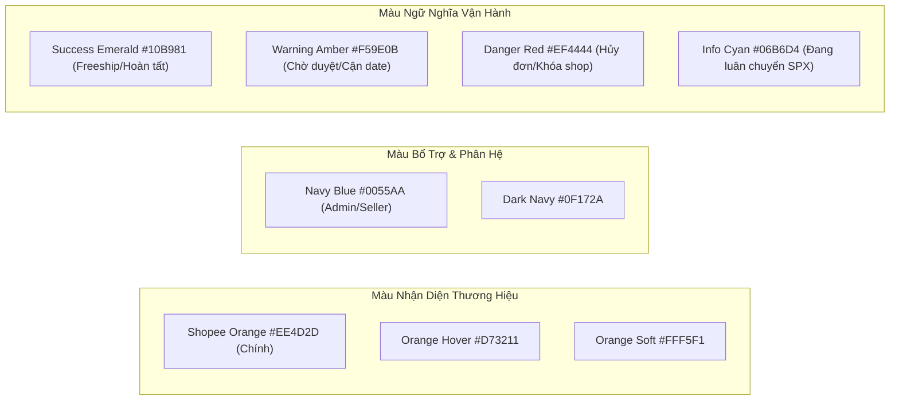
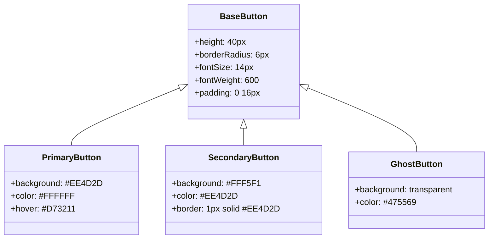
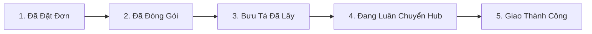

# QUY CHUẨN THIẾT KẾ GIAO DIỆN VÀ TRẢI NGHIỆM NGƯỜI DÙNG (UI/UX DESIGN SYSTEM)
## DESIGN SYSTEM SPECIFICATION, STYLE GUIDE & COMPONENT LIBRARY
### HỆ THỐNG THƯƠNG MẠI ĐIỆN TỬ MINI SHOPEE MULTI-VENDOR ENTERPRISE

---

| **Mã tài liệu** | UIUX-DS-MINISHOPEE-V2.0 |
|---|---|
| **Phiên bản** | 2.0.0-ENTERPRISE |
| **Tiêu chuẩn thiết kế** | Shopee Human-Centric UI, WCAG 2.1 Level AA, 8-Point Grid System |
| **Bộ mã màu chính** | Shopee Brand Orange (`#EE4D2D`), Navy Blue (`#0055AA`), Neutral Slate |
| **Cơ quan ban hành** | Khối Thiết kế Trải nghiệm Người dùng (Product Design / UI-UX Team) |

---

## MỤC LỤC TỔNG QUAN

1. [TRIẾT LÝ THIẾT KẾ VÀ NGUYÊN TẮC CỐT LÕI](#1-triết-lý-thiết-kế-và-nguyên-tắc-cốt-lõi)
2. [HỆ THỐNG DESIGN TOKENS CHUẨN HÓA](#2-hệ-thống-design-tokens-chuẩn-hóa)
   - [2.1. Bảng mã màu sắc (Color Palette)](#21-bảng-mã-màu-sắc-color-palette)
   - [2.2. Thang tỷ lệ chữ (Typography Scale)](#22-thang-tỷ-lệ-chữ-typography-scale)
   - [2.3. Lưới bố cục và Hệ thống khoảng cách (8pt Spacing Grid)](#23-lưới-bố-cục-và-hệ-thống-khoảng-cách-8pt-spacing-grid)
   - [2.4. Điểm ngắt đáp ứng đa thiết bị (Responsive Breakpoints)](#24-điểm-ngắt-đáp-ứng-đa-thiết-bị-responsive-breakpoints)
3. [ĐẶC TẢ CÁC LINH KIỆN GIAO DIỆN CHUẨN HÓA (COMPONENT SPECS)](#3-đặc-tả-các-linh-kiện-giao-diện-chuẩn-hóa-component-specs)
   - [3.1. Nút bấm và Trạng thái tương tác (Buttons & Actions)](#31-nút-bấm-và-trạng-thái-tương-tác-buttons--actions)
   - [3.2. Thẻ sản phẩm thương mại điện tử (Product Card Spec)](#32-thẻ-sản-phẩm-thương-mại-điện-tử-product-card-spec)
   - [3.3. Nhãn ưu đãi kép (Dual Voucher Badges & Mini Xu Tag)](#33-nhãn-ưu-đãi-kép-dual-voucher-badges--mini-xu-tag)
   - [3.4. Giỏ hàng đa gian hàng phân cấp (Multi-Vendor Cart Spec)](#34-giỏ-hàng-đa-gian-hàng-phân-cấp-multi-vendor-cart-spec)
   - [3.5. Thanh tiến trình vận chuyển trực quan (SPX Live Stepper)](#35-thanh-tiến-trình-vận-chuyển-trực-quan-spx-live-stepper)
   - [3.6. Cửa sổ Trợ lý AI đàm thoại (Copilot Chat Floating Widget)](#36-cửa-sổ-trợ-lý-ai-đàm-thoại-copilot-chat-floating-widget)
4. [TIÊU CHUẨN KHẢ NĂNG TIẾP CẬN (ACCESSIBILITY - WCAG 2.1 AA)](#4-tiêu-chuẩn-khả-năng-tiếp-cận-accessibility---wcag-21-aa)
5. [HIỆU ỨNG CHUYỂN ĐỘNG VÀ PHẢN HỒI VI MÔ (MOTION & FEEDBACK)](#5-hiệu-ứng-chuyển-động-và-phản-hồi-vi-mô-motion--feedback)

---

## 1. TRIẾT LÝ THIẾT KẾ VÀ NGUYÊN TẮC CỐT LÕI

Hệ thống giao diện **Mini Shopee Multi-Vendor** được xây dựng trên 4 nguyên tắc trải nghiệm người dùng hiện đại:

1. **Shopee Familiarity (Thân thuộc và Tự nhiên)**: Tận dụng tối đa thói quen mua sắm trực tuyến của người tiêu dùng Đông Nam Á (màu cam đặc trưng, cấu trúc thẻ sản phẩm, luồng giỏ hàng, thẻ flash sale), giúp người dùng bắt đầu mua sắm ngay lập tức với chi phí học hỏi bằng 0 (Zero Learning Curve).
2. **Mobile-First & Touch-Friendly**: Mọi thành phần giao diện đều được tính toán tối ưu cho màn hình cảm ứng điện thoại thông minh; vùng chạm ngón tay cái (Tap Targets) luôn có kích thước tối thiểu $44 \times 44\text{ px}$.
3. **Frictionless Purchasing (Mua sắm không rào cản)**: Tối giản hóa quy trình thanh toán còn dưới 3 thao tác; tự động đề xuất và áp dụng mã giảm giá tốt nhất (Best Voucher Recommendation) và chuyển khoản VietQR 1 chạm với mã QR tạo động.
4. **Zero Cognitive Overload (Không quá tải nhận thức)**: Phân tầng thông tin thị giác rõ ràng (Visual Hierarchy), nhấn mạnh các hành động chính (Primary CTA), làm mờ các chi tiết thứ cấp và hiển thị phản hồi trạng thái tức thì.

---

## 2. HỆ THỐNG DESIGN TOKENS CHUẨN HÓA

### 2.1. Bảng mã màu sắc (Color Palette)

#### Bảng chi tiết mã màu Tokens (CSS Variables):

| Token Name | Hex Code | Giá trị RGB | Ứng dụng nghiệp vụ trên hệ thống |
|---|:---:|:---:|---|
| `--color-primary` | `#EE4D2D` | `rgb(238, 77, 45)` | Nút Đặt hàng, Giá bán chính, Huy hiệu Flash Sale, Icon kích hoạt |
| `--color-primary-hover` | `#D73211` | `rgb(215, 50, 17)` | Trạng thái di chuột (Hover/Active) trên các nút hành động chính |
| `--color-primary-light` | `#FFF5F1` | `rgb(255, 245, 241)` | Nền thẻ sản phẩm được chọn, Highlight hàng trong giỏ hàng |
| `--color-secondary` | `#0055AA` | `rgb(0, 85, 170)` | Thanh điều hướng Admin, Huy hiệu Shopee Mall, Mã QR VietQR |
| `--color-freeship` | `#00BFA5` | `rgb(0, 191, 165)` | Huy hiệu Freeship Xtra, Voucher Miễn phí vận chuyển |
| `--color-xu-gold` | `#F59E0B` | `rgb(245, 158, 11)` | Đồng tiền thưởng Mini Xu, Điểm tích lũy, Vòng quay may mắn |
| `--color-success` | `#10B981` | `rgb(16, 185, 129)` | Đơn giao thành công, Đã đối soát, Ví tiền khả dụng |
| `--color-danger` | `#EF4444` | `rgb(239, 68, 68)` | Cảnh báo hết hàng, Đơn hủy, Bị cấm hoạt động, Bán dưới giá vốn |
| `--color-neutral-900` | `#0F172A` | `rgb(15, 23, 42)` | Tiêu đề chính, Văn bản có độ tương phản cao nhất |
| `--color-neutral-600` | `#475569` | `rgb(71, 85, 105)` | Nội dung mô tả sản phẩm, Thông tin chính sách |
| `--color-neutral-400` | `#94A3B8` | `rgb(148, 163, 184)` | Giá gốc gạch ngang, Placeholder trong ô nhập liệu |
| `--color-neutral-100` | `#F1F5F9` | `rgb(241, 245, 249)` | Nền tổng thể trang web, Khung phân tách khối |

### 2.2. Thang tỷ lệ chữ (Typography Scale)
- **Họ phông chữ chính**: `Inter, -apple-system, BlinkMacSystemFont, "Segoe UI", Roboto, "Be Vietnam Pro", sans-serif`.
- Hỗ trợ hiển thị dấu thanh tiếng Việt mượt mà, không lỗi chân chữ.

| Cấp bậc Typography | Kích thước Font | Line Height | Font Weight | Trường hợp sử dụng |
|---|:---:|:---:|:---:|---|
| **Display Heading** | $32\text{ px}$ | $40\text{ px}$ | Bold (700) | Banner trang chủ Mega Sale, Trang đích Giới thiệu |
| **Heading 1 (H1)** | $24\text{ px}$ | $32\text{ px}$ | Bold (700) | Tiêu đề trang, Tên chi tiết sản phẩm (PDP) |
| **Heading 2 (H2)** | $20\text{ px}$ | $28\text{ px}$ | Semi-Bold (600) | Tên mục danh mục, Tiêu đề giỏ hàng, Dashboard Card |
| **Heading 3 (H3)** | $18\text{ px}$ | $24\text{ px}$ | Semi-Bold (600) | Tên gian hàng, Giá tiền nổi bật, Tiêu đề Modal |
| **Body Large** | $16\text{ px}$ | $24\text{ px}$ | Regular (400) / Med (500) | Văn bản giới thiệu, Tên sản phẩm trên thẻ Card |
| **Body Standard** | $14\text{ px}$ | $20\text{ px}$ | Regular (400) | Nội dung đánh giá, Mô tả chi tiết, Bảng dữ liệu |
| **Caption / Label**| $12\text{ px}$ | $16\text{ px}$ | Medium (500) | Nhãn voucher, Ngày đặt hàng, Ghi chú dưới chân |
| **Micro Tag** | $10\text{ px}$ | $14\text{ px}$ | Bold (700) | Tag Giảm %, Tag "Mall", Tag "Yêu Thích +" |

### 2.3. Lưới bố cục và Hệ thống khoảng cách (8pt Spacing Grid)
Hệ thống tuân thủ nghiêm ngặt quy tắc bước nhảy bội số 4px và 8px:
- `space-1`: $4\text{ px}$ (Khoảng cách giữa icon và chữ nhỏ)
- `space-2`: $8\text{ px}$ (Padding nội bộ của nhãn Badge, khoảng cách giữa các tags)
- `space-3`: $12\text{ px}$ (Khoảng cách giữa các ô nhập liệu Form)
- `space-4`: $16\text{ px}$ (Padding chuẩn của Card sản phẩm, lề nội dung)
- `space-6`: $24\text{ px}$ (Khoảng cách giữa các khối mục chính)
- `space-8`: $32\text{ px}$ (Khoảng cách giữa các phân đoạn trang)
- `space-12`: $48\text{ px}$ (Khoảng cách phân tách Header - Content - Footer)

### 2.4. Điểm ngắt đáp ứng đa thiết bị (Responsive Breakpoints)
- **Mobile (xs)**: $< 640\text{ px}$ (Bố cục 1 cột, thanh điều hướng đáy dạng Bottom Bar, ẩn sidebar).
- **Tablet (sm/md)**: $640\text{ px} - 1024\text{ px}$ (Lưới sản phẩm 2-3 cột, giỏ hàng chia tỷ lệ 60/40).
- **Desktop (lg)**: $1024\text{ px} - 1280\text{ px}$ (Lưới sản phẩm 4-5 cột chuẩn, chiều rộng khung tối đa $1200\text{ px}$).
- **Ultrawide (xl)**: $> 1280\text{ px}$ (Lưới 6 cột, căn giữa với thanh viền biên cân đối).

---

## 3. ĐẶC TẢ CÁC LINH KIỆN GIAO DIỆN CHUẨN HÓA (COMPONENT SPECS)

### 3.1. Nút bấm và Trạng thái tương tác (Buttons & Actions)

- **Quy tắc trạng thái Loading**: Khi đang gửi yêu cầu đặt hàng hoặc thanh toán, nút hiển thị vòng xoay Spinner ($18\text{ px}$) màu trắng, vô hiệu hóa sự kiện click (`pointer-events: none; opacity: 0.7`) để chống ấn đúp (Double-click protection).

### 3.2. Thẻ sản phẩm thương mại điện tử (Product Card Spec)
- **Tỷ lệ ảnh sản phẩm**: Tỷ lệ vuông $1:1$ (`aspect-ratio: 1 / 1`), áp dụng `object-fit: cover`.
- **Huy hiệu giảm giá**: Góc trên bên phải, nền vàng rực rỡ (`#FEE2E2`), chữ đỏ (`#DC2626`), hiển thị tỷ lệ `-25%`.
- **Huy hiệu uy tín gian hàng**: Góc trên bên trái:
  - `Mall`: Nền đỏ đậm (`#D0011B`), chữ trắng in hoa, bo góc nhẹ.
  - `Yêu thích+`: Nền cam đất, viền bo tròn nhẹ.
- **Phân cấp giá hiển thị**:
  - Giá khuyến mãi: Màu cam Shopee (`#EE4D2D`), kích thước $16\text{ px}$, đậm (`font-weight: 700`), ký hiệu `₫` đặt trước.
  - Giá gốc: Màu xám (`#94A3B8`), kích thước $12\text{ px}$, gạch ngang ở giữa (`line-through`).
- **Thanh đo nhiệt lượng Flash Sale**: Dạng thanh bo tròn màu đỏ cam với dòng chữ lồng *"Đã bán 85%"*.

### 3.3. Nhãn ưu đãi kép (Dual Voucher Badges & Mini Xu Tag)
- **Order Discount Badge**: Viền răng cưa nhẹ mô phỏng phiếu giảm giá, màu nền `#FFF5F1`, viền viễn cam `#EE4D2D`, icon chiếc kéo hoặc tag giảm giá.
- **Freeship Xtra Badge**: Màu nền xanh ngọc dịu `#E6FFFA`, viền xanh lục `#00BFA5`, icon xe tải giao hàng tốc hành.
- **Mini Xu Counter**: Icon đồng xu màu vàng sáng lấp lánh kèm số xu tích lũy hoặc chiết khấu trừ thẳng: `-15,000 Xu (-15.000₫)`.

### 3.4. Giỏ hàng đa gian hàng phân cấp (Multi-Vendor Cart Spec)
- **Cấu trúc nhóm gian hàng (Shop Grouping Header)**:
  - Checkbox toàn shop: Chọn/Bỏ chọn toàn bộ sản phẩm của gian hàng này.
  - Tên Shop kèm nút *Chat ngay* mở Trợ lý CSKH của riêng shop đó.
  - Danh sách mặt hàng thuộc shop với trường chọn biến thể (Màu sắc, Size).
- **Bộ xếp chồng Voucher tự động (Dual Stacking Bar)**:
  - Thanh ghim cố định ở đáy màn hình hiển thị 3 cấp độ giảm giá:
    $$\text{Tổng thanh toán} = \text{Tạm tính} - \text{Voucher Shop} - \text{Voucher Sàn} - \text{Freeship} - \text{Mini Xu}$$

### 3.5. Thanh tiến trình vận chuyển trực quan (SPX Live Stepper)
Thanh tiến trình gồm 5 chặng vận chuyển tiêu chuẩn của Shopee Express (SPX):

- Điểm đánh dấu (Dot): Kích thước $16\text{ px}$; khi đơn hàng đang ở chặng nào, điểm đó có hiệu ứng vòng tròn tỏa sóng (Pulsing Radar Animation) màu cam.
- Tích hợp bản đồ GPS mô phỏng: Hiển thị tọa độ di chuyển thực tế của shipper trên tuyến đường từ Hub bưu cục đến nhà khách hàng.

### 3.6. Cửa sổ Trợ lý AI đàm thoại (Copilot Chat Floating Widget)
- Nút kích hoạt dạng quả cầu nổi (FAB) ở góc dưới cùng bên phải màn hình:
  - Màu nền Gradient Cam - Đỏ đậm.
  - Có hiệu ứng nhấp nháy phát sáng khi có tin nhắn gợi ý sản phẩm mới.
- Cửa sổ đàm thoại hỗ trợ Render dạng Rich Markdown:
  - Thẻ sản phẩm nhúng trực tiếp kèm nút **Mua Ngay 1 Chạm**.
  - Bảng thống kê chi phí P&L cho Người bán.
  - Âm thanh phản hồi Chime du dương khi chuyển giao cuộc trò chuyện sang nhân viên người thật.

---

## 4. TIÊU CHUẨN KHẢ NĂNG TIẾP CẬN (ACCESSIBILITY - WCAG 2.1 AA)

Dự án cam kết đạt chuẩn tiếp cận cho người khiếm thị, thị lực kém hoặc người sử dụng thiết bị trợ thính:
1. **Độ tương phản màu sắc (Color Contrast Ratio)**:
   - Toàn bộ văn bản thông thường (dưới 18px) đạt tỷ lệ tương phản tối thiểu **$4.5:1$** so với màu nền.
   - Các tiêu đề lớn và nút bấm chính đạt tỷ lệ tương phản tối thiểu **$3.0:1$**.
2. **Điều hướng bằng bàn phím (Keyboard Accessibility)**:
   - Người dùng có thể di chuyển qua toàn bộ liên kết, nút bấm và form bằng phím `Tab` và `Shift + Tab`.
   - Vòng viền hiển thị tiêu điểm rõ ràng (`:focus-visible` với viền cam $2\text{ px}$ cách lề $2\text{ px}$).
3. **Tương thích máy đọc màn hình (Screen Readers)**:
   - Mọi hình ảnh sản phẩm đều có thuộc tính `alt` mô tả chính xác nội dung mặt hàng.
   - Các nút icon không có chữ đều có thẻ `aria-label="Thêm vào giỏ hàng"`, `aria-label="Đóng cửa sổ"`.
   - Các thông báo lỗi form sử dụng `role="alert"` để máy đọc màn hình phát âm thanh cảnh báo ngay lập tức.

---

## 5. HIỆU ỨNG CHUYỂN ĐỘNG VÀ PHẢN HỒI VI MÔ (MOTION & FEEDBACK)

- **Thời lượng chuyển động (Transition Durations)**:
  - Hiệu ứng đổi màu di chuột (Hover): $150\text{ ms}$ (`ease-in-out`).
  - Hiệu ứng mở/đóng Modal hoặc Drawer giỏ hàng: $300\text{ ms}$ (`cubic-bezier(0.16, 1, 0.3, 1)`).
  - Hiệu ứng mở rộng Accordion câu hỏi Q&A: $250\text{ ms}$.
- **Trạng thái tải dữ liệu giả lập (Skeleton Loaders)**:
  - Thay vì hiển thị màn hình trắng, hệ thống hiển thị các khối màu xám nhạt với hiệu ứng sóng ánh sáng chuyển động (Shimmer Wave Effect) mô phỏng chính xác khung thẻ sản phẩm.
- **Âm thanh phản hồi (Audio Chime)**:
  - Tích hợp âm báo âm thanh nhẹ nhàng chuẩn Web Audio API khi nạp thành công đơn hàng hoặc khi AI chuyển giao cuộc gọi sang nhân viên hỗ trợ con người.

---

*Quy chuẩn Thiết kế UI/UX này là kim chỉ nam thẩm mỹ và công thái học, bảo đảm tính đồng nhất thị giác và đẳng cấp trải nghiệm cho toàn bộ nền tảng Mini Shopee.*
