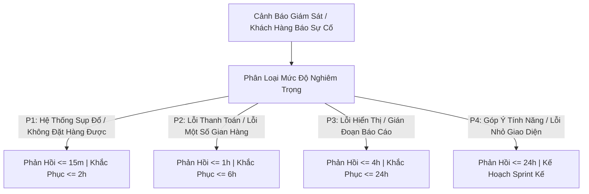
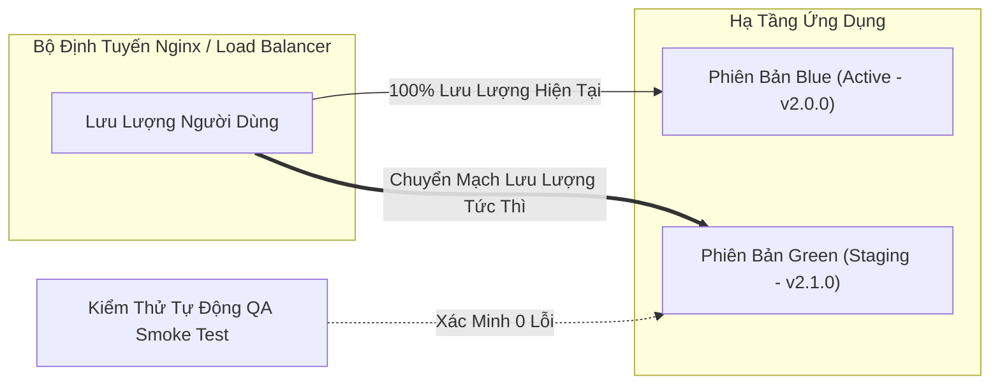

# QUY TRÌNH BẢO TRÌ, NÂNG CẤP & CAM KẾT MỨC ĐỘ DỊCH VỤ (SLA)
## DỰ ÁN: NỀN TẢNG THƯƠNG MẠI ĐIỆN TỬ MINI SHOPEE MULTI-VENDOR
**Mã tài liệu:** `SLA-MAINT-MINISHOPEE-V2.0` | **Phiên bản:** `2.0.0 Enterprise` | **Ngày ban hành:** `2026-10-23`

---

## 1. CAM KẾT MỨC ĐỘ KHẢ DỤNG HỆ THỐNG (SERVICE LEVEL AGREEMENT - SLA)

Nền tảng **Mini Shopee Multi-Vendor** được thiết kế kiến trúc phân tán chịu lỗi cao, cam kết mức độ khả dụng dịch vụ (Uptime Availability) đạt tối thiểu **99.95%** trong suốt thời gian bảo hành và vận hành:

$$\text{Uptime} = \frac{\text{Tổng thời gian trong tháng (phút)} - \text{Thời gian gián đoạn ngoài kế hoạch (phút)}}{\text{Tổng thời gian trong tháng (phút)}} \times 100\% \ge 99.95\%$$

*(Tương đương tổng thời gian gián đoạn không vượt quá 21.6 phút mỗi tháng).*

### 1.1. Các chỉ số phục hồi thảm họa (Disaster Recovery Targets)
- **RPO (Recovery Point Objective):** $\le 5\text{ phút}$. Dữ liệu giao dịch đơn hàng và đối soát tài chính được sao lưu định kỳ, cam kết không mất mát dữ liệu vượt quá 5 phút trong kịch bản sự cố nghiêm trọng nhất.
- **RTO (Recovery Time Objective):** $\le 15\text{ phút}$. Toàn bộ cụm dịch vụ được tự động khởi tạo lại hoặc chuyển vùng (Failover) sẵn sàng tiếp nhận lưu lượng giao dịch trong vòng 15 phút.

---

## 2. PHÂN CẤP SỰ CỐ & THỜI GIAN PHẢN HỒI (INCIDENT SEVERITY MATRIX)

| Cấp Độ | Định Nghĩa Sự Cố | Thời Gian Phản Hồi (Response) | Thời Gian Khắc Phục Tạm Thời | Thời Gian Xử Lý Triệt Để |
| :---: | :--- | :---: | :---: | :---: |
| **P1 - Blocker** | Toàn bộ sàn ngưng hoạt động; khách không thể thanh toán; dữ liệu bị phá hủy | $\le 15\text{ phút}$ | $\le 1\text{ giờ}$ | $\le 4\text{ giờ}$ |
| **P2 - Critical** | Một tính năng cốt lõi bị lỗi (ví dụ: cổng VietQR treo, bưu tá không nhận được đơn); không có giải pháp thay thế tức thì | $\le 1\text{ giờ}$ | $\le 3\text{ giờ}$ | $\le 12\text{ giờ}$ |
| **P3 - Major** | Lỗi ảnh hưởng tới một nhóm người dùng nhỏ hoặc có giải pháp tạm thời (workaround) khả thi | $\le 4\text{ giờ}$ | $\le 8\text{ giờ}$ | $\le 48\text{ giờ}$ |
| **P4 - Minor** | Lỗi hiển thị nhỏ (typo, căn lề); yêu cầu hướng dẫn sử dụng hoặc đề xuất cải tiến | $\le 24\text{ giờ}$ | Không áp dụng | Đưa vào chu kỳ phát hành kế tiếp |

---

## 3. QUY TRÌNH NÂNG CẤP HỆ THỐNG KHÔNG GIÁN ĐOẠN (ZERO-DOWNTIME DEPLOYMENT)

Nhằm đảm bảo trải nghiệm mua sắm $24/7$ của người dùng, mọi hoạt động triển khai phiên bản mới đều tuân thủ mô hình **Blue-Green Deployment** hoặc **Rolling Update**:

### Các bước thực hiện nâng cấp:
1. **Chuẩn bị môi trường Green:** Khởi chạy phiên bản mã nguồn mới trên các container độc lập.
2. **Kiểm tra sức khỏe tự động (Automated Smoke Test):** Thực hiện bộ kiểm thử $100\%$ tính năng trọng yếu: Đăng nhập JWT, thêm giỏ hàng, áp dụng Dual Voucher, tính toán thuế VAT.
3. **Chuyển mạch bộ định tuyến:** Nginx hoán đổi upstream traffic sang môi trường Green trong vòng $0.1\text{s}$ mà không làm đứt kết nối của người dùng đang thao tác.
4. **Giám sát tỷ lệ lỗi (Error Budget Monitoring):** Nếu tỷ lệ lỗi HTTP 5xx vượt quá $0.1\%$ trong 5 phút đầu tiên, hệ thống tự động Rollback lưu lượng về môi trường Blue an toàn.

---

## 4. LỊCH BẢO TRÌ ĐỊNH KỲ (SCHEDULED MAINTENANCE WINDOWS)

- **Thời gian bảo trì định kỳ:** Vào khung giờ thấp điểm từ **02:00 đến 04:00 sáng Thứ Ba** (tuần thứ 2 hàng tháng).
- **Thông báo trước:** Toàn bộ người mua và gian hàng được nhận thông báo trước ít nhất **48 giờ** thông qua biểu ngữ hệ thống (Admin Emergency Broadcast Banner) và thông báo ứng dụng.
- **Nội dung công việc bảo trì định kỳ:**
  - Tối ưu hóa chỉ mục cơ sở dữ liệu và dọn dẹp các bản ghi tạm thời hết hạn TTL.
  - Cập nhật các bản vá bảo mật hệ điều hành máy chủ và thư viện phụ thuộc (`npm audit fix`).
  - Kiểm tra tính toàn vẹn của cây Merkle Tree đối soát tài chính.
  - Thử nghiệm diễn tập phục hồi dữ liệu từ bản sao lưu (DR Drill).

---

## 5. ĐỘI NGŨ HỖ TRỢ KỸ THUẬT & ĐẦU MỐI LIÊN HỆ

| Tầng Hỗ Trợ | Phạm Vi Trách Nhiệm | Thời Gian Trực | Phương Thức Liên Hệ |
| :--- | :--- | :---: | :--- |
| **Tier 1 - Tự Động** | Trợ lý AI Copilot (Admin Sentinel, ShopSmart, CSKH Kim Ngân) | $24/7/365$ | Tích hợp trực tiếp trên giao diện chat của hệ thống |
| **Tier 2 - Vận Hành** | Đội ngũ kỹ sư hỗ trợ kỹ thuật khách hàng & giám sát DevOps | 08:00 - 22:00 hàng ngày | Email: `support@minishopee.enterprise.vn` Hotline: `1900-6868` (Nhánh 2) |
| **Tier 3 - Kỹ Sư Cốt Lõi** | Đội ngũ Kiến trúc sư hệ thống và Lập trình viên cao cấp | Trực cuộc gọi $24/7$ cho sự cố P1/P2 | Hotline khẩn cấp: `0988-888-999` (CSIRT Lead) |

---
*Tài liệu SLA và quy trình bảo trì này là phụ lục ràng buộc pháp lý đi kèm Hợp đồng chuyển giao công nghệ phần mềm Mini Shopee Multi-Vendor.*