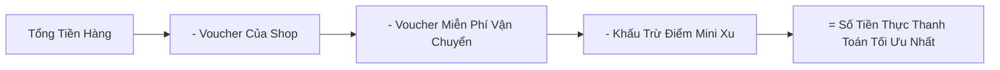

# SỔ TAY HƯỚNG DẪN SỬ DỤNG PHẦN MỀM (CUSTOMER & USER MANUAL)
## DỰ ÁN: NỀN TẢNG THƯƠNG MẠI ĐIỆN TỬ MINI SHOPEE MULTI-VENDOR
**Mã tài liệu:** `USER-MINISHOPEE-V2.0` | **Phiên bản:** `2.0.0 Enterprise` | **Ngày ban hành:** `2026-10-23`

---

## MỤC LỤC
1. [Giới Thiệu Chung Về Hệ Thống](#1-giới-thiệu-chung-về-hệ-thống)
2. [Phần 1: Cẩm Nang Dành Cho Khách Mua Hàng (Buyer Portal)](#phần-1-cẩm-nang-dành-cho-khách-mua-hàng-buyer-portal)
3. [Phần 2: Cẩm Nang Dành Cho Người Bán Hàng (Seller Center)](#phần-2-cẩm-nang-dành-cho-người-bán-hàng-seller-center)
4. [Phần 3: Cẩm Nang Dành Cho Ban Quản Trị Sàn (Admin Portal)](#phần-3-cẩm-nang-dành-cho-ban-quản-trị-sàn-admin-portal)
5. [Trung Tâm Trợ Giúp & Kênh Hỗ Trợ Khách Hàng](#5-trung-tâm-trợ-giúp--kênh-hỗ-trợ-khách-hàng)

---

## 1. GIỚI THIỆU CHUNG VỀ HỆ THỐNG

**Mini Shopee Multi-Vendor** là nền tảng thương mại điện tử đa người bán thế hệ mới, tích hợp đầy đủ tính năng mua sắm, quản trị gian hàng, quản lý dòng tiền ký quỹ và phân phối vận chuyển thông minh.

Hệ thống được phân định rõ ràng thành 3 cổng thông tin chính:
1. **Cổng Khách Hàng (Buyer Portal):** Mua sắm, săn deal, áp mã giảm giá kép, tích xu, thanh toán VietQR và theo dõi bưu tá giao hàng trực tiếp.
2. **Kênh Người Bán (Seller Center):** Đăng tải sản phẩm, quản lý kho an toàn, khởi tạo Flash Sale, đấu thầu Shopee Ads và quản trị ví doanh thu rút tiền.
3. **Cổng Quản Trị Sàn (Admin Portal):** Giám sát tài chính toàn sàn, đối soát thuế TMĐT, kiểm soát ký quỹ Escrow, phê duyệt giải ngân và giải quyết khiếu nại tranh chấp.

---

## PHẦN 1: CẨM NANG DÀNH CHO KHÁCH MUA HÀNG (BUYER PORTAL)

### 1.1. Đăng ký & Đăng nhập tài khoản
1. Nhấn vào nút **Đăng Ký** hoặc **Đăng Nhập** ở góc trên bên phải thanh điều hướng (Header).
2. Nhập Email và Mật khẩu (Mật khẩu tối thiểu 6 ký tự).
3. Hệ thống tự động kích hoạt tài khoản ngay lập tức và tặng ngay **10.000 Mini Xu chào mừng** cho thành viên mới!

### 1.2. Tìm kiếm thông minh & Săn Flash Sale
- **Thanh tìm kiếm tức thì (Trie Autocomplete):** Khi bạn gõ từ khóa (ví dụ: `áo`, `sạc`, `giày`), hệ thống sẽ tự động đề xuất top từ khóa phổ biến trong thời gian dưới $1\text{ms}$, hỗ trợ tìm kiếm không dấu hoặc sai chính tả (ví dụ: `ao polo`, `dien thoai`).
- **Khám phá Flash Deals:** Tại trang chủ, mục **Flash Sale** hiển thị các sản phẩm giảm giá sốc với thanh tiến độ số lượng đã bán thực tế. Nhấn **Mua Ngay** để giữ giá ưu đãi trước khi hết giờ.

### 1.3. Trang chi tiết sản phẩm (PDP) & Lựa chọn biến thể
- Lựa chọn kích thước (Size S, M, L, XL) và màu sắc. Giá bán và số lượng tồn kho của từng biến thể SKU sẽ tự động cập nhật ngay trên màn hình.
- **Hỏi & Đáp cộng đồng (Q&A):** Bạn có thể xem các câu hỏi của khách hàng trước đó hoặc tự đặt câu hỏi cho chủ Shop để được giải đáp trong vài phút.

### 1.4. Quản lý giỏ hàng & Xếp chồng ưu đãi đa tầng (Triple Stacking)
Trong trang **Giỏ Hàng (`/cart`)**, hệ thống cho phép bạn tiết kiệm tối đa chi phí mua sắm:
1. **Áp mã giảm giá của Shop:** Nhập mã hoặc nhấn chọn từ danh sách voucher của từng người bán.
2. **Áp mã Freeship Extra toàn sàn:** Giảm ngay tới $30.000\text{đ}$ hoặc miễn phí vận chuyển cho đơn hàng từ $300.000\text{đ}$.
3. **Sử dụng Mini Xu:** Gạt công tắc **Dùng Mini Xu** để cấn trừ trực tiếp vào tiền thanh toán (1 Xu = 1 VNĐ, khấu trừ tối đa 50% giá trị đơn hàng).

### 1.5. Thanh toán VietQR & Trả tiền khi nhận hàng (COD)
- **Thanh toán VietQR:** Hệ thống tự động tạo mã QR chuẩn NAPAS247 kèm đúng số tiền và mã đơn hàng. Mở ứng dụng ngân hàng bất kỳ (Vietcombank, MB, Techcombank, v.v.), quét mã để hoàn tất trong 3 giây.
- **Thanh toán tiền mặt COD:** Bạn chỉ thanh toán tiền cho bưu tá khi kiện hàng đã được giao tận tay.

### 1.6. Theo dõi bưu tá trên Bản đồ SPX Live GPS
Vào mục **Đơn Mua (`/orders`)**, nhấn nút **Xem Lộ Trình Giao Hàng SPX**:
- Màn hình hiển thị bản đồ trực quan mô phỏng bưu tá đang di chuyển thời gian thực.
- Cập nhật chi tiết 5 mốc tiến độ: *Đã xác nhận -> Đã đóng gói -> Đang luân chuyển qua Hub -> Bưu tá đang giao hàng -> Giao thành công*.
- Tự động xuất hóa đơn điện tử giá trị gia tăng (VAT 8%) có thể in trực tiếp.

### 1.7. Trò chuyện cùng Trợ lý Mua Sắm AI (Buyer Assistant)
Nhấn vào biểu tượng **Chat AI** ở góc dưới màn hình:
- Hiểu tiếng lóng mua sắm: Gõ *"pass đơn"*, *"deal sốc"*, *"áp mã"*, *"ship hỏa tốc 2h"*, AI sẽ hướng dẫn tận tình.
- Gợi ý phối đồ thông minh: Hỏi *"mua áo polo thì mặc với quần gì?"* để nhận ngay gợi ý combo quần âu hoặc giày sneaker kèm link đặt hàng 1-click.

---

## PHẦN 2: CẨM NANG DÀNH CHO NGƯỜI BÁN HÀNG (SELLER CENTER)

### 2.1. Đăng ký mở gian hàng mới
1. Đăng nhập tài khoản, nhấn vào mục **Kênh Người Bán** trên thanh điều hướng.
2. Điền thông tin gian hàng: Tên shop, số điện thoại hotline, địa chỉ kho hàng, thông tin tài khoản ngân hàng thụ hưởng (Tên ngân hàng, Số tài khoản, Chủ tài khoản).
3. Gian hàng sẽ được kích hoạt ngay lập tức để bạn bắt đầu kinh doanh.

### 2.2. Đăng bán sản phẩm & Quản lý tồn kho an toàn (Safety Stock)
1. Trong Seller Dashboard, chọn mục **Quản Lý Sản Phẩm** -> **Thêm Sản Phẩm Mới**.
2. Nhập thông tin: Tên sản phẩm, ngành hàng, giá niêm yết, giá vốn hàng bán (**COGS**), số lượng tồn kho ban đầu.
3. Thiết lập biến thể SKU (Màu sắc, kích thước, ảnh đại diện từng phân loại).
4. **Cảnh báo tồn kho an toàn:** Hệ thống tự động phân tích tốc độ bán hàng ngày (Daily Run Rate) và cảnh báo sản phẩm sắp hết hàng theo chỉ số DIR (Days of Inventory Remaining). Nhấn **Nhập Hàng Nhanh** để bổ sung số lượng tồn kho theo lô.

### 2.3. Khởi tạo chiến dịch Flash Sale riêng của Shop
1. Chọn tab **Marketing & Khuyến Mãi** -> **Tạo Khung Flash Sale**.
2. Lựa chọn khung giờ vàng được hệ thống đề xuất: `00h - 02h`, `12h - 14h`, hoặc `20h - 22h`.
3. Nhập mức chiết khấu mong muốn (từ 5% đến 50%).
4. **Khóa sàn an toàn thông minh:** Hệ thống tự động kiểm tra, nếu mức giá giảm xuống dưới $1.05 \times \text{COGS}$, màn hình sẽ cảnh báo nguy cơ bán lỗ và tự động điều chỉnh về mức giá sàn an toàn để bảo vệ biên lãi gộp cho shop.

### 2.4. Đấu thầu từ khóa Shopee Ads Simulator
1. Chọn mục **Quảng Cáo Shopee Ads**.
2. Chọn sản phẩm cần tăng tốc doanh số, nhập danh sách từ khóa tìm kiếm (Chính xác hoặc Mở rộng).
3. Đặt giá thầu cho mỗi lượt nhấp (CPC Bid).
4. Hệ thống mô phỏng cơ chế đấu thầu nhị thức GSP, hiển thị thứ hạng Ad Rank dự kiến và chỉ số lợi tức đầu tư mục tiêu (**ROAS $\ge 3.5\times$**).

### 2.5. Quản trị Ví Doanh Thu & Rút tiền về Ngân hàng
1. Chọn mục **Tài Chính & Ví Doanh Thu**.
2. Màn hình phân định rõ:
   - **Số dư tạm giữ Escrow:** Tiền các đơn hàng đang giao hoặc trong thời gian 7 ngày khiếu nại.
   - **Số dư khả dụng:** Doanh thu các đơn hàng đã hoàn tất hợp lệ (đã trừ phí sàn 5% và thuế TMĐT 2.5%).
3. Nhấn nút **Rút Tiền Khả Dụng**, nhập số tiền cần rút và xác nhận. Lệnh rút tiền sẽ được gửi tới Ban Quản Trị Sàn để phê duyệt và giải ngân tự động về tài khoản ngân hàng liên kết.

### 2.6. Đồng hành cùng Trợ lý Kinh Doanh AI (Seller ShopSmart Copilot)
Nhấn biểu tượng **ShopSmart AI** trong Seller Dashboard để nhận tư vấn:
- *"Kiểm tra sản phẩm sắp hết hàng?"* -> AI liệt kê ngay danh sách SKU có số ngày còn hàng $< 3$ ngày kèm đề xuất số lượng cần nhập thêm.
- *"Phân tích biên lợi nhuận P&L shop tôi?"* -> AI tính toán chi tiết tỷ suất lợi nhuận gộp, điểm hòa vốn và tư vấn cấu trúc giá niêm yết tối ưu.

---

## PHẦN 3: CẨM NANG DÀNH CHO BAN QUẢN TRỊ SÀN (ADMIN PORTAL)

### 3.1. Bảng điều khiển KPI & Dòng tiền ký quỹ Escrow
Truy cập `/admin/dashboard` để nắm bắt sức khỏe toàn diện của sàn giao dịch:
- **Tổng GMV toàn sàn:** Doanh số bán hàng tích lũy.
- **Doanh thu phí sàn:** Tổng số tiền hoa hồng 5% thu được.
- **Két Ký Quỹ Escrow Vault:** Tổng số tiền đang được bảo chứng an toàn, đảm bảo tính thanh khoản và khả năng hoàn tiền bất kỳ lúc nào.
- **Nợ tồn COD:** Giám sát rủi ro tiền mặt do các bưu tá đang lưu giữ chưa đối soát nộp về quỹ trung tâm.

### 3.2. Quản lý đối tác Người Bán & Người Dùng
- **Kiểm duyệt gian hàng:** Xem xét thông tin, hồ sơ thuế và phê duyệt các gian hàng mới đăng ký.
- **Khóa Shop vi phạm:** Trường hợp gian hàng bị khách hàng khiếu nại hàng giả hoặc tỷ lệ hủy đơn cao (NFR $> 10\%$), Admin có thể chuyển trạng thái gian hàng sang **Locked** (Cách ly khỏi sàn) chỉ với 1 click.
- **Cấm tài khoản gian lận (Ban User):** Vô hiệu hóa ngay lập tức các tài khoản bùng hàng hoặc có hành vi trục lợi hệ thống.

### 3.3. Đối soát thuế TMĐT theo Nghị định 52/2018 & Thông tư 40/2021
Vào tab **Đối Soát Thuế TMĐT**:
- Hệ thống tự động tổng hợp danh sách doanh thu của từng gian hàng trong tháng.
- Tự động tính toán số thuế GTGT (1.0%) và thuế TNCN (1.5%) đã được sàn khấu trừ tại nguồn.
- Xuất biên bản đối soát tài chính và danh sách kê khai thuế định dạng chuẩn sẵn sàng nộp cho Cơ quan Thuế.

### 3.4. Phê duyệt lệnh rút tiền ví của Người Bán
1. Vào tab **Quyết Toán & Giải Ngân**.
2. Xem danh sách các yêu cầu rút tiền đang chờ xử lý.
3. Hệ thống đối khớp tự động với Sổ cái Kế toán kép (Double-Entry Ledger) có bảo chứng Merkle Tree.
4. Nhấn **Phê Duyệt & Giải Ngân** để xác nhận chuyển tiền cho đối tác bán hàng. Mọi hành động đều được lưu nhật ký kiểm toán hệ thống bất biến.

### 3.5. Radar phát hiện gian lận Sybil Ring & Trọng tài hoàn tiền
- **Radar Sybil:** Tự động quét và hiển thị các cụm tài khoản liên kết (sử dụng đồ thị DSU) có chung thiết bị phần cứng hoặc địa chỉ IP để săn voucher. Admin có thể phong tỏa đồng loạt toàn bộ cụm chỉ bằng một thao tác.
- **Trọng tài tranh chấp (Dispute Center):** Khi người mua và người bán không thống nhất được việc đổi trả, hệ thống chấm điểm uy tín (Trust Score), cung cấp gợi ý phán quyết và cho phép Admin nhấn **Hoàn Tiền Cho Người Mua** hoặc **Bảo Lưu Thanh Toán Cho Người Bán**.

### 3.6. Giám sát an ninh cùng Trợ lý Admin Sentinel Copilot
Trợ lý AI chuyên trách giám sát sàn hỗ trợ Quản Trị Viên:
- *"Báo cáo doanh số GMV và số dư Escrow Vault?"* -> Trả về số liệu tài chính thời gian thực.
- *"Kiểm tra nghĩa vụ thuế Nghị định 52 tháng này?"* -> Trích xuất chi tiết số thuế đã khấu trừ.
- *"Soạn thảo thông báo bảo trì hệ thống toàn sàn?"* -> Tự động tạo bản tin phát sóng chuẩn định dạng Markdown chuyên nghiệp.

---

## 5. TRUNG TÂM TRỢ GIÚP & KÊNH HỖ TRỢ KHÁCH HÀNG

Khi cần hỗ trợ kỹ thuật hoặc giải đáp nghiệp vụ phát sinh:
- **Hotline Kỹ Thuật 24/7:** `1900-MINI-SHOPEE` (1900 6868)
- **Email Hỗ Trợ:** `support@minishopee.vn` / `devops@minishopee.vn`
- **Cổng Hỗ Trợ Trực Tuyến:** Truy cập biểu tượng Chat Support góc phải màn hình để được hỗ trợ tức thì bởi đội ngũ kỹ thuật viên.

---
*Tài liệu hướng dẫn sử dụng này là một phần không thể tách rời trong bộ hồ sơ bàn giao phần mềm chính thức cho Khách hàng.*
