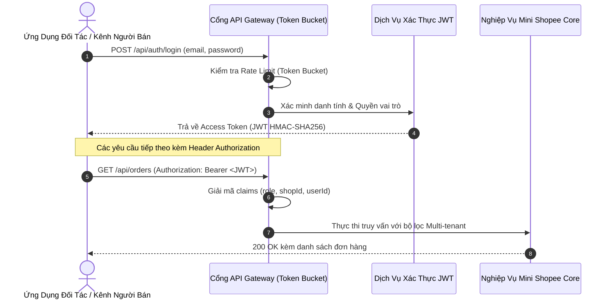

# TÀI LIỆU ĐẶC TẢ API & GIAO THỨC TÍCH HỢP HỆ THỐNG
## DỰ ÁN: NỀN TẢNG THƯƠNG MẠI ĐIỆN TỬ MINI SHOPEE MULTI-VENDOR
**Mã tài liệu:** `API-SPEC-MINISHOPEE-V2.0` | **Phiên bản:** `2.0.0 Enterprise` | **Ngày ban hành:** `2026-10-23`

---

## 1. TỔNG QUAN & NGUYÊN TẮC THIẾT KẾ API

Giao diện lập trình ứng dụng (API) của hệ thống **Mini Shopee Multi-Vendor** được thiết kế theo tiêu chuẩn kiến trúc `RESTful API` cấp độ Richardson Maturity Level 3, hỗ trợ mở rộng tích hợp với các hệ thống thanh toán ngân hàng (VietQR), đơn vị vận chuyển bên thứ ba (SPX Express), phần mềm quản lý kho (ERP/WMS) và các đối tác gian hàng lớn.

### 1.1. Các nguyên tắc cốt lõi:
- **Base URL:** `https://api.minishopee.enterprise.vn/api` (Production) hoặc `http://localhost:5000/api` (Development).
- **Định dạng dữ liệu:** $100\%$ yêu cầu và phản hồi sử dụng định dạng `application/json; charset=utf-8`.
- **Chuẩn hóa phản hồi (Unified Envelope Format):**
  ```json
  {
    "success": true,
    "data": {},
    "error": null,
    "timestamp": "2026-10-23T12:00:00.000Z"
  }
  ```
- **Xác thực an toàn:** Sử dụng chuẩn `Bearer JWT` trong tiêu đề `Authorization: Bearer <TOKEN>`.
- **Bảo mật Webhook:** Xác thực tính toàn vẹn gói tin bằng chữ ký số `HMAC-SHA256` trong tiêu đề `X-MiniShopee-Signature`.

---

## 2. QUY CHUẨN XÁC THỰC & BẢO MẬT API



---

## 3. DANH SÁCH ENDPOINT TRỌNG YẾU (CORE ENDPOINTS)

### 3.1. Phân hệ Xác thực & Phân quyền (Authentication)

#### `POST /auth/login`
- **Mô tả:** Đăng nhập hệ thống và nhận token truy cập.
- **Request Body:**
  ```json
  {
    "email": "seller.tech@minishopee.vn",
    "password": "SecurePassword123!"
  }
  ```
- **Response (200 OK):**
  ```json
  {
    "success": true,
    "data": {
      "token": "eyJhbGciOiJIUzI1NiIsInR5cCI6IkpXVCJ9...",
      "user": {
        "id": "usr_998811",
        "email": "seller.tech@minishopee.vn",
        "name": "TechWorld Official",
        "role": "seller",
        "shopId": "shop_techworld_01"
      }
    }
  }
  ```

---

### 3.2. Phân hệ Đơn Hàng & Đặt Hàng (Orders & Checkout)

#### `POST /orders`
- **Mô tả:** Khởi tạo đơn hàng mới, áp dụng đồng thời Dual Voucher (Đơn hàng + Freeship) và khấu trừ Mini Xu (tối đa 50%). Thực thi kiểm soát đồng thời lạc quan OCC để chống bán vượt kho.
- **Headers:** `Authorization: Bearer <TOKEN>`
- **Request Body:**
  ```json
  {
    "items": [
      { "productId": "prod_lap_01", "quantity": 1, "shopId": "shop_techworld_01" }
    ],
    "shippingAddress": {
      "fullName": "Nguyễn Văn A",
      "phone": "0912345678",
      "province": "Hà Nội",
      "district": "Cầu Giấy",
      "ward": "Dịch Vọng",
      "street": "123 Cầu Giấy"
    },
    "paymentMethod": "vietqr",
    "orderVoucherCode": "TECH100K",
    "freeshipVoucherCode": "FREESHIP",
    "coinOffset": 5000
  }
  ```
- **Response (201 Created):**
  ```json
  {
    "success": true,
    "data": {
      "orderId": "ord_20261023_001",
      "totalAmount": 15895000,
      "shippingFee": 0,
      "discountAmount": 130000,
      "finalAmount": 15760000,
      "paymentStatus": "pending",
      "vietqrData": {
        "qrCodeUrl": "https://img.vietqr.io/image/970422-0912345678-compact2.png?amount=15760000&addInfo=MINISHOPEE+ord_20261023_001",
        "accountNumber": "0912345678",
        "accountName": "MINI SHOPEE ESCROW VAULT",
        "bankCode": "MBBANK"
      }
    }
  }
  ```

---

### 3.3. Webhook Tích Hợp Đơn Vị Vận Chuyển SPX Express

#### `POST /logistics/spx/webhook`
- **Mô tả:** Nhận cập nhật trạng thái luân chuyển và tọa độ GPS bưu tá theo thời gian thực từ SPX Express.
- **Headers:**
  - `X-MiniShopee-Signature`: `sha256=<HMAC_HEX_DIGEST>`
- **Request Body:**
  ```json
  {
    "trackingNumber": "SPX_VN_988211029",
    "orderId": "ord_20261023_001",
    "event": "COURIER_OUT_FOR_DELIVERY",
    "currentLocation": {
      "latitude": 21.0333,
      "longitude": 105.8000,
      "hubName": "Hub SPX Cầu Giấy"
    },
    "courier": {
      "name": "Trần Văn Bình",
      "phone": "0987654321",
      "vehicleType": "EV_SCOOTER"
    },
    "estimatedDeliveryTime": "2026-10-23T14:30:00Z"
  }
  ```
- **Response (200 OK):**
  ```json
  {
    "success": true,
    "message": "Tracking updated successfully"
  }
  ```

---

### 3.4. Webhook Cổng Thanh Toán Tự Động VietQR

#### `POST /payment/vietqr/webhook`
- **Mô tả:** Ngân hàng hoặc cổng trung gian thông báo biến động số dư khi khách hàng quét mã QR thanh toán thành công.
- **Headers:** `X-MiniShopee-Signature: sha256=<HMAC_SIGNATURE>`
- **Request Body:**
  ```json
  {
    "transactionId": "TXN_MB_982110294",
    "orderId": "ord_20261023_001",
    "amount": 15760000,
    "bankCode": "MBBANK",
    "transactionTime": "2026-10-23T12:05:12Z",
    "content": "MINISHOPEE ord_20261023_001"
  }
  ```
- **Quy trình xử lý nội bộ:**
  1. Kiểm tra chữ ký bảo mật webhook.
  2. Xác minh số tiền khớp với `finalAmount` của đơn hàng.
  3. Chuyển trạng thái đơn sang `paid`, tiền được tạm khóa trong Escrow Vault.
  4. Ghi nhận bút toán vào Sổ cái kép (Double-Entry Ledger) và cập nhật Cây băm Merkle Tree.

---

## 4. BẢNG MÃ LỖI HTTP CHUẨN DOANH NGHIỆP

| Mã Lỗi | Tên Lỗi | Giải Thích | Hành Động Đề Xuất |
| :---: | :--- | :--- | :--- |
| **400** | Bad Request | Dữ liệu đầu vào sai cấu trúc hoặc thiếu trường bắt buộc | Kiểm tra schema JSON gửi lên |
| **401** | Unauthorized | Token JWT hết hạn hoặc không hợp lệ | Đăng nhập lại để nhận token mới |
| **403** | Forbidden | Người dùng không đủ quyền truy cập tài nguyên | Kiểm tra vai trò (`role`) của tài khoản |
| **404** | Not Found | Sản phẩm, đơn hàng hoặc gian hàng không tồn tại | Kiểm tra lại `id` tài nguyên |
| **409** | Conflict | Xung đột OCC CAS khi đặt hàng Flash Sale (hết hàng) | Hiển thị thông báo sản phẩm đã hết suất |
| **429** | Too Many Requests | Vượt giới hạn tốc độ yêu cầu (Token Bucket Limit) | Giảm tần suất gọi API, đọc header `Retry-After` |
| **500** | Internal Server Error | Lỗi xử lý ngoại lệ phía máy chủ | Kiểm tra nhật ký máy chủ và Correlation ID |

---

## 5. MẪU MÃ NGUỒN TÍCH HỢP (CODE SAMPLES)

### 5.1. JavaScript (Node.js / Browser Fetch)
```javascript
async function createOrder(token, orderPayload) {
  const response = await fetch("https://api.minishopee.enterprise.vn/api/orders", {
    method: "POST",
    headers: {
      "Content-Type": "application/json",
      "Authorization": `Bearer ${token}`
    },
    body: JSON.stringify(orderPayload)
  });

  const result = await response.json();
  if (!result.success) {
    throw new Error(result.error?.message || "Order creation failed");
  }
  return result.data;
}
```

### 5.2. Python 3 (Requests)
```python
import requests

def get_shop_products(api_token, shop_id):
    url = f"https://api.minishopee.enterprise.vn/api/seller/products?shopId={shop_id}"
    headers = {
        "Authorization": f"Bearer {api_token}",
        "Content-Type": "application/json"
    }
    res = requests.get(url, headers=headers)
    res.raise_for_status()
    payload = res.json()
    return payload.get("data", [])
```

---
*Tài liệu đặc tả API này là tài sản kỹ thuật chính thức bàn giao cho khách hàng nhằm phục vụ mở rộng hệ sinh thái và bảo trì lâu dài.*